# Codewire

**A Linux VM for every developer and coding agent, in the cloud or on your own
machine, driven by one command line.**

Each environment is its own virtual machine with its own kernel. Your keys stay
outside it, what you start in it keeps running when you disconnect, and any
port in it can become a private HTTPS link.
Open source under AGPL-3.0-only.

[Documentation](https://codewire.sh/docs) ·
[Quickstart](https://codewire.sh/docs/quickstart) ·
[Request an account](https://codewire.sh/signup) ·
[Security](SECURITY.md)

[](docs/assets/readme-walkthrough.svg)

## Install

```sh
curl -fsSL https://get.codewire.sh | sh
```

On Linux and macOS. The installer checks the download against its SHA-256 sum
and installs `cw`, which `cw upgrade` keeps current. Other options are in
[Install and sign in](https://codewire.sh/docs/install).

## Five minutes on the platform

A hosted sandbox needs a Codewire account
([request one](https://codewire.sh/signup)). No account yet? See
[On your own machine](#on-your-own-machine).

```sh
# 1. Sign in
cw setup                        # opens your browser; choose or create an organization

# 2. Add a credential: an SSH key that never enters a sandbox
cw credentials --cloud generate ssh --name my-key  # add its public key to your Git host
cw credentials --cloud --profile me set ssh my-key # your first profile is your default

# 3. Add a secret
cw secrets --cloud --user set GREETING             # type the value; never shown again

# 4. Launch a sandbox that uses both
cw create --name hello --image workspace --user-secrets platform
cw exec --in hello -- sh -c 'echo "$GREETING"'     # prints the value you typed

# 5. Run a server and open it
cw run --in hello --name web --detach -- python3 -m http.server 3000
cw ports hello --publish 3000 --label web
#   URL: https://web-02e72-{organization}.{preview domain}   (only you can open it)

# 6. Stop it
cw stop hello                   # frees the machine, keeps its disk; `cw start` resumes
cw rm hello                     # deletes the sandbox and its disk
```

Inside the sandbox, `git` and `ssh` sign with your key through a socket; the
private key stays with Codewire. The secret reaches every process you start
there as `$GREETING`. `--access org_members` or `--access public` on
`cw ports` widens who can open the link.

## On your own machine

A local VM needs no account: an x86_64 Linux machine with KVM, or an Apple
Silicon Mac on macOS 26 or later.

[](docs/assets/readme-walkthrough-local.svg)

```sh
cw setup --local                               # downloads the VM runtime this cw pins
cw create --local --name hello --path .        # this folder, mounted live in the VM
cw run --in hello --name web --detach -- python3 -m http.server 3000
cw ports hello --publish 3000                  # http://127.0.0.1:3000
cw rm hello                                    # your folder is not touched
```

## Why a VM for each environment

- **What runs inside can't reach your machine.** An agent runs whatever it
  writes and whatever its dependencies pull in. Each environment has its own
  kernel, so the boundary is the hypervisor, not your user account.
- **Your keys stay out.** Model API keys, Git access and SSH keys stay with
  Codewire. The environment gets a local route or a signing socket that uses
  them on its behalf. The [security model](https://codewire.sh/docs/reference/security)
  names the two sign-in tokens that are the exception.
- **Application secrets are just environment variables.** Values such as
  `DATABASE_URL` reach the processes you start, and only in the environments
  you select them for.
- **Work outlives your terminal.** Every command runs in a session. Detach,
  close the laptop, and reattach from anywhere.
- **Your machine stays clean.** Toolchains, dependencies, databases and
  containers live in the environment. Remove it and they are gone.

## Everyday commands

| Command | What it does |
| --- | --- |
| `cw create --name NAME` | Create an environment (`--local` for a VM on this machine) |
| `cw run --in NAME -- CMD` | Start a command in a session that keeps running |
| `cw run AGENT --in NAME` | Open a [supported coding agent](https://codewire.sh/docs/agents/supported) in a session |
| `cw exec --in NAME -- CMD` | Run a command once and wait for it |
| `cw shell NAME` | Open a shell |
| `cw attach NAME --session S` | Reattach to a session |
| `cw ls` | List environments; `cw ls NAME` lists its sessions |
| `cw ports NAME --publish PORT` | Open a port: a preview URL, or `127.0.0.1` for a local VM |
| `cw stop NAME` / `cw start NAME` | Stop or start an environment |
| `cw rm NAME` | Remove an environment |

`cw help --all` lists every command.

## Documentation

- **Using Codewire:** the [user guide](https://codewire.sh/docs), starting with
  the [Quickstart](https://codewire.sh/docs/quickstart).
- **For agents:** the whole guide as one Markdown file,
  [llms-full.txt](https://codewire.sh/docs/llms-full.txt).
- **How it works and self-hosting:** the [specification](SPEC.md) and the
  [architecture](docs/ARCHITECTURE.md).
- **Building and contributing:** [CONTRIBUTING.md](CONTRIBUTING.md) and
  [local development](docs/dev/LOCAL-DEV.md).

## Status

Codewire is pre-1.0. Breaking changes can land between releases.

## Security, conduct and licence

Report vulnerabilities as [SECURITY.md](SECURITY.md) describes. Contributors
follow the [code of conduct](CODE_OF_CONDUCT.md).
Codewire is licensed under AGPL-3.0-only. See [LICENSE](LICENSE).
