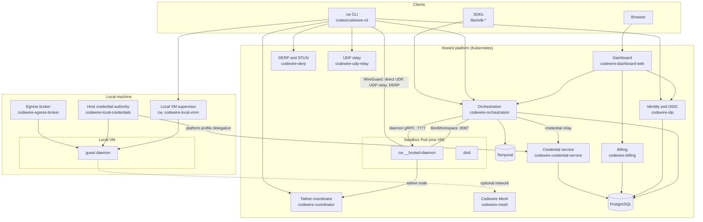

# Codewire specification

This is the one current specification of what Codewire is and how it behaves,
as shipped on `main`. It is written for an engineer or self-hoster who is new
to the system. It describes behaviour the code enforces; plans and proposals
are not here. Where a detail has its own document, this page states the
contract and links there.

How this page relates to the others: [README.md](README.md) is the front door;
[docs/ARCHITECTURE.md](docs/ARCHITECTURE.md) describes how the hosted platform
is put together on Kubernetes; [docs/GLOSSARY.md](docs/GLOSSARY.md) defines the
vocabulary this page uses; [docs/README.md](docs/README.md) is the map of every
other document.

Contents:

1. [What Codewire is](#1-what-codewire-is)
2. [Product model](#2-product-model)
3. [Components](#3-components)
4. [Hosted sandboxes](#4-hosted-sandboxes)
5. [Local VMs and trusted hosts](#5-local-vms-and-trusted-hosts)
6. [Contracts](#6-contracts)
7. [Access paths](#7-access-paths)
8. [Security model](#8-security-model)
9. [Configuration for self-hosting](#9-configuration-for-self-hosting)
10. [Delivery and verification](#10-delivery-and-verification)

## 1. What Codewire is

Codewire gives a developer or an AI coding agent an isolated development
machine: a Linux environment with persistent storage, durable terminal and
agent sessions, Docker, and access over SSH, a browser terminal, file transfer
and preview URLs. Each environment runs in its own hardware-virtualized VM with
its own kernel, because agents run untrusted code and a shared kernel would make
one exploit reach every environment on a node. The hypervisor boundary is the
security boundary.

One CLI, `cw`, drives every environment wherever it runs. One daemon, the same
`cw` binary in a private mode, runs inside every environment. The platform
services, the dashboard, the CLI, the local VM runtime, the documentation site
and the SDKs are all in this repository, under AGPL-3.0-only.

## 2. Product model

The vocabulary below is canonical; [docs/GLOSSARY.md](docs/GLOSSARY.md) has
the definitions and the words to avoid.

### Organizations and members

An **organization** is the account boundary for billing, membership,
organization secrets and hosted environment ownership. A user belongs to
organizations with a role; a hosted environment belongs to exactly one
organization and counts toward its plan. A `cw_` **API key** is bound to
exactly one organization and never inherits its owner's account-wide
authority ([docs/dev/AUTH-POLICY.md](docs/dev/AUTH-POLICY.md)).

### Environments

An **environment** is the product object: an isolated development machine with
a runtime image, workspace storage (`/workspace` and `/home/codewire`, which
survive a stop), CPU, memory and disk, sessions, ports and selected secret and
credential sources. Environment states are `pending`, `pending_build`,
`building`, `build_failed`, `pulling_snapshot`, `creating`, `starting`,
`running`, `stopping`, `stopped`, `archiving`, `archived`, `restoring`,
`resizing`, `destroying`, `destroyed`, `error` and `unknown`. The dashboard
calls a hosted environment a **Sandbox**; it is the same object.

A `codewire.yaml` in the project describes an environment once (image,
repositories, setup, ports, kept folders, secrets and credential profile) and
either placement reads it (`crates/codewire-project` parses it).

### Placements

A **placement** is where an environment runs. The same `cw` commands work in
all three.

| Placement | Create | Runs on | Isolation | Daemon |
| --- | --- | --- | --- | --- |
| Hosted sandbox | `cw create --name app --image workspace` | the platform, on Kubernetes | one VM per environment (Kata Containers) | `cw __hosted-daemon` in the workspace container |
| Local VM | `cw create --local --name app --path .` | an x86_64 Linux machine (Cloud Hypervisor on KVM) or an Apple Silicon Mac (Virtualization.framework) | one VM per environment | the same guest daemon from the pinned runtime |
| Trusted host | `cw create --local --type host --name app --path .` | the user's machine, as their own user | none: process ownership only | a host daemon owned by the user |

A local VM needs no account. A trusted host session has no containment: an
agent there can read and change anything the user can.

### Sessions and managed agents

A **session** is a process inside an environment: a shell, a command or a
managed agent conversation. The environment owns it, so it outlives the client
that launched it; session names are unique within an environment, and output is
retained across disconnects and across a stop and start
([docs/dev/CLI-ORCHESTRATION.md](docs/dev/CLI-ORCHESTRATION.md),
[docs/dev/TERMINAL-RETENTION.md](docs/dev/TERMINAL-RETENTION.md)).

A **managed agent** (`cw run --agent codex|claude`, and `--agent noel` on a
trusted Linux host) is a conversation Codewire drives through the agent's own
protocol: `cw msg` sends a task, `cw inbox` lists messages and results,
`cw wait --message` returns one reply, `cw steer` and `cw interrupt` control a
turn where the client supports it. A conversation can launch workers under
itself with `--parent`; a worker's result is delivered once to its parent's
inbox. A managed agent runs the first `codex` or `claude` on the environment's
`PATH`, with no pinned version, in every placement. In a hosted sandbox or a
local VM it needs a credential profile with a provider for it; on a trusted
host it uses the user's own installed client and login.

### Application secrets and provider credentials

These are two product concepts with two boundaries
([docs/dev/SECRETS-AND-CREDENTIALS.md](docs/dev/SECRETS-AND-CREDENTIALS.md)).

- An **application secret** is a named value such as `DATABASE_URL`, stored in
  a user, organization or project source. Selecting a source for an environment
  (`--secrets`, `--user-secrets`, `--org-secrets`) projects its values into
  that environment's processes under their original names. Those processes and
  the environment's root can read them: Codewire does not promise secrecy from
  the workload itself.
- A **provider credential** is a named identity for Codex/OpenAI, Anthropic,
  GitHub or SSH. Its private material stays outside the environment. A
  **credential profile** selects identities, one per slot (`codex`, `openai`,
  `anthropic`, `ssh`; the user's GitHub connection is part of every profile).
  Selecting a profile authorizes a typed proxy, signer or repository executor,
  never raw material, except the direct delivery exceptions in
  [section 8](#8-security-model).
- Storing either does nothing by itself. No selected source means no
  application secrets; no profile means no provider access. Codewire never
  infers the category from a key's name or value, and never copies material
  between the local and platform stores.

Local values live in the Secret Service on Linux or the Keychain on macOS;
platform values live in the credential service's protected store. A local VM
may select local or platform sources; a hosted sandbox selects platform ones
only.

### Saved state vocabulary

- An **environment projection** is the set of child-visible values assembled
  for one process launch from the selected sources. It is ephemeral and
  restores nothing.
- A **snapshot** is saved state that can be reused or restored, always
  qualified: a **skill snapshot** (immutable reusable skill content, seeded
  into a local VM's root disk by `crates/codewire-local-vmm`) is implemented;
  workspace and environment snapshots are reserved names and not implemented,
  and the `pulling_snapshot` state is defined in the contract but never
  entered. Workspace storage surviving a stop is not a snapshot.
- A **VM checkpoint** is saved running-VM execution state. Codewire does not
  implement VM checkpoints.

## 3. Components

Everything in the product runtime is Rust. The control plane is a set of
service binaries on one shared chassis; the CLI, the in-environment daemon and
the local VM supervisor are one binary, `cw`.



### Control plane

| Component | Crate | Role |
| --- | --- | --- |
| Service chassis | `crates/codewire-server-core` | HTTP scaffold, authentication layer, request identity, error envelope, tracing, database and NATS helpers, the application migrations. Every service builds on it. |
| Identity | `crates/codewire-idp`, `crates/codewire-oidc`, `crates/codewire-email` | Accounts, passwords, TOTP, browser sessions, API keys and the OIDC/OAuth provider (discovery, PKCE, device flow, introspection, revocation; `codewire-oidc` is a standalone library); transactional email through SES or Resend. |
| Orchestration | `crates/codewire-orchestration` | The environment API, the Temporal worker and reconciler, the Kubernetes sandbox client, workspace binding, the credential relay, the terminal and SSH proxies, previews and admin. |
| Billing | `crates/codewire-billing` | Catalog, plans, Stripe and usage metering. |
| Credential service | `crates/codewire-credential-service`, `crates/codewire-credential-broker`, `crates/codewire-platform-credentials`, `crates/codewire-workload-secrets` | The isolated broker that holds platform provider material and application secrets and answers typed requests. |
| Tailnet | `crates/codewire-coordinator`, `crates/codewire-derp`, `crates/codewire-udp-relay`, `crates/codewire-tailnet` | Coordination of environment and client nodes, the DERP relay and STUN edge, the shared UDP relay, and the WireGuard transport library. |
| Codewire Mesh | `crates/codewire-mesh` | The network control plane for nodes that are not hosted sandboxes: local VMs and trusted hosts, with its own database. |
| Dashboard | `crates/codewire-dashboard-web`, `packages/codewire-design`, `apps/dashboard` | The server-rendered HTML dashboard (Askama templates, HTMX), its design system, image and browser tests. It is the backend-for-frontend: browser JavaScript holds no bearer token. It also serves `/docs`, the site built from `apps/docs/zola` (`CODEWIRE_DOCS_ROOT`), and the `install.sh` installer. |

PostgreSQL holds product state (two separate schema histories: the application
database and the Mesh database,
[docs/dev/DATABASE-MIGRATIONS.md](docs/dev/DATABASE-MIGRATIONS.md)). Temporal
runs the durable lifecycle workflows. NATS is used only for service-internal
fan-out where a service needs it.

### The `cw` binary

| Mode | Crate | Role |
| --- | --- | --- |
| CLI | `crates/codewire-cli`, `crates/codewire-cli-bin`, `crates/codewire-client` | Every user command, the OAuth client, the tailnet SSH client and the local VM supervisor. |
| Hosted daemon | `crates/codewire-daemon`, `crates/codewire-workspace-access`, `crates/codewire-daemon-bridge` | `cw __hosted-daemon`: sessions, files, the SSH server, the tailnet peer and the credential bridge inside a hosted sandbox. |
| Guest daemon | the same crates | The daemon inside a local VM, from the runtime pack the release pins. |
| Release identity | `crates/codewire-cw-release` | The immutable version store behind the managed installation and `cw upgrade` ([docs/dev/CLI-MANAGED-INSTALL.md](docs/dev/CLI-MANAGED-INSTALL.md)). |

### Local VM runtime

| Component | Crate | Role |
| --- | --- | --- |
| Supervisor and runner | `crates/codewire-local-vmm` | Host-owned VM lifecycle: Cloud Hypervisor on Linux, the signed `codewire-vz-runner` helper on macOS (`crates/codewire-local-vmm/macos-vz-runner`). |
| Guest init | `crates/codewire-vmm-guest-probe` | The static guest init and daemon probe in the guest root. |
| Host credential authority | `crates/codewire-local-credentials`, `crates/codewire-credential-bridge`, `crates/codewire-protected-store` | The host-side broker, signer and repository executor for local credential profiles, and the delegation to the platform broker for platform profiles. |
| Network worker and egress | `crates/codewire-netstack`, `crates/codewire-egress-broker`, `crates/codewire-egress-policy` | The confined packet worker and the egress broker that dials on the guest's behalf under a fixed policy. |
| Disk scrub | `crates/codewire-ext4-scrub` | Clears every block of an ext4 disk its guest cannot read through the filesystem; a local snapshot's capture runs it on the copy of `state.raw`. |

### Images

`images/base` and `images/workspace` build the default workspace image (the
support pair), `images/cw-runtime` the `cw` runtime pack that runs inside a
local VM, and the daemon (support) image carries `cw` for hosted sandboxes.
`crates/codewire-workspace-image` holds the published workspace image pin.

## 4. Hosted sandboxes

[docs/ARCHITECTURE.md](docs/ARCHITECTURE.md) describes the Kubernetes shape in
detail; this section states the contract.

- **One Pod per environment**, created through the kubernetes-sigs
  `agent-sandbox` CRDs (`SandboxTemplate`, `SandboxClaim`, `Sandbox`,
  `SandboxWarmPool`) by orchestration's sandbox client. The Pod holds a
  `workspace` container running the user's image and a guest-local `dind`
  container. The node's container runtime socket is never mounted or proxied
  into a sandbox.
- **A runtime profile** selects the RuntimeClass: `commodity` is Kata
  Containers with Cloud Hypervisor and the normal profile; `confidential` is
  Kata with QEMU-SNP on eligible nodes; `runc` and `none` are diagnostic only
  and refused for managed creation unless
  `SANDBOX_ALLOW_DIAGNOSTIC_RUNTIME=true`
  ([docs/dev/CODEWIRE-GUARD-RUNTIME-PROFILES.md](docs/dev/CODEWIRE-GUARD-RUNTIME-PROFILES.md)).
- **The daemon binds before it listens.** The workspace Pod carries no
  environment identity, only a Pod-bound projected token with audience
  `codewire.internal.workspace-binding.v1`. The daemon long-polls
  `BindWorkspace` on orchestration's internal TLS listener (8087), receives
  its binding and access grant, and only then serves its gRPC service on
  7777, SSH on 2222 and the tailnet on UDP 31000
  ([docs/dev/SANDBOX-DAEMON.md](docs/dev/SANDBOX-DAEMON.md)). Every daemon
  RPC requires the bound Pod's daemon credential in the
  `x-codewire-daemon-token` header.
- **Lifecycle** is a set of desired states (`started`, `stopped`,
  `destroyed`, `archived`, `resized`) that the orchestration worker reconciles
  through Temporal. Every Start re-pins the Sandbox's daemon to the configured
  support image, except for confidential Sandboxes, whose attested Pod policy
  admits exactly the containers they were rendered with.
- **Docker** inside a sandbox is a daemon inside the same VM
  (`DOCKER_HOST=unix:///var/run/docker/docker.sock`), never the node's.
- **Previews** are HTTPS URLs that orchestration forwards to one application
  port; port 2222 is reserved
  ([docs/dev/SANDBOX-PREVIEWS.md](docs/dev/SANDBOX-PREVIEWS.md)).

## 5. Local VMs and trusted hosts

### Runtime

A release's `cw` pins its local VM runtime by digest. `cw setup --local`
downloads exactly those files from the release origin, checks each one and
installs them under `~/.cache/codewire/local-vmm-v1/`: Cloud Hypervisor and
virtiofsd (Linux) or the signed `codewire-vz-runner` helper (macOS), the
Codewire guest kernel, the guest root (guest init, BusyBox, runc), and the
sealed `cw` runtime pack that runs sessions and managed agents inside the VM.
Creating or starting a VM installs a missing or foreign runtime first; running
VMs keep the runtime they started with
([docs/dev/LINUX-LOCAL-VMS.md](docs/dev/LINUX-LOCAL-VMS.md),
[docs/dev/MACOS-CLI.md](docs/dev/MACOS-CLI.md)).

Host requirements on Linux: x86_64, KVM, vhost-vsock, Linux 6.2 or later with
Landlock, e2fsprogs, and a Secret Service for local values; `cw` refuses to
run local VMs as root. On macOS: Apple Silicon, macOS 26 or later; the runtime
ships its own e2fsprogs and git, and the helper must be signed with the
virtualization entitlement.

### Supervisor

One supervisor process per user (`cw __native-supervisor`) owns local VM
lifecycle, state and host ports. Its state is one SQLite database,
`supervisor.db`, in the state root (`~/.codewire/native-v1` by default,
`CODEWIRE_NATIVE_STATE_ROOT` overrides it). `cw` talks to it over gRPC on a
Unix socket under `/tmp/cw-<uid>/` whose directory is mode 0700 and whose
socket is 0600, and the supervisor checks every connection's peer uid
(`crates/codewire-local-vmm/src/uds.rs`).

The protocol is `LocalSupervisorService` in
`crates/codewire-local-vmm/proto/codewire/local/v1/control.proto`. A `cw`
carries a native protocol version and a minimum it accepts
(`NATIVE_SUPERVISOR_PROTOCOL_VERSION` and
`MINIMUM_SUPERVISOR_PROTOCOL_VERSION` in
`crates/codewire-local-vmm/src/supervisor_config.rs`; features such as SSH
are gated on the version a supervisor reports). After `cw upgrade`, the
previous `cw`'s supervisor keeps serving the VMs that still run; the new `cw`
uses it for everything that does not boot or reconfigure a VM, refuses those
while the old supervisor may still run a VM, and retires it and takes over by
itself once no VM runs. A supervisor outside the accepted range (older than
v0.3.388's, or a newer one after `cw upgrade rollback`) is refused with a
message that names it. `cw upgrade --vms` stops each VM through the old
supervisor, has it hand over the state root, and starts each VM again on the
new `cw`; the flag is the user's consent, because a restart ends the work
running in them.

### Workspace

`--path` (default: the current directory) with `--path-mode mount|copy|clone|empty`.
`mount`, the default, shares the directory live and read-write through
virtio-fs; `copy` copies it once as it is; `clone` contains only the committed
tree at `HEAD`; `empty` starts empty. The share policy refuses the home
directory itself, anything containing it, top-level system directories and
credential stores. Folders matching `workspace.vm_only` (default `node_modules`,
`target`, `.venv`) are bound to the VM's disk over the live mount. A dedicated
Docker data disk (8 GiB by default) is attached for `/var/lib/docker`.

### Networking and egress

The VM has no network device. Inside the guest a TUN device carries raw IP
over a vsock port to the host, where the confined network worker
(`cw __native-network-worker`, on `crates/codewire-netstack`) terminates the
guest's TCP and DNS and has no dial authority of its own. The egress broker
(`cw __native-egress-broker`, on `crates/codewire-egress-broker`) dials on the
guest's behalf under the built-in `open` policy of
`crates/codewire-egress-policy` (deny first; DNS on 53 and TCP to ports 22, 80
and 443 of public addresses). Loopback, private, link-local and metadata
ranges, the host's own interface addresses and the public address the host is
seen from are always refused, with an immediate reset. There is no way to
select another policy for a local VM today. Both processes run under Landlock
and seccomp on Linux and under Seatbelt on macOS; losing either fails the
environment closed (`error`), and a stop and start restores egress. Published
ports listen on `127.0.0.1` only. A local VM joins Codewire Mesh only when a
network is selected at creation; the host owns the Mesh identity and the VM
sees only admitted streams for its declared ports.

### Credentials on the host

The local credential authority (`cw __local-credential-authority`, on
`crates/codewire-local-credentials`) holds credential metadata in
`~/.codewire/credentials-v1` and the material in the OS protected store
(`crates/codewire-protected-store`: the Secret Service on Linux, the login
Keychain or owner-only files on macOS). The supervisor never links or owns that
authority. One broker (`cw __local-credential-broker`) per VM generation reads
an admitted value from the store, reaches the guest daemon's credential bridge
over vsock, and injects the selected credential into the provider requests the
guest sends to the daemon's loopback ingress. SSH signatures are made on the
host and only signatures cross; a GitHub or SSH repository is checked out on
the host by the repository executor. For a platform profile the broker runs as
a relay that reads no store and dials no provider: the host opens an
owner-authenticated delegation to the platform broker, which performs the
provider operations, and no platform provider material is copied to the host
or the VM. A local profile holds a Codex sign-in but no Claude sign-in; a
Claude sign-in reaches a local VM only through a platform profile. The `open`
egress policy still lets the guest open TCP 443 to a provider directly, so the
broker keeps the credential out of the workload but does not enforce provider
mediation.

### Trusted host

`--type host` runs sessions as the user's own account with their ordinary
`HOME` and tools, through the ordinary environment daemon started natively by
that user, with no VM and no credential bridge, over an owner-private
`daemon.sock` in its state directory (`~/.local/state/codewire/hosts/<id>/`
by default; `CW_HOST_DATA_DIR` overrides it). VM, secret and network flags are
refused. Codewire provides owned process cleanup only. Stop and remove retire
the daemon's runtime and keep the project directory. Linux and macOS are the
admitted hosts.

## 6. Contracts

| Contract | Source | Served as | Generated into |
| --- | --- | --- | --- |
| Control-plane API | `proto/codewire/v1` (public, strictest stability); `proto/codewire/console/v1` (the first-party dashboard surface); `proto/codewire/internal/v1` (workspace binding, coordination, Mesh authorization); `proto/codewire/testing/v1` (a never-routed conformance probe) | Connect-RPC by the platform services | `crates/codewire-proto` (Rust), `packages/codewire-proto-ts` and `libs/sdk-ts` (TypeScript), `libs/gen-go` and `libs/sdk-go` (Go), `libs/gen-python` and `libs/sdk-python` (Python) |
| Admin API | `proto/codewire/admin/v1` | Connect-RPC | `crates/codewire-admin-proto` |
| Daemon, bridge and broker | `libs/daemon-proto/proto/daemon/v1/daemon.proto` and the bridge and broker protos beside it; `proto/codewire/bridge/v1` | gRPC (tonic) between orchestration, the daemon, the credential relay and the brokers | `crates/codewire-daemon-proto` |
| Local VM supervisor | `crates/codewire-local-vmm/proto/codewire/local/v1/control.proto` | gRPC over the owner-only Unix socket ([section 5](#5-local-vms-and-trusted-hosts)) | `crates/codewire-local-vmm` |

Authoring rules, the error model and the codegen are in
[docs/dev/PROTO-STYLE.md](docs/dev/PROTO-STYLE.md). Buf generates the Go,
Python and TypeScript code for every package under `proto/codewire`, not only
the public one; the SDKs in `libs/sdk-*` are hand-written on top of them. The
Rust crates are built from checked-in descriptors
(`scripts/ci/proto/build-rust-descriptors.sh`), and `crates/codewire-daemon-proto`
compiles its protos at build time, which is why a source build needs `protoc`.
`make proto-drift-check` regenerates the Go, Python and TypeScript trees and
the descriptors and fails when they differ from what is committed; CI runs the
same check. Public and generated contracts ship with their generated clients,
wrappers and tests in one change.

`daemon.v1` (`DaemonService`, `HostControlService`, `PlatformManagedService`)
is the compatibility contract between a `cw` client and the daemon of any
environment; `broker.v1` (`CredentialBrokerService`) is the broker side of
the credential bridge. The daemon's protocol version and the minimum it
accepts are `DAEMON_PROTOCOL_VERSION` and `DAEMON_MINIMUM_PROTOCOL_VERSION`
in `crates/codewire-daemon-proto/src/lib.rs`, with named capabilities such as
`exec.v1` and `pty.v1`. A client sends its version and required capabilities
in `GetCapabilities`; the daemon answers `upgrade_required` when the versions
do not overlap (naming which side to upgrade), `unsupported` when a required
capability is missing, and otherwise its runtime state (`starting`,
`unhealthy`, ready). The retired WebSocket session and HTTP file APIs do not
exist. The local credential authority has its own gRPC contract in
`crates/codewire-local-credentials/proto`.

Authentication has four credential flavors: the browser session cookie, the
OAuth user bearer (PKCE with a system browser, the device grant without one),
the organization-bound `cw_` API key, and the platform-internal HMAC service
token. Kubernetes supplies the separate Pod-bound identity a daemon uses to
fetch its binding ([docs/dev/AUTH-POLICY.md](docs/dev/AUTH-POLICY.md)).

## 7. Access paths

### SSH to a hosted sandbox

The daemon's SSH server (SFTP and SCP included) listens on port 2222 inside the
Pod and is reached over the environment's tailnet node:

```text
cw / OpenSSH / VS Code
  -> WireGuard to the daemon's SSH server
       direct UDP  ->  shared UDP relay  ->  DERP (TCP)
  -> WebSocket SSH proxy through orchestration (last resort)
```

The client publishes its node to the coordinator, dials SSH as soon as the
environment peer arrives, and WireGuard rides DERP until disco proves direct
UDP or the UDP relay; the transport then moves under the open stream without
reconnecting. The daemon's Ed25519 host key is generated per binding, never
leaves the VM, and only its public line is recorded with orchestration,
write-once. `cw setup ssh` writes an OpenSSH block whose `KnownHostsCommand`
asks the platform for that key, so there is no trust-on-first-use, and turns
off agent and X11 forwarding and every SSH authentication method: admission
happens before traffic reaches the server, in orchestration's SSH proxy or the
tailnet coordinator ([docs/dev/DERP-STUN.md](docs/dev/DERP-STUN.md)).
`cw doctor tailnet ENV` reports which transport was selected.

### SSH to a local VM

A local VM has no network device and no tailnet node by default. SSH
terminates in the host supervisor: `cw --local shell --stdio ENV` is the
OpenSSH `ProxyCommand`, it opens an SSH stream to the supervisor over the
owner-only socket (`OpenEnvironmentSshStream`), and the supervisor runs the
session through the environment's guest daemon over vsock, so nothing listens
for SSH anywhere (`crates/codewire-local-vmm/src/supervisor/ssh.rs`). Host
keys live under the supervisor root. `cw setup ssh` writes cloud aliases only;
`cw-local-*` is reserved and refused for now, and `cw ssh known-hosts` refuses
local VMs.

### Terminal

`cw shell ENV` opens a PTY session through the daemon; `cw attach` reattaches
a durable session (`Ctrl-B`, then `D` detaches). The dashboard terminal is a
browser presentation of the same durable sessions, reached through
orchestration's terminal proxy with a short-lived ticket derived from the
browser session ([docs/dev/BROWSER-TERMINALS.md](docs/dev/BROWSER-TERMINALS.md)).

### Ports and previews

A hosted sandbox publishes a port as an HTTPS preview URL
(`https://{label}-{sandbox-id-prefix}-{organization-slug}.{preview domain}`)
with access `creator`, `org_members` or `public`; a private preview requires
the viewer's Codewire sign-in, and the proxy strips the credential it
authenticated with before the request reaches the application. A local VM
publishes a guest port on the host's `127.0.0.1` only (`cw ports ENV --publish
PORT --host-port PORT`). Neither is network isolation for the environment.

### File transfer

`scp`, `sftp` and `rsync` over the SSH path; `cw cp` through the daemon's
file RPCs, which are confined to `/workspace` and `/home/codewire`.

## 8. Security model

This section states what the code enforces. Each boundary names where it is
enforced; the invariants are the ones `AGENTS.md` and
[docs/dev/SECRETS-AND-CREDENTIALS.md](docs/dev/SECRETS-AND-CREDENTIALS.md)
pin.

### Boundaries

| Boundary | Enforced by | What it means |
| --- | --- | --- |
| VM per environment | Kata RuntimeClass (hosted); Cloud Hypervisor or Virtualization.framework (local) | A workload's kernel is its own. Docker runs inside the same VM. The node's or host's container runtime never reaches an environment. |
| Daemon admission | NetworkPolicy and the daemon credential (hosted); the owner-only socket (local) | Only orchestration reaches 7777 and 2222 in a hosted Pod; only the world reaches UDP 31000. Every daemon RPC carries the bound Pod's credential. |
| Identity-free Pod | The template renderer and the `identity-free-workspace` policy guard | A workspace Pod carries no daemon token, environment ID or secret, only a Pod-bound binding token (600 s) that grants its own binding and nothing else; `automountServiceAccountToken` is false. |
| Credential non-disclosure | The credential service's broker (hosted), the host authority (local) | Provider material stays outside the environment behind a transparent HTTP proxy that injects and redacts the credential, an SSH signer that returns only signatures, and a repository executor. The relay legs carry typed requests and ciphertext. |
| Application secrets | The launch projection | Selected values reach the workload's processes for one launch, under their original names; they are not written to durable configuration, Temporal history, session metadata or VM seeds. |
| Host tool confinement | Landlock and seccomp (Linux), Seatbelt (macOS) | The network worker, egress broker, local credential broker, Mesh transport and enrollment issuer run with no files, no processes and only the sockets they hold; the egress broker may only dial under the egress policy. On macOS the VM itself runs in Apple's own sandboxed Virtualization service; the signed helper has the hardened runtime and the virtualization entitlement, not a Seatbelt profile. |
| Accounts | The IdP | TOTP two-factor cannot be turned off once enabled; five failed passwords or codes lock the account for 15 minutes; browser sessions last 8 hours; disabling an account deletes its sessions and tokens and retires its API keys. |

### What a workload inside a sandbox can and cannot do

Can: run as the workspace user with VM root reachable through privileged
Docker-in-Docker; read every application secret projected to it; read the
Pod's binding token and the daemon credential (both scoped to this Pod only);
read a directly delivered Codex or Claude login (below); reach the Internet
through the sandbox's egress; reach its own provider routes.

Cannot: reach the Kubernetes API (the API server rejects the binding token's
audience); reach another environment's daemon or binding; read a provider
credential that the broker holds; obtain a refresh token, API key, GitHub or
SSH private material or organization-owned credential; reach the node's
container runtime.

Hosted network policy today
(`crates/codewire-orchestration/src/sandbox/template/network.rs`):
orchestration renders one `NetworkPolicy` per environment. Ingress admits the
orchestration Pods to the daemon's 7777 and 2222 and to every TCP port, so
the preview proxy can reach a registered application port, and admits
non-private addresses to UDP 31000 when the tailnet listener is enabled.
Egress admits the public Internet (the private, loopback, link-local and
carrier-grade NAT ranges are excluded), cluster DNS, the ingress controller on
80 and 443, STUN, the UDP relay and the confidential key broker where
configured. There is no user-facing per-environment egress rule on the hosted
platform. A local VM's egress is bounded by the `open` policy above.
Credential non-disclosure is not egress mediation: a sandbox can still open
TCP 443 to a provider directly.

### Direct delivery exceptions

Provider material enters an environment only where the proxy cannot work, with
owner approval, listed in
[docs/dev/SECRETS-AND-CREDENTIALS.md](docs/dev/SECRETS-AND-CREDENTIALS.md)
"Direct delivery exceptions" and cited at the delivering code. The complete
list is:

- the environment creator's own personal Codex (ChatGPT) access token and ID
  token, written as Codex's `auth.json`;
- the environment creator's own personal Claude sign-in access token, written
  as Claude Code's `~/.claude/.credentials.json` (`claudeAiOauth`), with
  exactly the six scopes of Claude Code's own login (`user:inference`,
  `user:profile`, `user:sessions:claude_code`, `user:mcp_servers`,
  `user:file_upload`, `user:plugins`) and never a scope beyond them.

Each is delivered only to a hosted sandbox or the creator's own local VM, only
while the creator's own profile selects that credential and the grant carries
the dedicated `codex-login` or `claude-login` permission, with a non-empty
placeholder refresh token. A delivered token is a bearer token for the
creator's account, usable from anywhere until it expires (about 8 hours for
Claude); every process in the environment and anyone with terminal access can
read it, and a stopped local VM keeps it on its state disk until its next
boot's check removes it or it expires. Delivery stops at the next check (within
2 minutes when denied, about 14 minutes after the environment loses credential
authority). Refresh tokens, API keys, Claude setup tokens, GitHub and SSH
material and organization-owned credentials are never delivered.

### Authority reuse limits

The credential service's broker evaluates a hosted sandbox's authority once per
bridge epoch and may reuse that decision (its runtime session and derived
grants, never material) for at most 60 seconds; only epoch admission creates
it, and a lease evaluates it again inline. Every lease of a granted slot rereads
its credential's record by id and owner and evaluates again when that record
is missing, inactive or of another revocation generation. Decrypted provider
material may be reused only within one bridge epoch, for at most two minutes,
for exactly the record that lease admitted. So:

| Change | Applies |
| --- | --- |
| Rotate, replace, Reconnect, revoke, delete, OAuth refresh | the next request |
| Membership, role, organization, environment, binding, personal-credential confirmation, Pod lineage | within 60 seconds |
| Switch to another profile | through the restart it triggers |
| SSH key change | the next signature |

Codex and Claude login delivery, owner-local delegation leases, SSH signing,
OAuth refresh admission and keep-alive, and environment projection keep full
per-call authority checks. The local placement broker keeps no cache. There is
no process-wide or persistent material or decision cache; the
`epoch-material-cache-owner` policy check guards that.

### Repository access

The Codewire GitHub App requests Contents (read and write), Pull requests
(read and write) and Metadata (read). An environment that uses a GitHub
connection can read, push to and open pull requests in every repository the
installation covers; the token never enters the environment. Codewire never
persists, injects or falls back to a raw forge token.

## 9. Configuration for self-hosting

A Codewire deployment names its own registries and hosts; the product ships no
default that points at one operator's infrastructure, and a service missing a
required value refuses to start and names the variable.

- [docs/CONFIGURATION.md](docs/CONFIGURATION.md): the runtime image
  repositories and registries a deployment configures
  (`CODEWIRE_WORKSPACE_IMAGE_REPOSITORY`, `CODEWIRE_APPROVED_IMAGE_REGISTRIES`,
  `SANDBOX_DAEMON_IMAGE`) and where the manifests set them.
- [docs/dev/CI-CONFIGURATION.md](docs/dev/CI-CONFIGURATION.md): the Forgejo
  settings and repository Actions variables a site that runs Codewire's CI
  sets once (`CODEWIRE_SOURCE_URL`, `CODEWIRE_IMAGE_REGISTRY`, the OpenBao
  address, the release and cache endpoints).
- `deployments/k8s`: the Kubernetes manifests and kustomize overlays, with
  the `codewire-config` ConfigMap that carries most service settings; each
  overlay sets its own values. The Dev and Production desired state lives in
  the separate deploy repository, not here.
- [docs/dev/DERP-STUN.md](docs/dev/DERP-STUN.md): the DERP, STUN and UDP
  relay configuration (`DERP_HOST`, `STUN_HOST`, `STUN_PORT`,
  `CODEWIRE_UDP_RELAY_ADVERTISE_ADDRS`, `CODEWIRE_UDP_RELAY_ALLOCATOR_URL`).
- [docs/dev/LOCAL-DEV.md](docs/dev/LOCAL-DEV.md): the local Kind cluster
  that runs the whole platform on one machine.

CLI and local VM configuration is documented for users on the site
(`apps/docs/zola/content/cli/configuration.md`); every value is a documented
`CODEWIRE_` variable or a `codewire.yaml` key.

## 10. Delivery and verification

- **Build once.** A push to `main` builds every runtime image (services,
  daemon, DERP, Mesh, dashboard) by digest, and the support pair (base and
  workspace image) when their inputs changed. arm64 images are built natively
  on the arm64 builder, never under emulation.
- **Verify, sign, then promote.** Deploy Dev signs an image set with Cosign
  only after `main` CI's verdict for that exact commit, binding the image
  family, the source commit and the verdict into the signature; every image
  carries SLSA provenance that names the canonical public source URL. The Dev
  cluster runs those digests. Production never builds a runtime image: a
  release tag reuses the signed Dev images of its exact commit, verified
  against the checked-in public key (`scripts/ci/trust`), and the deploy
  repository promotes them.
- **The CLI release.** `cw` is built for Linux (x86_64 and arm64) and macOS,
  the macOS binary and the VZ helper are Developer ID signed and notarized,
  and the release's `SHA256SUMS`, manifest and channel pointer are signed with
  the release OpenPGP key. `cw upgrade` verifies a release with its compiled
  key, without GnuPG, and refuses a downgrade or different bytes under the same
  version. A release's `cw` pins its local VM runtime by digest.
- **Verification.** Pull-request CI runs the quick checks and the
  verification families the change selects; `main` runs the full verification
  after merge. The local loop is the same scripts
  (`scripts/dev/preflight.sh`), and a product change is done only when it has
  been observed working in the product
  ([CONTRIBUTING.md](CONTRIBUTING.md), [docs/TESTING.md](docs/TESTING.md)).
