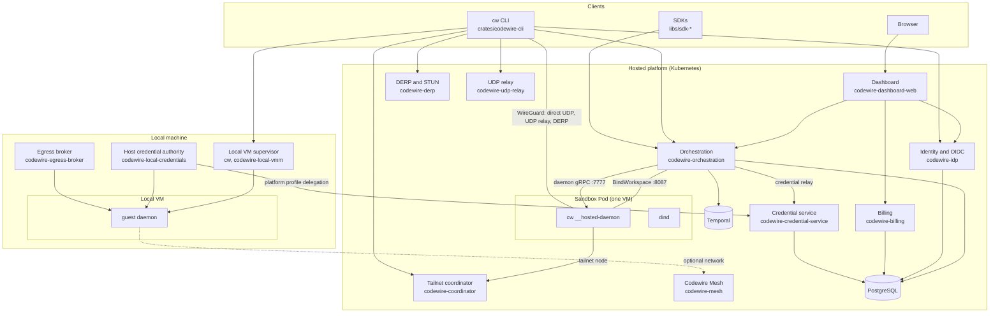

# Codewire specification

This is the one current specification of what Codewire is and how it behaves,
as shipped on `main`. It is written for an engineer or self-hoster who is new
to the system. It describes behaviour the code enforces; plans and proposals
are not here. Where a detail has its own document, this page states the
contract and links there.

How this page relates to the others: [README.md](README.md) is the front door;
[docs/ARCHITECTURE.md](docs/ARCHITECTURE.md) describes how the hosted platform
is put together on Kubernetes; [docs/GLOSSARY.md](docs/GLOSSARY.md) defines the
vocabulary this page uses; [docs/README.md](docs/README.md) is the map of every
other document.

Contents:

1. [What Codewire is](#1-what-codewire-is)
2. [Product model](#2-product-model)
3. [Components](#3-components)
4. [Hosted sandboxes](#4-hosted-sandboxes)
5. [Local VMs and trusted hosts](#5-local-vms-and-trusted-hosts)
6. [Contracts](#6-contracts)
7. [Access paths](#7-access-paths)
8. [Security model](#8-security-model)
9. [Configuration for self-hosting](#9-configuration-for-self-hosting)
10. [Delivery and verification](#10-delivery-and-verification)

## 1. What Codewire is

Codewire gives a developer or an AI coding agent an isolated development
machine: a Linux environment with persistent storage, durable terminal and
agent sessions, Docker, and access over SSH, a browser terminal, file transfer
and preview URLs. Each environment runs in its own hardware-virtualized VM with
its own kernel, because agents run untrusted code and a shared kernel would make
one exploit reach every environment on a node. The hypervisor boundary is the
security boundary.

One CLI, `cw`, drives every environment wherever it runs. One daemon, the same
`cw` binary in a private mode, runs inside every environment. The platform
services, the dashboard, the CLI, the local VM runtime, the documentation site
and the SDKs are all in this repository, under AGPL-3.0-only.

## 2. Product model

The vocabulary below is canonical; [docs/GLOSSARY.md](docs/GLOSSARY.md) has
the definitions and the words to avoid.

### Organizations and members

An **organization** is the account boundary for billing, membership,
organization secrets and hosted environment ownership. A user belongs to
organizations with a role; a hosted environment belongs to exactly one
organization and counts toward its plan. A `cw_` **API key** is bound to
exactly one organization and never inherits its owner's account-wide
authority ([docs/dev/AUTH-POLICY.md](docs/dev/AUTH-POLICY.md)).

### Environments

An **environment** is the product object: an isolated development machine with
a runtime image, workspace storage (`/workspace` and `/home/codewire`, which
survive a stop), CPU, memory and disk, sessions, ports and selected secret and
credential sources. Environment states are `pending`, `pending_build`,
`building`, `build_failed`, `pulling_snapshot`, `creating`, `starting`,
`running`, `stopping`, `stopped`, `archiving`, `archived`, `restoring`,
`resizing`, `destroying`, `destroyed`, `error` and `unknown`. A start of an
environment in `error` recovers it in both placements (#4953): a local VM's
runner first stops the failed VM it may still hold, as `cw stop` would, then
boots; a hosted Sandbox retries its create, which replaces a failed Pod. The
dashboard calls a hosted environment a **Sandbox**; it is the same object.

A `codewire.yaml` in the project describes an environment once (image,
repositories, setup, ports, kept folders, secrets and credential profile) and
either placement reads it (`crates/codewire-project` parses it). A local create
also merges the `codewire.local.yaml` beside it, for personal and local VM
settings; a cloud create never reads that file. Repeated `--file` merges the
named files in order: mappings merge by key, a later value or list replaces the
earlier one, and `null` removes a key.

`cw update ENV --file codewire.yaml` (#5949) gives an
existing cloud Sandbox the file's `startup_script`, added, changed or removed,
without recreating it, so its ID and preview host names stay. Repeated `--file`
merges as create does. The update compares the file with the Sandbox's saved
settings (what `cw export` prints) and shows each difference before the prompt
or `--yes`. `startup_script` is the one setting it changes: every start reads
the saved script and runs it, so the change takes effect at the next start, and
a running Sandbox keeps running. Only the settings the file states are
compared, since create may have filled the rest from a preset, a flag or a
default; a file with no `startup_script` removes the saved one. Any other
stated setting that differs refuses the whole update by name, with where it changes instead: `secrets` and
`credentials` with `--secrets` and `--profile`, `resources` with `cw resize`,
`idle_stop` with `--idle-stop`, and the rest (the image, preset, repositories,
`install_command`, ports, agents, skills, network, `working_directory` and
`environment`) only by creating a Sandbox, since create applies them once.
Nothing is saved after a refusal. `--file` doesn't combine with the source
flags, and a local VM's `cw --local update --file` is refused for now: its
setup is sealed per VM.

The rules for the startup script after create:

- **One writer.** Only the Sandbox's creator may change it, as with its
  sources; organization owners and admins have no override. A member who can
  exec into the Sandbox can't leave a hook that runs unattended at the
  creator's next start, when the creator's bindings are present. Only one call
  writes the saved script after create. It validates it exactly as create
  validates `codewire.yaml`, with the same size limit and encoding, and it
  changes no other setting.
- **Only while running or stopped.** A running Sandbox gets the new script at
  its next start, not now, and `cw` says so, so nobody takes it to have run. A
  running Sandbox whose setup hasn't finished is refused, since its setup
  would run the new script at once.
- **Audited without its text.** The audit row names the actor, the Sandbox,
  and the script's SHA-256 and length, never the script. A startup script is
  not a place for secrets; use `secrets`.
- **Never under someone else.** A saved script runs only for its creator. A
  departure keeps the creator's Sandboxes, and an organization owner or
  admin can still start them, so when the creator leaves, is removed or
  deletes their account, any saved startup script, from create or update, is
  cleared with the departure. No Sandbox changes owner today, and any future
  transfer must clear it too.
- **No wider reading.** Whoever can read the Sandbox's saved settings today
  (`cw export`) can read the script, and nobody else. It appears in no list
  view and no log.

A create form enters the same environment field by field: the dashboard's
Create Sandbox form and the iOS app's Create sheet. Their fields, limits and
refusal words are one set, in `codewire_project::create_input`, and
`codewire_project_proto::create_request` turns an accepted form into the
`CreateEnvironment` request, its project included; neither form keeps rules of
its own. `cw create` reads flags and `codewire.yaml` instead, with its own
lifetime syntax (`--ttl 1h30m`); every create meets the same project
validation and the server's checks.

An environment carries **labels** (#5804, not yet built): keys and values its
users set to find and group environments, such as `team=search` or
`job=nightly`. Codewire stores and returns them and never reads them to
decide anything. The journey is
[docs/journeys/environment-labels.md](docs/journeys/environment-labels.md).
- **Limits.** Up to 64 labels. A key is 1 to 63 characters of letters,
  digits, `-`, `_`, `.` and `/`, starting with a letter or a digit. A value is
  up to 256 characters, may be empty, and holds no control characters. A
  request over a limit is refused whole with `invalid_argument` naming the
  label.
- **Setting them.** At create (`CreateEnvironmentRequest.labels`,
  `cw create --label KEY=VALUE`, repeatable). `UpdateEnvironmentLabels`
  names the keys to set and the keys to remove, and the server applies both
  in one transaction, so two callers changing different keys never undo each
  other; with `replace`, the set it names becomes the whole set and it
  names nothing to remove. A key named both to set and to remove is refused
  with `invalid_argument`. The limits apply to the result, and a request
  that would break one changes nothing. `cw label ENV KEY=VALUE...
  [--remove KEY]...` sends exactly the keys it names. Changing labels needs
  the access that stopping the environment needs, and an API key needs
  `write:environments`. A create from a snapshot or a VM checkpoint takes
  only the labels its own request names.
- **Finding by them.** `ListEnvironments` takes `labels` and lists an
  environment only when it has every given key with the given value;
  `cw ls --label KEY=VALUE` (repeatable) does the same. `Environment.labels`,
  `cw info`, `cw ls --output json` and the SDKs return them.
- **Not secret.** Everyone who can list an environment sees its labels. Never
  put a credential or personal data in one.
- **Local VMs** take the same labels, limits and commands
  (`cw create --local --label`, `cw --local ls --label`, `cw label`). The
  supervisor stores them with the environment's local record, and they never
  reach the server.
- The dashboard does not show labels yet.

### Placements

A **placement** is where an environment runs. The same `cw` commands work in
all three.

| Placement | Create | Runs on | Isolation | Daemon |
| --- | --- | --- | --- | --- |
| Hosted sandbox | `cw create --name app --image workspace` | the platform, on Kubernetes | one VM per environment (Kata Containers) | `cw __hosted-daemon` in the workspace container |
| Local VM | `cw create --local --name app --path .` | an x86_64 Linux machine (Cloud Hypervisor on KVM) or an Apple Silicon Mac (Virtualization.framework) | one VM per environment | the same guest daemon from the pinned runtime |
| Trusted host | `cw create --local --type host --name app --path .` | the user's machine, as their own user | none: process ownership only | a host daemon owned by the user |

A local VM needs no account. A trusted host session has no containment: an
agent there can read and change anything the user can. A
[host](#hosts) is a computer enrolled to run VMs for an organization;
`cw create --on host:NAME` places an environment on one, as a preview.

### Sessions and managed agents

A **session** is a process inside an environment: a shell, a command or a
managed agent conversation. The environment owns it, so it outlives the client
that launched it; session names are unique within an environment, and output is
retained across disconnects and across a stop and start
([docs/dev/CLI-ORCHESTRATION.md](docs/dev/CLI-ORCHESTRATION.md),
[docs/dev/TERMINAL-RETENTION.md](docs/dev/TERMINAL-RETENTION.md)). Stopping a
session ends it and every process it started, within a stated bound. Stopping
the environment stops its sessions; after a start, each one is restarted under
its own name with `cw restart ENV --session NAME`.

`--env` on `cw run` and `cw exec` takes `KEY=VALUE`, or `KEY` alone
(#5222), which sends the value `KEY` has in `cw`'s own environment, so a
program can hand a secret it already holds to one process without putting it
in `cw`'s arguments, where anything that can read the host's process table
sees it. A `KEY` that isn't set is refused by its name
before anything starts; it is never sent empty. `cw` never prints a value it
sends, in its output or its errors. Every command that saves `--env` in an
environment's settings as a plain variable (`cw create`, local or cloud, and
`cw init`) keeps requiring `KEY=VALUE` and refuses `KEY` alone, pointing to
`cw secrets`. Codewire never stores or logs the values a run or exec sends.
The platform passes a run's values to the environment's daemon and writes no
part of the request. A cloud `cw exec` sends its values over the
environment's own SSH channel, in its command line (`env KEY=VALUE` before
the command), so inside the environment they are in the arguments of the
processes that start the command, the SSH server's `SHELL -c LINE` among
them, and can stay there while it runs. Only the environment's user, who can
read the command's environment anyway, sees them there; the host's process
table never does. That SSH server
(`crates/codewire-workspace-access/src/ssh.rs`) logs that a session started,
with its connection, channel and terminal, never the command. Every message
that carries them marks its `env` field
`debug_redact`, so no `Debug` of a request shows them: in `codewire.v1`,
`LaunchSessionRequest`, `ExecRequest`, `StreamExecRequest` and `RunStart`; in
`daemon.v1`, which the bridge forwards them in, `LaunchSessionRequest`,
`ExecStartRequest` and `PtyStartRequest`. The daemon holds them for the
process it starts and never writes them to its session record on disk (`env`
is skipped when `PersistedSession` is serialized,
`crates/codewire-daemon/src/durable_session.rs`), so they aren't kept across
its restart.

A **managed agent** (`cw run --agent codex|claude`, and `--agent noel` on a
trusted Linux host) is a conversation Codewire drives through the agent's own
protocol: `cw msg` sends a task, `cw inbox` lists messages and results,
`cw wait --message` returns one reply, `cw steer` and `cw interrupt` control a
turn where the client supports it. A conversation can launch workers under
itself with `--parent`; a worker's result is delivered once to its parent's
inbox. A managed agent runs the first `codex` or `claude` on the environment's
`PATH`, with no pinned version, in every placement. In a hosted sandbox or a
local VM it needs a credential profile with a provider for it; on a trusted
host it uses the user's own installed client and login.

### Application secrets and provider credentials

These are two product concepts with two boundaries
([docs/dev/SECRETS-AND-CREDENTIALS.md](docs/dev/SECRETS-AND-CREDENTIALS.md)).

- An **application secret** is a named value such as `DATABASE_URL`, stored in
  a user, organization or project source. Selecting a source for an environment
  (`--secrets`, `--user-secrets`, `--org-secrets`) projects its values into
  that environment's processes under their original names. Those processes and
  the environment's root can read them: Codewire does not promise secrecy from
  the workload itself.
- A **provider credential** is a named identity for Codex/OpenAI, Anthropic,
  GitHub or SSH. Its private material stays outside the environment. A
  **credential profile** selects identities, one per slot (`codex`, `openai`,
  `anthropic`, `ssh`; the user's GitHub connection is part of every profile).
  Selecting a profile authorizes a typed proxy, signer or repository executor,
  never raw material, except the direct delivery exceptions in
  [section 8](#8-security-model).
- Storing either does nothing by itself. No selected source means no
  application secrets; no profile means no provider access. Codewire never
  infers the category from a key's name or value, and never copies material
  between the local and platform stores.

Local values live in the Secret Service on Linux or the Keychain on macOS;
platform values live in the credential service's protected store. A local VM
may select local or platform sources; a hosted sandbox selects platform ones
only.

### Saved state vocabulary

- An **environment projection** is the set of child-visible values assembled
  for one process launch from the selected sources. It is ephemeral and
  restores nothing.
- A **snapshot** is saved state that can be reused or restored, always
  qualified ([GLOSSARY.md](docs/GLOSSARY.md#snapshot)). Two kinds ship:
  - a **skill snapshot**: immutable reusable skill content, seeded into a
    local VM's root disk by `crates/codewire-local-vmm`;
  - a **disk snapshot**: a stopped environment's disks, saved by `cw snapshot
    create` and forked into new environments by `cw create --snapshot`. It
    holds no memory. Hosted sandboxes have them (`--cloud`), and so do local
    VMs on Linux and on a Mac (#4654).

  Workspace and environment snapshots are reserved names and not implemented,
  and the `pulling_snapshot` state is defined in the contract but never
  entered. Workspace storage surviving a stop is not a snapshot. What each
  snapshot command does, and what it refuses, is in
  [docs/journeys/snapshots-and-forks.md](docs/journeys/snapshots-and-forks.md).
- A **VM checkpoint** is saved running-VM execution state: memory and device
  state, with the VM's disks ([GLOSSARY.md](docs/GLOSSARY.md#vm-checkpoint)).
  Local VMs on Linux and on a Mac have them: `cw checkpoint` creates, lists,
  inspects, restores and removes them, and `cw create --local --checkpoint`
  forks one into new environments with fresh identity. A checkpoint stays on
  the host that made it, and a Mac restores it only on the macOS build it was
  taken on (#4654). A Mac restores or forks one only while it is unlocked,
  because macOS protects the saved state with a key it releases only then; on
  a locked Mac both are refused before the source stops or a fork is made
  (#5976). With a release build of `cw`, at 2 vCPU and 4 GiB, a whole
  restore, the source's stop included, and a fork each finish in under
  10 seconds, on Linux and on a Mac (#6124). Hosted sandboxes have none.

## 3. Components

Everything in the product runtime is Rust. The control plane is a set of
service binaries on one shared chassis; the CLI, the in-environment daemon and
the local VM supervisor are one binary, `cw`.



### Control plane

| Component | Crate | Role |
| --- | --- | --- |
| Service chassis | `crates/codewire-server-core` | HTTP scaffold, authentication layer, request identity, error envelope, tracing, database and NATS helpers, the application migrations. Every service builds on it. |
| Identity | `crates/codewire-idp`, `crates/codewire-oidc`, `crates/codewire-email` | Accounts, passwords, TOTP, browser sessions, API keys and the OIDC/OAuth provider (discovery, PKCE, device flow, introspection, revocation; `codewire-oidc` is a standalone library); transactional email through SES. |
| Orchestration | `crates/codewire-orchestration` | The environment API, the Temporal worker and reconciler, the Kubernetes sandbox client, workspace binding, the credential relay, the terminal and SSH proxies, previews and admin. |
| Billing | `crates/codewire-billing` | Catalog, plans, Stripe and usage metering. |
| Credential service | `crates/codewire-credential-service`, `crates/codewire-credential-broker`, `crates/codewire-platform-credentials`, `crates/codewire-workload-secrets` | The isolated broker that holds platform provider material and application secrets and answers typed requests. |
| Tailnet | `crates/codewire-coordinator`, `crates/codewire-derp`, `crates/codewire-udp-relay`, `crates/codewire-tailnet` | Coordination of environment and client nodes, the DERP relay and STUN edge, the shared UDP relay, and the WireGuard transport library. |
| Codewire Mesh | `crates/codewire-mesh` | The network control plane for nodes that are not hosted sandboxes: local VMs and trusted hosts, with its own database. |
| Dashboard | `crates/codewire-dashboard-web`, `packages/codewire-design`, `apps/dashboard` | The server-rendered HTML dashboard (Askama templates, HTMX), its design system, image and browser tests. It is the backend-for-frontend: browser JavaScript holds no bearer token. It also serves `/docs`, the site built from `apps/docs/zola` (`CODEWIRE_DOCS_ROOT`), `/updates`, the posts of a configured Liminal CMS site (see [docs/CONFIGURATION.md](docs/CONFIGURATION.md#updates-page)), and the `install.sh` installer. |

PostgreSQL holds product state (two separate schema histories: the application
database and the Mesh database,
[docs/dev/DATABASE-MIGRATIONS.md](docs/dev/DATABASE-MIGRATIONS.md)). Temporal
runs the durable lifecycle workflows. NATS is used only for service-internal
fan-out where a service needs it.

### The `cw` binary

| Mode | Crate | Role |
| --- | --- | --- |
| CLI | `crates/codewire-cli`, `crates/codewire-cli-bin`, `crates/codewire-client` | Every user command, the OAuth client, the tailnet SSH client and the local VM supervisor. |
| Rust SDK | `crates/codewire` | The `codewire.v1` client: configuration, the Connect transport, bearer tokens, typed errors and every public service wrapper. `codewire-client` builds on it and re-exports it (#3511). |
| Hosted daemon | `crates/codewire-daemon`, `crates/codewire-workspace-access`, `crates/codewire-daemon-bridge` | `cw __hosted-daemon`: sessions, files, the SSH server, the tailnet peer and the credential bridge inside a hosted sandbox. |
| Guest daemon | the same crates | The daemon inside a local VM, from the runtime pack the release pins. |
| Release identity | `crates/codewire-cw-release` | The immutable version store behind the managed installation and `cw upgrade` ([docs/dev/CLI-MANAGED-INSTALL.md](docs/dev/CLI-MANAGED-INSTALL.md)). |

### Native apps

| Component | Crate | Role |
| --- | --- | --- |
| iOS app core | `crates/codewire-client-ffi` | The iOS app's Rust core behind UniFFI bindings for Swift (#3825): the shell, `codewire-client`'s hosted shell, the loop `cw shell` runs; and a create from the dashboard's create form rules (`codewire_project::create_input`), then `CreateEnvironment` and the setup wait `cw create` uses (`codewire_client::environment_setup::await_setup`), each row a step. Journey: [docs/journeys/ios-app.md](docs/journeys/ios-app.md). |

### Local VM runtime

| Component | Crate | Role |
| --- | --- | --- |
| Supervisor and runner | `crates/codewire-local-vmm` | Host-owned VM lifecycle: Cloud Hypervisor on Linux, the signed `codewire-vz-runner` helper on macOS (`crates/codewire-local-vmm/macos-vz-runner`). |
| Guest init | `crates/codewire-vmm-guest-probe` | The static guest init and daemon probe in the guest root. |
| Host credential authority | `crates/codewire-local-credentials`, `crates/codewire-credential-bridge`, `crates/codewire-protected-store` | The host-side broker, signer and repository executor for local credential profiles, and the delegation to the platform broker for platform profiles. |
| Network worker and egress | `crates/codewire-netstack`, `crates/codewire-egress-broker`, `crates/codewire-egress-policy`, `crates/codewire-egress-worker` | The confined packet worker and the egress broker that dials on the guest's behalf under a fixed policy. `codewire-egress-worker` holds both confined processes, the worker's session driver and the broker's control channel, for the local runtime and cw-egress. |
| Network session | `crates/codewire-network-session` | The authenticated session between an environment's guest and its host egress worker: the key, the hello, acknowledgement and ready handshake, and MAC-authenticated packet frames, shared by both halves (#4000). Its `hosted` module also holds a hosted sandbox's stream hello to cw-egress and the stream's key, which both ends use. |
| Confinement | `crates/codewire-confinement` | The process confinement the single-purpose host workers share: on Linux the single-thread check, capability and privilege locks, Landlock domains and seccomp deny lists; on macOS Seatbelt profiles. Also the parent's pre-exec isolation of a child it starts: inherited descriptors, the open-file limit and, on Linux, the parent-death signal and privilege lock. |
| Egress TLS front door | `crates/codewire-egress-front-door` | Terminates an environment's TLS to its bound egress hosts with a per-environment CA and hands each decrypted request to a caller's back end. Local HTTPS hostnames use its TLS serving, and a local VM boot that intercepts runs it in its own confined `cw __native-front-door` process, started by the runner before the seed is written, on Linux and macOS (#3999). |
| Egress front door bridge | `crates/codewire-egress-front-door-bridge` | A front door back end that maps a bound host and path to an existing transparent credential route and hands the request to the credential bridge unchanged. Its route hosts are the names a local VM boot with the `egress-intercept` switch on binds for interception; the front door process serves each request it is handed through the boot's credential broker (#3999). |
| Egress node | `crates/codewire-egress-node` | cw-egress, the per-node egress supervisor for hosted sandboxes (#4000): the per-Pod replacement limit, and the guest's stream hello and the stream's network key from the network session's `hosted` module; nothing runs it yet. |
| KVM device plugin | `crates/codewire-kvm-device-plugin` | cw-kvm-device-plugin, the node's device plugin for the `standard` runtime profile (#5602): it registers `codewire.sh/kvm` with the kubelet and has it add the node's `/dev/kvm`, read and write, to each container given one (`deployments/k8s/kvm-device-plugin`). Kind's overlays deploy it; Dev does not yet. |
| Disk scrub | `crates/codewire-ext4-scrub` | Clears every block of an ext4 disk its guest cannot read through the filesystem; a local snapshot's capture runs it on the copy of `state.raw`. |
| Prost redaction check | `crates/codewire-prost-debug-redact` | Build-time only: fails the build of a crate that generates protobuf types with prost (`codewire-daemon-proto`, `codewire-local-credentials`, `codewire-local-vmm`) when a message with a field marked `debug_redact` is missing from its `skip_debug` list, because prost's derived `Debug` ignores the option (#5034). |

### Images

`images/base` and `images/workspace` build the default workspace image (the
support pair), `images/cw-runtime` the `cw` runtime pack that runs inside a
local VM, and the daemon (support) image carries `cw` for hosted sandboxes.
`crates/codewire-workspace-image` holds the published workspace image pin.

The workspace image carries the coding agents at the versions in
`images/workspace/agents`, installed from one reviewed lockfile into a
read-only tree outside the home. Those versions are where an environment
starts, and the fallback. An environment runs the agents' newest release
(#4946): on first use the image's `claude` installs Claude Code's own
self-updating build in the home, the other agents' upgrades land in the home
too, and `PATH` prefers the home's copies, in a local VM and a hosted sandbox
alike. The Claude Code build an environment runs is fetched from its vendor at
first use and updates itself, and is not covered by Codewire's lockfile,
licence or advisory checks.

Target, not shipped (#3223): the workspace image carries a graphical desktop
as an inert layer: an X server that is also a VNC server (`Xvnc`), an XFCE
session, `xdotool` and `scrot`, and the launcher that starts them, from the
same dated package snapshot as the rest of the image. It also carries
Chromium, Debian's open-source build from a dated, signed snapshot, with its
sandbox always on, and Codewire's look for the desktop. Nothing in the layer
runs or listens until an environment's desktop is started
([Desktop](#desktop)).

## 4. Hosted sandboxes

[docs/ARCHITECTURE.md](docs/ARCHITECTURE.md) describes the Kubernetes shape in
detail; this section states the contract.

- **One Pod per environment**, created through the kubernetes-sigs
  `agent-sandbox` CRDs (`SandboxTemplate`, `SandboxClaim`, `Sandbox`,
  `SandboxWarmPool`) by orchestration's sandbox client. The Pod holds a
  `workspace` container running the user's image and a guest-local `dind`
  container. The node's container runtime socket is never mounted or proxied
  into a sandbox.
- **A runtime profile** selects the RuntimeClass: `commodity` is Kata
  Containers with Cloud Hypervisor and the normal profile; `confidential` is
  Kata with QEMU-SNP on eligible nodes; `runc` and `none` are diagnostic only
  and refused for managed creation unless
  `SANDBOX_ALLOW_DIAGNOSTIC_RUNTIME=true`
  ([docs/dev/CODEWIRE-GUARD-RUNTIME-PROFILES.md](docs/dev/CODEWIRE-GUARD-RUNTIME-PROFILES.md)).
- **The daemon binds before it listens.** The workspace Pod carries no
  environment identity, only a Pod-bound projected token with audience
  `codewire.internal.workspace-binding.v1`. The daemon long-polls
  `BindWorkspace` on orchestration's internal TLS listener (8087), receives
  its binding and access grant, and only then serves its gRPC service on
  7777, SSH on 2222 and the tailnet on UDP 31000
  ([docs/dev/SANDBOX-DAEMON.md](docs/dev/SANDBOX-DAEMON.md)). Every daemon
  RPC requires the bound Pod's daemon credential in the
  `x-codewire-daemon-token` header.
- **Lifecycle** is a set of desired states (`started`, `stopped`,
  `destroyed`, `archived`, `resized`) that the orchestration worker reconciles
  through Temporal. Every Start re-pins the Sandbox's daemon to the configured
  support image, except for confidential Sandboxes, whose attested Pod policy
  admits exactly the containers they were rendered with. A new workflow run
  keeps the operation generation, so it doesn't restart a running Sandbox,
  when Temporal describes the run holding it as closed, with any close
  status; that run's activities still executing are then refused, because
  the generation's claim no longer names their run
  ([docs/dev/ORCHESTRATION-FENCING.md](docs/dev/ORCHESTRATION-FENCING.md)).
- **A release never restarts a running Sandbox through its credentials**
  (#6005). The runtime's reserved environment names are part of every
  credential selection's digest, and they are kept as append-only versions.
  A running Sandbox keeps the version its binding captured until its next
  start; orchestration's bootstrap check and the credential service both
  rebuild its selection under that version. A changed selection still
  restarts it. A rollback to code that lacks a
  version restarts the Sandboxes bound under it. An owner-local delegation
  may use any shipped version, so an older `cw` keeps working. A version is
  retired only once no live binding and no supported `cw` still uses it;
  an older `cw` must then upgrade.
- **A credential's state never restarts a running Sandbox** (#6093, #6092).
  Its managed clients are fixed when its Pod binds, and its next start
  applies the current ones. A credential that is revoked or deleted, or whose
  refresh fails, is refused at its next use in the running Sandbox, as
  `credential_revoked` or `credential_needs_reconnect`, and a reconnect serves
  the use after it, with no restart either way. Every shipped managed-clients
  encoding stays valid, so a binding's recorded clients always decode.
- **Unplanned restarts** (#5997, target, not shipped). When a running
  Sandbox's runtime is restarted or replaced without a member asking, the
  Sandbox says when and why, and its organization's owners are told. Four
  causes count:
  - `pod_failed`: its Pod failed on a node that is still there;
  - `runtime_replaced`: its Pod was deleted or replaced, as in a node drain or
    reboot;
  - `node_lost`: its node was lost and the Sandbox came back on another;
  - `configuration_changed`: the bootstrap check restarted it because its
    credential selection, managed clients or generation changed.

  A start, stop, restart, resize, update or daemon repair that a member asked
  for is not unplanned. Orchestration records `restarted_at` (when the Sandbox
  was running again) and `restart_cause` with #3772's `sandbox_restarted` code,
  and keeps them until the next start or stop, an idle stop included.
  `cw info`, `cw ls`, their JSON, the API and the SDKs carry both. Every owner of the
  organization gets an email through the identity service's outbox, as
  invitations do; unplanned restarts in one organization within 10 minutes
  share one email. The journey is
  [`sandbox-unplanned-restart`](docs/journeys/cloud-sandbox.md#sandbox-unplanned-restart-a-restart-nobody-asked-for-is-shown-and-the-owners-are-emailed).
- **Docker** inside a sandbox is a daemon inside the same VM
  (`DOCKER_HOST=unix:///var/run/docker/docker.sock`), never the node's.
- **Previews** are HTTPS URLs that orchestration forwards to one application
  port; ports 2222, 5901 and 9222 are reserved
  ([docs/dev/SANDBOX-PREVIEWS.md](docs/dev/SANDBOX-PREVIEWS.md)).

Target, not shipped (#5602): a third managed runtime profile, `standard`,
runs the environment in a VM that Codewire's own runtime starts inside the
Pod: the supervisor, Cloud Hypervisor and guest that run a local VM
([section 5](#5-local-vms-and-trusted-hosts)). Kata is not involved.

- **The Pod** holds one container, `workspace`, running Codewire's runtime
  image at a pinned digest on the node's ordinary container runtime. It does
  not run as root, has no capabilities and no privilege escalation, and gets
  `/dev/kvm` from the node and nothing else. There is no `dind` container
  and no init container.
- **Inside the VM** run the user's image, Docker and the same daemon as on
  `commodity`. The daemon binds before it listens, holds the Sandbox's
  tokens, and serves 7777, 2222 and the tailnet. The workspace container has
  the runtime's `cw` read-only at `/codewire/bin/cw`, as a `commodity` Pod
  does: the daemon starts every process of a sandbox with application
  secrets through it. The root disk is named by the image build and holds
  setup's install state, so a stop and start keep it, and setup does not run
  again; a new image build starts a fresh root.
- **The supervisor** in the container boots the VM, hands it the Pod's
  settings, keeps the VM's copies of the projected tokens fresh, forwards
  7777 and 2222 from the Pod's address to the daemon, and powers the guest
  off when the Pod is told to stop. The tailnet uses its relays; the direct
  UDP path is later work.
- **The VM has no network device.** Its traffic leaves through the
  supervisor to cw-egress on the node, which decides every destination, so
  `standard` is offered only where hosted egress (#4000) is on.
- **The first version is guest-carried.** Until the supervisor joins the
  VM's network session to cw-egress, the daemon in the VM runs no egress
  path of its own: its platform connections (the binding, the gateway, the
  relay) leave through the VM's session to the exact addresses the Pod names,
  and every other connection, the workload's included, is refused at the
  supervisor. The daemon learns it is guest-carried only from the VM's kernel
  command line, which the runtime alone sets; a daemon that also finds a
  broker Pod's egress path refuses to start. Before it serves, the daemon
  checks from the workload's network that a direct dial to a public address
  and a DNS query to a public resolver and to the cluster's all fail, and
  refuses to serve if any is answered. It records no SSH host key before the
  check passes and sends the check with the key: orchestration records the
  key, and the sandbox's access becomes ready, only when each of its three
  probes (a direct dial, public DNS and the cluster's DNS) found no way out.
  That record is the guest's own report, evidence that the daemon ran its
  check, not the boundary, since the whole guest is the Sandbox user's; its
  log names each probe, its target and its outcome either way.
  The Pod's `CODEWIRE_VM_EGRESS_MODE`, fixed when it is created, waives
  that check only for `broker`, hosted broker mode inside the VM, whose
  stream cw-egress checks as on Kata. A pool's template is `guest-carried`.
  A guest-carried daemon whose bind is intercepted refuses to serve: it has
  no egress loop to install the front door's CA.
- **Broker mode inside the VM** (#5602). An environment's own `standard`
  template is `broker`: the daemon in the VM runs hosted broker mode
  unchanged. Before the workload starts, the VM's init makes the egress TUN
  `cwegress0`, owned by the workspace user, in the workspace's network, with
  the same routing a Kata Pod's TUN init makes: the workload's default route
  and its resolver go into the TUN, and the daemon's own platform dials
  leave by the guest's `eth0`. The daemon dials cw-egress, one of the Pod's
  platform peers, with the Pod's own egress token and carries the TUN over
  that stream, so the workload reaches the network only through cw-egress,
  under the environment's policy. The runtime sends that token into the VM
  in this mode alone and resends it whenever the kubelet rotates it; the VM
  replaces its copy whole. cw-egress's admission is the check: the token
  opens only this Pod's stream, on this node, checked against the token's
  Pod UID, the Pod's label and the stream's source address as cw-egress sees
  them, never a value the guest supplies. The guest's `eth0` and the
  supervisor's end of the VM's session take `192.0.2.6/30` and `192.0.2.5`
  in this mode, beside the TUN's `192.0.2.2/30`, and the supervisor accepts
  packets from that one guest address; the runtime chooses the pair from the
  Pod's own setting, never from the guest. A broker-mode guest's kernel
  command line names `codewire.hosted_broker=1`, which the runtime alone
  sets, never beside the guest-carried parameter.
  The tokens that cross into a `standard` guest, each Pod-bound:
  | Token | Audience | Mode | Checked by |
  |---|---|---|---|
  | binding | the workspace binding | both | orchestration's binding, by TokenReview and the live Pod |
  | credential | the credential workspace | both, when set up | the credential service, by reviewed Pod UID |
  | egress | cw-egress | `broker` only | cw-egress's admission: this Pod's UID, label and address, on this node |
  The Pod's 7777 and 2222 reach the VM over two fixed guest-channel ports
  that exist only in such a boot and accept only the host; the guest joins
  each to one address in the workspace's network: the daemon's gRPC
  listener and its SSH port. The daemon's listener is made by the VM's own
  init, as root, before the workspace starts, held for the VM's life and
  handed to the daemon alone, so no workspace process can listen in its
  place and receive orchestration's credential; the daemon keeps it from its
  children and cannot be traced by them. SSH needs no such listener: a
  process that took its port would fail the platform's pinned host key, not
  learn anything.
  The daemon's stdout and stderr reach the Pod log, as a Kata Pod's daemon's
  do: the guest writes them out over one more fixed guest-channel port, and
  the runtime, which only reads it, writes each line prefixed
  `guest-daemon: `, escaped so no guest byte can end it or start another,
  cut at 4 KiB, and capped at 200 lines and 64 KiB a second per Sandbox,
  counting what it drops. That text is untrusted guest output: nothing uses
  it for health, readiness or billing.
  Production's `standard` profile stays off until an orchestration-side
  check that does not depend on the guest exists; for a broker-mode
  `standard` Pod that is #5800's lockdown check at the `cw-egress` handshake.
- **The workspace image** reaches the VM as a read-only disk that the node
  pulls and caches like any image and every Sandbox on the node shares. Each
  VM adds a small writable root that is rebuilt at every start. The home and
  the workspace persist on the Sandbox's volume, as on `commodity`. Once the
  daemon's first bind is answered, the volume is marked as used, and a later
  Pod that finds its disk missing fails instead of starting an empty
  workspace. Docker's data has a disk of its own on the volume, half the room
  the VM's disks share; a missing one is made afresh, since its data is
  disposable. The disks together never exceed the volume.
- **Beside the other profiles.** `commodity` and `confidential` do not
  change. A profile is chosen for an organization, an environment keeps the
  profile it was created on, and nothing is converted. Until `standard` can
  run a user's own image, an environment that names one is created on
  `commodity`.
- **Moving one organization** (target, not built). The deployment's
  `standard` settings make the profile available, and `SANDBOX_RUNTIME_PROFILE`
  stays the default for every organization that is not moved. A global admin
  moves an organization with its `standard_runtime_enabled` flag, set only
  from a global admin's signed-in session and never from an API key, whoever
  owns it; the method itself enforces that. The flag
  refuses to turn on while the deployment has no `standard`, and each change
  commits together with its audit entry. A create decides its profile once,
  in this order:
  1. the confidential tier is `confidential`;
  2. a moved organization's create from the workspace image is `standard`;
  3. anything else gets the default.

  The environment records that profile, and a database trigger keeps the
  record from changing. Every later render, start, restore and warm-pool
  claim reads the record, never the flag or the current disk.
  - Turning the flag on or off changes only new creates.
  - Clone, fork and restore into a new environment decide again under the
    destination organization's flag.
  - An environment whose recorded profile the deployment no longer offers is
    refused at start, never moved.
- **Suspend** (target, not shipped, #5529): a `standard` Sandbox with
  `idle_suspend` on pauses its VM inside its Pod after that much idle time,
  keeping its processes. A connection on the Pod's published ports, or a
  stop, resumes it; the guest can only ask to be paused. Off by default, set
  like `idle_stop`; a suspended second is billed only from the runtime's own
  pause record, never from anything the guest says, at a rate that is 0
  until set. Kata profiles never
  suspend, and hibernate comes later. The contract, including every
  periodic call that must not wake a suspended Sandbox, is
  [docs/dev/IDLE-STOP.md](docs/dev/IDLE-STOP.md), "Suspend". Internally,
  orchestration's `RuntimeDriver::scale_down`/`scale_up` are the stop and
  start (agent-sandbox's `operatingMode: Suspended`), never this.
- **Not on `standard` at first:** a user's own image, private images, and
  snapshots and forks.

The Guard rules for this profile are in
[docs/dev/CODEWIRE-GUARD-RUNTIME-PROFILES.md](docs/dev/CODEWIRE-GUARD-RUNTIME-PROFILES.md),
and its walk is
[docs/journeys/standard-runtime.md](docs/journeys/standard-runtime.md).

## 5. Local VMs and trusted hosts

### Runtime

A release's `cw` pins its local VM runtime by digest. `cw setup --local`
downloads exactly those files from the release origin, checks each one and
installs them under `~/.cache/codewire/local-vmm-v1/`: Cloud Hypervisor and
virtiofsd (Linux) or the signed `codewire-vz-runner` helper (macOS), the
Codewire guest kernel, the guest root (guest init, BusyBox, runc), and the
sealed `cw` runtime pack that runs sessions and managed agents inside the VM.
Creating or starting a VM installs a missing or foreign runtime first; running
VMs keep the runtime they started with
([docs/dev/LINUX-LOCAL-VMS.md](docs/dev/LINUX-LOCAL-VMS.md),
[docs/dev/MACOS-CLI.md](docs/dev/MACOS-CLI.md)).

Host requirements on Linux: x86_64, KVM, Linux 6.2 or later with
Landlock, e2fsprogs, and a Secret Service for local values; `cw` refuses to
run local VMs as root. On macOS: Apple Silicon, macOS 26 or later; the runtime
ships its own e2fsprogs and git, and the helper must be signed with the
virtualization entitlement.

### Supervisor

One supervisor process per user (`cw __native-supervisor`) owns local VM
lifecycle, state and host ports. Its state is one SQLite database,
`supervisor.db`, in the state root (`~/.codewire/native-v1` by default,
`CODEWIRE_NATIVE_STATE_ROOT` overrides it). On macOS, `cw setup --local`,
`cw create --local` and `cw --local start` warn on stderr when no folder in the
state root's path is one Spotlight skips, a dot folder or one whose name ends
in `.noindex`: Spotlight indexes other folders, and its image importer reads
the VMs' `.raw` disk images there (#5831, until #5830 renames them). The
warning suggests a `.noindex` folder. `~/Library` is not skipped. Time Machine
skips the state root's `vms/` tree, marked when it is created and on an
existing root at the supervisor's next start (#5900), as it already skips
each VM's `checkpoints/` and the snapshot store (#4654). So a
local VM's disks are not backed up; work kept in Git or in folders shared from
the host is. `cw` talks to it over gRPC on a
Unix socket under `/tmp/cw-<uid>/` whose directory is mode 0700 and whose
socket is 0600, and the supervisor checks every connection's peer uid
(`crates/codewire-local-vmm/src/uds.rs`).

The protocol is `LocalSupervisorService` in
`crates/codewire-local-vmm/proto/codewire/local/v1/control.proto`. A `cw`
carries a native protocol version and a minimum it accepts
(`NATIVE_SUPERVISOR_PROTOCOL_VERSION` and
`MINIMUM_SUPERVISOR_PROTOCOL_VERSION` in
`crates/codewire-local-vmm/src/supervisor_config.rs`; features such as SSH
are gated on the version a supervisor reports). After `cw upgrade`, the
previous `cw`'s supervisor keeps serving the VMs that still run; the new `cw`
uses it for everything that does not boot or reconfigure a VM, refuses those
while the old supervisor may still run a VM, and retires it and takes over by
itself once no VM runs. A supervisor outside the accepted range (older than
v0.3.388's, or a newer one after `cw upgrade rollback`) is refused with a
message that names it. `cw upgrade --vms` stops each VM through the old
supervisor, has it hand over the state root, and starts each VM again on the
new `cw`; the flag is the user's consent, because a restart ends the work
running in them.

### Workspace

`--path` (default: the current directory) with `--path-mode mount|copy|clone|empty`.
`mount`, the default, shares the directory live and read-write through
virtio-fs; `copy` copies it once as it is; `clone` contains only the committed
tree at `HEAD`; `empty` starts empty. The VM can change anything in a mounted
directory, `.git` included, so Git hooks and settings it writes there run on
the host the next time the user runs git in that folder. This is accepted
(owner, 2026-11-10, #4004); `clone` is the mode for untrusted workloads.
Pulling a VM's commits brings no hooks or git config; copying a repository's
`.git` directory out of a VM with `cw cp` does, so copy files or pull commits
instead. The share policy refuses the home
directory itself, anything containing it, top-level system directories and
credential stores. Folders matching `workspace.vm_only` (default `node_modules`,
`target`, `.venv`) are bound to the VM's disk over the live mount. A dedicated
Docker data disk (8 GiB by default) is attached for `/var/lib/docker`.

A create takes the workspace image from the supervisor's content store when it
can. If the image is named by digest, and that document and every blob it names
are already stored and verified, the create uses them without the network, and its
image step reads "Using the cached image". Any part that is missing is fetched
alone. A tag is always resolved with the registry, because a tag can move. A
create that can't reach the registry for a tag says that it asked the registry
for the tag (#4968).

**Target, not shipped (#4646): one read-only image disk per image.** Today each
new VM unpacks its image in the guest. The target keeps the unpacked image on
one disk per image on the host, `image.raw`, mode 0400, attached read-only to
every VM of that image as `cw-image` and mounted `ro,noload,nosuid,nodev`; each
VM's root disk keeps only its own changes, and its overlay takes its lower from
the image disk. The disk is built once, under a per-image lock, by a builder
guest that has no network, share, identity or workload: three disks (a seed, the
image's layers, an empty disk to fill) and nothing else. The host keeps the
result only when the builder exits cleanly and the disk's marker carries the
random build id chosen for that build. Every VM's root generation records the
image disk and build id it sits on, and the guest refuses to mount an overlay
over a disk whose marker does not match. That marker is a consistency check, not
authentication: a disk's integrity rests on the runner's private store, or in a
`standard` Pod on the digest-pinned, read-only image volume that holds it. A disk is kept while a VM, pending
create or saved state names it. Existing VMs, snapshots and checkpoints keep
their combined root disk.

### Networking and egress

The VM has no network device. Inside the guest a TUN device carries raw IP
over a vsock port to the host, where the confined network worker
(`cw __native-network-worker`, on `crates/codewire-netstack`) terminates the
guest's TCP and DNS and has no dial authority of its own. On each TCP
connection it terminates, the netstack sends a keep-alive every 30 s, so a
live but idle peer is kept, and aborts a connection whose peer has answered
nothing for 120 s (#6399). The same netstack, with the same limits, carries
a `standard` Pod's platform connections and `cw-egress`'s worker. It carries
no other UDP: a well-formed IPv4 datagram that is not a DNS A or AAAA
question to the environment's resolver (`192.0.2.1:53`), such as DNS sent to
another server or STUN, is dropped with no reply, so its sender waits out its
own timeout, and
is recorded as refused, `udp_not_carried`, against its address and port in
the refusal log below (#3997). The record is best effort: it is skipped
rather than delay a TCP admission. ICMP, IPv6, and malformed or fragmented
packets are dropped with no record. The egress broker
(`cw __native-egress-broker`, on `crates/codewire-egress-broker`) dials on the
guest's behalf under the VM's selected network policy, from
`crates/codewire-egress-policy`. Three policies are built in, the same for
local VMs and hosted Sandboxes (#3997). None can be changed or deleted.

- `open` is the default. It allows DNS on 53, and TCP on any port to public
  addresses.
- `web` allows DNS on 53, and TCP on ports 22, 80 and 443 to public
  addresses: the rules `open` had before #3997.
- `locked` allows nothing, except that a selected model credential still
  reaches its provider, as the interception paragraph below says (#5215).

No built-in allows UDP other than DNS. Where a broker enforces the policy (a
local VM, or a hosted Sandbox with hosted egress on), every other UDP send is
blocked, and `cw` says so. A Sandbox that selects nothing shows
`open (default)`; a local VM's store keeps no difference between selecting
`open` and selecting nothing, so it shows `open`. A selection of `open` made
before #3997 reads `open`, and its egress widened from ports 22, 80 and 443 to
every TCP port. To keep the three ports, select `web`. `cw info`, and
`cw update ENV --policy open` and a hosted create with `--policy open`, say
so in one sentence beside the policy line, never under `--output json`, for
every selection whose reference is `open`: no selection records when it was
made.
The three names are reserved: no stored policy can be created with one. A
local policy already named `web` keeps its selections, and
`cw --local policy ls` marks it and gives the step that copies it under a new
name (`cw --local policy create NAME --from local:id:UUID`). A local VM's
selection of a stored policy is kept by the policy's id, so a VM that selected
the user's `web` keeps enforcing that policy's rules and digest, and never
becomes the built-in; a bare `web` given after #3997 means the built-in, and
the user's policy is reached as `local:id:UUID`. A create the supervisor
replays from its journal before it selected its policy, whose bare built-in
name a stored policy has, may have been written by a cw from before #3997,
so it is refused with a sentence naming the fix, and nothing is selected or
booted.

Target, not shipped (#6226): the dashboard's Network policies page shows the
three built-ins as above, and says that UDP other than DNS is blocked.

`cw create --local --policy REF` and `cw update ENV --policy REF` select
another, built-in or named, and an edit to a selected policy applies to the
running VMs that select it (#3378, #3386). Loopback, private, link-local and
metadata ranges, the host's own interface addresses and the public address the
host is seen from are always refused under every policy, with an immediate
reset. Both processes run under Landlock and seccomp on Linux and under
Seatbelt on macOS; losing either fails the environment closed (`error`), and a
stop and start restores egress. The state keeps which process ended and how:
`cw info` names its exit status and what that status means, as the process's
own exit codes define it, or the signal that ended it. `--output json` carries
them as `runner_exit.status`, `reason` and `signal`, and `cw --local daemon
logs` shows the same in an `# exit` part (#4953). An answer from the broker
that misses the worker's deadline refuses only its own lookup or connection:
the worker keeps
the session until the late answer arrives and checks it, so a slow resolver or
a stalled broker never ends the broker or fails the environment (#4948). While
the broker is past that deadline the VM stays `running` with egress refused,
and `cw info` and `cw doctor` say so, with how long it has refused, until a
request is answered again; `cw info` names stopping and starting the VM, which
restarts the broker, as the next step (#4965). A malformed or unauthenticated
answer still ends the broker. Published ports listen on
`127.0.0.1` only. A
local VM joins Codewire Mesh only when a network is selected at creation; the
host owns the Mesh identity and the VM sees only admitted streams for its
declared ports.

Target, not shipped (#3999): for an agent's provider hosts the broker hands
the connection to a TLS front door, one process per VM, instead of dialling.
The front door is confined to no filesystem, no new sockets and no process
creation, and holds only the descriptors it inherits: by Landlock and
seccomp on Linux, and by a Seatbelt profile on macOS.
A front door that ends without a stop being asked for is not restarted: from
then on every intercepted connection is refused at once, the VM keeps
running, and `cw --local info` and `cw doctor` say that its agents can't
reach their providers and that `cw --local restart NAME` restores them; the
JSON carries `"interception": {"state": "lost"}` (#5216, the `lost` state of
#4912).
What an agent sends to its provider is not documented and changes
between releases, so a compatibility test runs the real Claude Code against a
stand-in provider (#4925): for the image's version when that version or a
login file Codewire writes changes, and on a schedule for the newest release,
which is the one environments run (#4946).
On an intercepted host, only a request that carries the environment's
placeholder on a path its route serves is served whatever the network
policy's default. A placeholder on a path the route does not serve is refused
before any lease, whatever the policy. Every other request to that host
follows the policy as if the host were not intercepted:
a rule that allows it lets it through untouched, and without one it is
refused and counted. Untouched means as sent, framing aside, except that it
asks for an uncompressed answer (`accept-encoding: identity`): the broker
passes on no reply in a content coding, since it doesn't decode one, so the
client's own request for one would end a compressed reply as a failure
(#6362). That answer is for the host the forward would dial, the
route's own provider origin, never a name the request gives. The credential
broker that serves or forwards these requests never sees the policy. On a
local VM the supervisor, which holds the policy, gives the broker its answer
for each bound host when it starts. Nothing the front door or the request
carries can change it, an absent answer is a refusal, and a policy edit
restarts the broker with the new answer. On hosted, nobody gives an answer:
the broker runs in the platform, where an untouched forward would leave past
the Sandbox's own policy and cw-egress, so by its own rule it refuses every
such request, whatever the policy, until one can leave through the Sandbox's
own egress. A refused request gets the same answer whether it carried no
credential, the user's own key or another environment's placeholder, and
nothing is dialled; one with no placeholder-shaped value is refused before
any lease (#5555). On an agent's token host, Claude's `platform.claude.com`
for a Claude sign-in and Codex's `auth.openai.com` for the Codex slot, the
one request the broker serves is the agent's refresh carrying Codewire's
managed refresh token: it is answered with placeholders, outside the
environment, and never reaches the provider (#3999, #6197). Codex's routed workspace origins, one label under
`chatgpt.com`, can't be named ahead, so for them the supervisor's answer is
whether a rule covers every such name (`*.chatgpt.com`): it asks the policy
about a fresh random name under the suffix each time, so a rule for one name
never counts. An exact rule for one routed name doesn't let an untouched
forward through until the egress broker's signed decision reaches the
credential broker (#4931). A deny rule on a routed name refuses its
connection at the egress broker, before any hand-off. The wildcard arrives
with the per-host answer itself, at local authority protocol 27: an authority
from before ignores the whole answer, so the supervisor starts no
intercepting broker from one unless the policy allows every bound host and
every routed suffix. A deny rule on the host refuses everything to it. A
selected credential acts on the user's own account at its provider, which no
network policy limits. The managed GitHub credential is the exception: it is
served only where a rule allows the GitHub hosts, because its grant cannot be
limited to an environment's own repositories.

`cw --local policy log ENV` (#5058) shows what a running local VM has had
refused since it started, most recently seen first. Rows fold
by destination, protocol, port and reason, so TCP and UDP to one port are two
rows, and each row says: the name, or the address where no name leads to it;
the latest address seen; the protocol and the port; the reason; the policy and
revision it was last refused under; when it was first and last seen; and how
many times. A refused lookup is a `dns` row with no port and usually no
address, printed as `-` (JSON `null`). The rows come from two sources, with
the reason codes of "Refusals an agent or a person can read" in
`docs/dev/SECRETS-AND-CREDENTIALS.md`:

- the egress broker's refusals of a lookup, a connection or a UDP datagram,
  with the raw `RefusalReason`, so the owner sees `protected_address` and
  `intercept_unavailable` where the guest sees only not allowed or
  unavailable. Its record log (`crates/codewire-egress-policy/src/record.rs`)
  also keeps passes while learn mode runs (#4015); the broker sends only
  refusals, so the owner's log never shows a pass;
- an intercepted host's front door's refusals, with the reason the agent
  received: its own (a path the route doesn't serve, a request it doesn't
  forward) and each refusal the credential broker answers with. The front door
  reports them, not the broker, which keeps its confinement and gains no
  output. The broker's answers it knows only by their `Codewire-Refusal`
  header (no credential selected and the three credential reasons), so such a
  row says what the agent received, not proof that the broker sent it. A row
  holds only the route's bound host and its port, the reason, a count and the
  times, never the request's method, `Host` header, path, query, other
  headers, body, credential or placeholder, nor any text of the response, so a
  crafted request can't put another name or any of its content in the log. A
  request refused by the network policy (`name_not_allowed`) carries the
  policy and revision the supervisor recorded when it last sent that
  environment's allowed hosts to the credential authority, taken only from
  that record and never from the front door; any other reason here has `-` for
  the policy.

The workload chooses the hosts and the volume, so the egress broker and the
front door each fold their refusals before they report, and send the rows
that changed at most once a second, each on its existing control channel to
the runner, with no new socket, peer or capability. A host hammered with
refused requests raises a count, never the size of the log or the rate of
frames. The runner files every report under the boot it serves and never
under an environment a report names; a report naming another environment is
refused. The front door terminates the guest's traffic, so the runner takes
its reports as untrusted: it parses them strictly within fixed bounds,
accepts only the fixed reasons, keeps a row only for a host on the routes it
bound for this boot, and enforces its own rate and row cap for them, so a
flood can't evict the egress broker's rows. A report or row it rejects is
dropped and counted, never stored in part: `--output json` gives `rejected`,
the number rejected since the VM started, and the log adds one line saying
how many when it isn't 0. The runner keeps the
environment's one merged log, bounded at 1,000 rows with the row seen least
recently dropped, and the log says when it dropped rows (`--output json`
gives `dropped`, the number of rows dropped since the VM started). Every
host is checked before it is stored or printed: ASCII only (an
international name in its IDNA form), at most 253 characters, and no
control or escape character.
A host that fails the check is kept as one row, `(a name cw won't show)`,
with its reason and count and never its text, so a host can never carry a
terminal sequence to the owner's screen. The supervisor reads the log through
a new read on `LocalSupervisorService` behind its own supervisor feature, so
an older supervisor says it can't show the log. The log is in memory only and
lasts one run of the VM: a stop, a restart or a restore starts it empty, and
on a VM that isn't running the command says so. Only the owner's socket
reads it; the view inside the environment (#4015) is the protected
projection, `guest_records`, and the two share no code path that could widen
what the guest sees. `cw info ENV` adds one line: how many requests were
refused since the VM started and when the last was, naming `cw --local policy log
ENV`; the rows keep counts, not a time series, so it can't count by hour.
Target, not shipped (#6189): a hosted Sandbox's refusals are the `refused`
events of its audit log ("Sandbox audit log"), and `cw --cloud policy log
ENV` and `cw info ENV`'s `Refused:` line read them there, in the same table,
JSON and words as a local VM's.

Target, not shipped (#5114, #5116, #5117): the dashboard's Network policies
page lists an organization's policies, each with its revision, its rules and
the number of Sandboxes that select it; hovering, focusing or tapping that
number names up to ten of them. Owners and admins create, edit, check and
delete policies there, and members read them, under the store's own rules
and refusals. A Sandbox's page shows its policy, revision and enforcement
state under Network access, and lets the Sandbox's creator choose another
policy without a restart; later it lists what was refused, with a one-step
Allow, on the Sandbox's audit log page (#6189). With #6226 the page lists
the built-ins `open`, `web` and `locked`, and a Sandbox that selects nothing
shows `open (default)`. Where the deployment doesn't enforce hosted network
policies, as `ListNetworkPolicies` says, each of these pages says that
outbound connections are not restricted. Where it does, they say that UDP
other than DNS is blocked. No page says policies are not enforced on a
deployment that enforces them. The dashboard never shows a local policy:
those live on the
user's computer. A page learns of a new revision, an enforcement change or a
refusal from the live event stream, never by polling; those events are part
of #5114, #5116 and #5117, and none exists yet.

A Mesh node is online only while it holds a live coordinator session that
Mesh has heard from in the last 45 s. Every Mesh client pings every 15 s, so a
node that goes silent shows offline within 45 s; Mesh records when it last
heard from each node. Silence never ends a session: a local VM's transport
cannot rejoin within its generation, so a node waking from a sleep keeps its
session and shows online again. The live sessions are in Mesh's memory, which is
complete only while Mesh runs one replica; more replicas would need that
record in the Mesh database. Who may revoke a node (#2697): a network owner,
any node; a member, only a node recorded as their own, such as a local VM they
attached. A hosted environment's node belongs to its environment: a member
cannot revoke it, and it leaves the network when the environment is destroyed.
The client that deletes a Mesh-attached local environment revokes its node,
once the removal is confirmed, with the credential of the attachment's own
owner store (`cw --local rm` does); the supervisor never holds that
credential. A failed revoke leaves the removal done and the exit status
unchanged: the node shows offline, and `cw` prints the exact
`cw network revoke` command that removes it.

Target, not shipped (#5115, #5118, #5119): a Sandbox's page in the
dashboard names its Mesh Network and whether it joined, in the words `cw info`
uses for each attachment state and failure. The Mesh Networks page lists an
organization's Mesh Networks and their nodes: whether each is online and when
Mesh last heard from it. It creates Mesh Networks and invite codes, revokes
nodes under the rules above, and deletes a Mesh Network that has no nodes.
The Sandbox create form chooses a Mesh Network. Online means the node holds a
live session with Mesh; the dashboard never claims that two nodes reach each
other. A page learns that a node or an attachment changed from the live event
stream, never by polling; those events are part of #5115 and #5118, and none
exists yet.

### Credentials on the host

The local credential authority (`cw __local-credential-authority`, on
`crates/codewire-local-credentials`) holds credential metadata in
`~/.codewire/credentials-v1` and the material in the OS protected store
(`crates/codewire-protected-store`: the Secret Service on Linux, the login
Keychain or owner-only files on macOS). The supervisor never links or owns that
authority. One broker (`cw __local-credential-broker`) per VM generation reads
an admitted value from the store, reaches the guest daemon's credential bridge
over vsock, and injects the selected credential into the provider requests the
guest sends to the daemon's loopback ingress. SSH signatures are made on the
host and only signatures cross; a GitHub or SSH repository is checked out on
the host by the repository executor. For a platform profile the broker runs as
a relay that reads no store and dials no provider: the host opens an
owner-authenticated delegation to the platform broker, which performs the
provider operations, and no platform provider material is copied to the host
or the VM. A local profile holds the owner's Codex sign-in and Claude
sign-in as a platform profile does; a Claude subscription token is still a
platform credential only. A policy that allows TCP 443 to a provider, as
the default `open` does, still lets the guest open it directly, so the
broker keeps the credential out of the workload but does not enforce provider
mediation.

### Trusted host

`--type host` runs sessions as the user's own account with their ordinary
`HOME` and tools, through the ordinary environment daemon started natively by
that user, with no VM and no credential bridge, over an owner-private
`daemon.sock` in its state directory (`~/.local/state/codewire/hosts/<id>/`
by default; `CW_HOST_DATA_DIR` overrides it). VM, secret and network flags are
refused. Codewire provides owned process cleanup only. Stop and remove retire
the daemon's runtime and keep the project directory. Linux and macOS are the
admitted hosts.

### Hosts

A **host** is a computer that a member enrolls to run Codewire VMs for their
organization, through the same local VM runtime and supervisor as `cw
--local`. It is not a trusted host: its environments are VMs. Hosts are a
preview (#3609): a host enrolls, connects and shows its state, and an
environment can be created, stopped, started and deleted on one. Reaching
that environment (`cw run`, `cw shell`, `cw exec`) is not built yet, and the
lifecycle on a host has not been observed working yet
([docs/journeys/hosts.md](docs/journeys/hosts.md)). The user guide is
`apps/docs/zola/content/environments/hosts.md`; the commands are in
`reference/cli/hosts.md` beside it.

- **Record.** `cw host enroll` (`HostService.EnrollHost`, `proto/codewire/v1/host.proto`)
  creates an Ed25519 key on the computer and registers its public key; the
  private key never leaves the computer. A host belongs to one organization and
  one owner, has a platform (`linux-x86_64-kvm` or `darwin-arm64-vz`), and its
  name is unique among the organization's hosts that are not revoked. A key
  belongs to one host record ever (migration `0015_hosts.sql`). The key is
  kept in the OS keyring (Secret Service, Keychain), or, on a Linux computer
  with no Secret Service, in a file only the user can read; the local
  enrollment beside it holds no secret.
- **Who may use it.** Enrolling grants nothing. The owner offers VMs with
  `cw host provide` (at least a maximum VM count; vCPU, memory and disk caps
  are optional) and lets named members or the whole organization place
  environments on it with `cw host grant`. A grant never follows from
  membership alone.
- **The session.** `cw host run` is the host agent. It opens one outbound
  HTTPS stream, `HostAgentService.AttachHost` (`proto/codewire/v1/host_agent.proto`),
  and nothing connects in to a host. The stream carries no bearer credential:
  the host opens with its ID, the control plane answers with a fresh nonce,
  and the host signs `codewire-host-attach-v1`, its ID and the nonce with its
  key, within 10 seconds of opening. The control plane pings every 15 seconds,
  asks for a new proof every 10 minutes (30 seconds to answer), and ends a
  session the host has gone quiet on. A host unheard for 45 seconds shows as
  offline. The agent connects again by itself, through `HTTPS_PROXY` when it is
  set. `OpenHostTunnel` is in the contract and refused until a later slice uses
  it.
- **Placing an environment.** `cw create --on host:NAME` sends the host
  (`CreateEnvironmentRequest.placement`) and a request ID, which makes a retry
  of that create return the first environment. The create is admitted under
  the organization's row lock: only the host's owner, a member it is granted
  to, or any member under an organization grant may place on it; the host
  must be offering VMs, online, running an agent that takes lifecycle
  operations, and have room within its owner's limits. A host environment
  starts with an empty workspace on the host's own runtime image: another
  image, repositories, application secrets, a credential profile, a Mesh
  network, a network policy, a hosted snapshot and the confidential tier are
  each refused by name. The host's own network applies: a host environment
  carries no platform network policy, and selecting one later is refused as
  at create. It counts toward the organization's environment limits and
  takes no credit and no platform CPU or memory.
- **Lifecycle on a host.** The environment's row names its backend
  (`environments.runtime_backend` is `host`), and the one lifecycle workflow
  runs each step on the host instead of the cluster. A step is one operation
  in `host_operations`, sent down the host's session and run by the agent
  through the local VM supervisor. The operation's ID is the supervisor's
  request ID, so an operation sent again after a lost reply is answered with
  its first result and never makes a second VM. A step waits at most 25
  minutes for the host's answer, then the environment is in error saying the
  host didn't answer. A host's own failure message is shown as one bounded
  line. A create or start that leaves the VM running writes the
  environment's `complete` log row, once per command, as the cluster's setup
  and start do; with nothing to set up, a host environment's setup reads
  complete and sessions open at once. Resize is refused for now.
- **Running the agent.** `cw host service install` keeps it running as a user
  service: systemd `--user` on Linux, a LaunchAgent on macOS. On Linux it
  names `loginctl enable-linger` when linger is off, which keeps the agent
  running while the user is logged out and starts it at boot.
- **Seen from anywhere.** `cw hosts` and the dashboard's Hosts page list the
  organization's hosts with their state, revoked ones included.
- **Ending.** `cw host revoke` (the owner, or an organization owner or admin)
  is final: the session is told and ended at its next message, the record
  stays, and its key can never be enrolled again. Revoking ends the
  operations the host has not finished, so nothing waits for it, and
  deleting an environment on a revoked host ends deleted without reaching
  the host. `cw host leave` removes this
  computer's host: its record unless revoked, its key, its service and the
  local enrollment.

The journey, with what has been observed on Dev, is
[docs/journeys/hosts.md](docs/journeys/hosts.md).

## 6. Contracts

| Contract | Source | Served as | Generated into |
| --- | --- | --- | --- |
| Control-plane API | `proto/codewire/v1` (public, strictest stability); `proto/codewire/console/v1` (the first-party dashboard surface); `proto/codewire/internal/v1` (workspace binding, coordination, Mesh authorization); `proto/codewire/testing/v1` (a never-routed conformance probe) | Connect-RPC by the platform services | `crates/codewire-proto` (Rust), `packages/codewire-proto-ts` and `libs/sdk-ts` (TypeScript), `libs/gen-go` and `libs/sdk-go` (Go), `libs/gen-python` and `libs/sdk-python` (Python) |
| Admin API | `proto/codewire/admin/v1` | Connect-RPC | `crates/codewire-admin-proto` |
| Daemon, bridge and broker | `libs/daemon-proto/proto/daemon/v1/daemon.proto` and the bridge and broker protos beside it; `proto/codewire/bridge/v1` | gRPC (tonic) between orchestration, the daemon, the credential relay and the brokers | `crates/codewire-daemon-proto` |
| Local VM supervisor | `crates/codewire-local-vmm/proto/codewire/local/v1/control.proto` | gRPC over the owner-only Unix socket ([section 5](#5-local-vms-and-trusted-hosts)) | `crates/codewire-local-vmm` |

Authoring rules, the error model and the codegen are in
[docs/dev/PROTO-STYLE.md](docs/dev/PROTO-STYLE.md). Buf generates the Go,
Python and TypeScript code for every package under `proto/codewire`, not only
the public one; the SDKs in `libs/sdk-*` are hand-written on top of them. The
two Connect contract crates compile their descriptor sets from `proto/` in
their build scripts, with a Rust compiler that `Cargo.lock` pins, so they need
no `protoc` or `buf` and nothing generated for them is checked in (#4950).
`crates/codewire-daemon-proto` compiles its protos at build time with
`protoc`, which is why a source build needs it. `make proto-drift-check`
regenerates the Go, Python and TypeScript trees and fails when they differ
from what is committed; CI runs the same check, and also holds the Rust
descriptor sets to the pinned `buf`'s. Public and generated contracts ship
with their generated clients, wrappers and tests in one change.

`daemon.v1` (`DaemonService`, `HostControlService`, `PlatformManagedService`)
is the compatibility contract between a `cw` client and the daemon of any
environment; `broker.v1` (`CredentialBrokerService`) is the broker side of
the credential bridge. The daemon's protocol version and the minimum it
accepts are `DAEMON_PROTOCOL_VERSION` and `DAEMON_MINIMUM_PROTOCOL_VERSION`
in `crates/codewire-daemon-proto/src/lib.rs`, with named capabilities such as
`exec.v1` and `pty.v1`. A client sends its version and required capabilities
in `GetCapabilities`; the daemon answers `upgrade_required` when the versions
do not overlap (naming which side to upgrade), `unsupported` when a required
capability is missing, and otherwise its runtime state (`starting`,
`unhealthy`, ready). The retired WebSocket session and HTTP file APIs do not
exist. The local credential authority has its own gRPC contract in
`crates/codewire-local-credentials/proto`.

Authentication has four credential flavors: the browser session cookie, the
OAuth user bearer (PKCE with a system browser, the device grant without one),
the organization-bound `cw_` API key, and the platform-internal HMAC service
token. Kubernetes supplies the separate Pod-bound identity a daemon uses to
fetch its binding ([docs/dev/AUTH-POLICY.md](docs/dev/AUTH-POLICY.md)).

## 7. Access paths

### SSH to a hosted sandbox

The daemon's SSH server (SFTP and SCP included) listens on port 2222 inside the
Pod and is reached over the environment's tailnet node:

```text
cw / OpenSSH / VS Code
  -> WireGuard to the daemon's SSH server
       direct UDP  ->  shared UDP relay  ->  DERP (TCP)
  -> WebSocket SSH proxy through orchestration (last resort)
```

The client publishes its node to the coordinator, dials SSH as soon as the
environment peer arrives, and WireGuard rides DERP until disco proves direct
UDP or the UDP relay; the transport then moves under the open stream without
reconnecting. A client stays one peer of the daemon while its coordinator
session reconnects: the coordinator names nodes by session, and the daemon
takes a newer announcement of the same node key in place of the older, so the
client's address keeps routing to it and its open stream continues (#5120). The coordinator binds each node key to its principal and environment, refuses the key to anyone else, retires a reconnecting peer's older session, and ends a session that has been silent for 45 s ([docs/dev/DERP-STUN.md](docs/dev/DERP-STUN.md#coordinator-sessions-and-node-keys)). The daemon's Ed25519 host key is generated per binding, never
leaves the VM, and only its public line is recorded with orchestration,
write-once. `cw setup ssh` writes an OpenSSH block whose `KnownHostsCommand`
asks the platform for that key, so there is no trust-on-first-use, and turns
off agent and X11 forwarding and every SSH authentication method: admission
happens before traffic reaches the server, in orchestration's SSH proxy or the
tailnet coordinator ([docs/dev/DERP-STUN.md](docs/dev/DERP-STUN.md)).
`cw doctor tailnet ENV` reports which transport was selected.

### SSH to a local VM

A local VM has no network device and no tailnet node by default. SSH
terminates in the host supervisor: `cw --local shell --stdio ENV` is the
OpenSSH `ProxyCommand`, it opens an SSH stream to the supervisor over the
owner-only socket (`OpenEnvironmentSshStream`), and the supervisor runs the
session through the environment's guest daemon over vsock, so nothing listens
for SSH anywhere (`crates/codewire-local-vmm/src/supervisor/ssh.rs`). Host
keys live under the supervisor root. `cw setup ssh` writes both alias
families, `cw-cloud-*` and `cw-local-*`, and `cw ssh known-hosts` answers for a
local VM with the key its supervisor holds.

### Port forwarding over SSH

A local forward (`ssh -L`, or a port an editor forwards) through either alias
reaches only the environment's own loopback: the target is `localhost` or a
literal loopback address, never a name to resolve, and a port the platform
holds there is refused by name (the daemon's SSH server, the credential
bridge and, in a hosted Sandbox, the daemon itself). A hosted Sandbox's SSH
server dials the workload's loopback; a local VM's supervisor opens the guest
daemon's `ForwardTcp`, which applies the same rule again, and refuses every
forward when the VM's runtime predates it. The server refuses remote
forwards, and the managed block turns agent and X11 forwarding off.

A Unix-socket forward (`ssh -L LOCAL.sock:REMOTE.sock`, OpenSSH's
`direct-streamlocal@openssh.com`) reaches the socket at `REMOTE.sock` as a
process of the workload user would (#5608). It is served on the same
connections as TCP forwards, each of which may also open a shell, and never on
a smaller grant. The target is an absolute path of at most 107 bytes; relative
paths, abstract names (`@…`) and remote socket forwards (`ssh -R`) are
refused. The whole lookup and the connect run as the workload user, with its
uid, gid and groups, inside the workload's own filesystem, so the kernel's
permission checks are the workload user's and the server's peer credentials
name it. Any socket that user can reach is reachable, the environment's Docker
socket included: a client forwarding it drives that Docker, which is root
inside the environment. A hosted Sandbox's SSH server, which runs as the
workload user, connects itself; a local VM's supervisor opens the guest
daemon's `ForwardUnix`, which makes the connection from a workload process: a
helper started the way every workload process is, so it has the workload
user's identity, capabilities and namespaces and sees the container's own
mounts, with no terminal, a fixed working directory and none of the secrets
ordinary workload processes are given. The root daemon never changes its own
credentials. Once connected, the helper relays the forward's bytes over its
standard input and output, so they pass through a workload process, and no
descriptor crosses to the root daemon. Since the workload controls that
helper, the daemon trusts nothing it says: it accepts one status line, bounded
in bytes and in time, from a fixed set of codes, and tells the client and the
log only its own words; and it kills the helper's process group when the
status does not come within the forward's ten seconds, and once the forward
closes or the connection ends, as soon as what the client already sent has
reached the socket, and at most ten seconds later: five for the client's side
to finish, and five for the daemon to write what it received. A VM whose
runtime predates `ForwardUnix` refuses every socket forward. Each forward,
opened or refused, is logged with the reason and its target path escaped and
bounded.

The platform's own sockets in the workload are refused, by identity, not by
name: each one's device and inode are recorded as it is bound, and a target
that resolves to one of them, through a symlink or a hard link included, is
refused, naming it; so is any target that resolves under the platform's own
directories (`/codewire`, and `/run/codewire` and its `/run/codewire-*`
siblings), whatever its identity, except exactly `/run/codewire-docker`: that
is where a local VM keeps the environment's Docker socket, which forwards may
reach, so the client machine can then drive that Docker, which is root inside
the environment; nothing of the platform's is ever put there. Its sockets are
still checked by identity first. The path is opened, checked and connected
through the same open file, so it cannot change in between. This refusal is
not a boundary against someone with a shell, who reaches the same sockets from
inside. It keeps a forward from being the supported way to carry the
environment's brokered credentials to another machine, and keeps tools that
forward sockets on their own from doing it by accident (#3068). On a local VM
the helper makes this check, and since the workload controls the helper it is
advice there, which is all it is meant to be.

### Terminal

`cw shell ENV` opens a PTY session through the daemon; `cw attach` reattaches
a durable session (`Ctrl-B`, then `d` detaches). The dashboard terminal is a
browser presentation of the same durable sessions, reached through
orchestration's terminal proxy with a short-lived ticket derived from the
browser session ([docs/dev/BROWSER-TERMINALS.md](docs/dev/BROWSER-TERMINALS.md)).

After a dropped connection, `cw` reattaches to the same session and resumes
its output where it stopped (#5090). The path line (`via direct UDP`) is
printed at the first attachment and again only when the path changes. When
`cw attach` (or `cw shell --durable`) reattaches while the session's program
holds the alternate screen, as a full-screen editor or agent does, it sets the
PTY one row shorter and then back to the terminal's size, so the program
redraws over anything printed during the drop; a first attachment never does.
Keys typed during the drop are held until the session answers; mouse and
focus reports the terminal sends meanwhile are dropped, since they describe a
pointer and focus that have since moved, so they neither count as lost keys
nor push typed keys out of what is held. Keys sent before the drop was
noticed are resent, and the notice counts them without the reports among
them.

### Ports and previews

A hosted sandbox publishes a port as an HTTPS preview URL
(`https://{label}-{sandbox-id-prefix}-{organization-slug}.{preview domain}`)
with access `creator`, `org_members` or `public`; a private preview requires
the viewer's Codewire sign-in, and the proxy strips the credential it
authenticated with before the request reaches the application. A local VM
publishes a guest port on the host's `127.0.0.1` only (`cw ports ENV --publish
PORT --host-port PORT`), and serves each labelled port at
`https://{label}-{env}.cw.localhost` through a router in the per-user
supervisor, with a certificate from the user's own CA, which is
name-constrained to `cw.localhost`. Neither is network isolation for the
environment.

### File transfer

`scp`, `sftp` and `rsync` over the SSH path; `cw cp` through the daemon's
file RPCs, which are confined to `/workspace` and `/home/codewire`.

`StatFile` (#5804) answers what is at one path without
listing its folder or reading the file, for a program that checks many paths
in a loop. The journey is
[docs/journeys/sdk-files.md](docs/journeys/sdk-files.md).
- It returns the entry `ListFiles` returns for that path: name, size,
  whether it is a folder, mode and modification time.
- It describes the path itself and does not follow a final symlink, as
  `ListFiles` and downloads don't. In the SDKs, an entry also says whether
  it is a symlink (`is_symlink`).
- A missing path is `not_found` with reason `FILE_NOT_FOUND`; the SDKs'
  `exists` turns only that into false.
- It is confined as the other file RPCs are, and a path outside `/workspace`
  and `/home/codewire` is refused as `ListFiles` refuses it.
- A local VM's supervisor answers it the same way, through its file
  service. The SDKs reach only cloud environments today, so `cw` and the
  supervisor's tests are what use it there.
- Like the other file RPCs, it needs no API key permission.

`WriteFiles` (#5804) writes many small files in one call, for
a program that sets up a project's files before it runs something. The
journey is [docs/journeys/sdk-files.md](docs/journeys/sdk-files.md).
- A request names 1 to 1,000 files, each a path and its bytes, up to 16 MiB
  of bytes in all; a larger file goes through `UploadFile`'s parts. A path
  follows the upload rules (absolute, at most 4,096 bytes and 256 parts, not
  a reserved upload name), and no path appears twice. A request that breaks
  a rule is refused whole with `invalid_argument` naming the path, and
  writes nothing.
- Each file is written as an upload is: staged beside its destination,
  missing parent folders made, mode `0644`, an existing file replaced. No
  file is put in place until every file is staged, so a failure while
  staging puts no file in place, though folders it made may remain. If
  putting one in place fails, the call fails and says which files were
  already written: its message gives how many and names the first few, and
  in the cloud the error's `written` metadata lists them all as JSON.
- Each server process holds at most 64 MiB of `WriteFiles` requests at once,
  and at most two of the largest (about 53 MB) for one account, counting a
  compressed request or one of unknown length at its largest, and refuses
  one that doesn't fit before reading it. It also holds at most two of the
  largest for one organization, and refuses a call over that share once it
  has read it, before writing anything. At most four calls run at once for
  one organization and two for one environment. A refused call is
  `resource_exhausted`.
- A call still running after two minutes is abandoned as
  `deadline_exceeded`, naming any files it had already written, and its
  staging files are removed.
- It returns each path with its size, in the request's order.
- It is confined, and a local VM's supervisor answers it, as `StatFile` is,
  and it needs no API key permission.

### Desktop

Target, not shipped (#3223). The contract is
[docs/dev/SANDBOX-DESKTOP.md](docs/dev/SANDBOX-DESKTOP.md) and the acceptance
journey is [docs/journeys/desktop.md](docs/journeys/desktop.md).

An environment has at most one graphical desktop, started on request and
shared by everyone who may open a terminal there. The daemon starts it
(`StartDesktop`, capability `desktop.vnc.v1`) as the durable session
`codewire-desktop`: display `:1`, with its VNC listener on the workload's
`127.0.0.1:5901` and nowhere else. Guest port 5901 is reserved: it can never
be published, previewed or served to a Mesh Network. Nor can 9222, the port
the image's Chromium uses when a launch turns its debugging on. The desktop outlives
every viewer and ends with a stop of the desktop or of the environment.
While it runs, every command,
shell and session started in the environment gets `DISPLAY=:1`, so an agent
started there draws on the desktop and can drive and read it. An environment
whose image predates the desktop layer reports it unavailable.

Nothing new listens outside the environment. There are two ways in, and both
already admit a user:

```text
cw desktop [ENV]
  -> ssh -N -L 127.0.0.1:PORT:127.0.0.1:5901 through the managed alias
  -> the system's VNC viewer on vnc://127.0.0.1:PORT

dashboard, a hosted Sandbox's page
  -> WebSocket codewire.desktop-stream.v1, admitted as the terminal's is
  -> orchestration -> the daemon's ForwardTcp to 127.0.0.1:5901
```

`cw desktop` works the same with `--local` and `--cloud`; `--status` and `--stop`
report and end the desktop. `codewire.v1.EnvironmentDesktopService` starts,
reads and stops a hosted Sandbox's desktop for a caller with operator access;
the supervisor's control protocol does the same for a local VM's owner. The
dashboard viewer is for hosted Sandboxes only. A desktop is a shared screen
inside the workload: anything running there can watch it and read what is
typed into it, as with a terminal.

## 8. Security model

This section states what the code enforces. Each boundary names where it is
enforced; the invariants are the ones `AGENTS.md` and
[docs/dev/SECRETS-AND-CREDENTIALS.md](docs/dev/SECRETS-AND-CREDENTIALS.md)
pin.

### Boundaries

| Boundary | Enforced by | What it means |
| --- | --- | --- |
| VM per environment | Kata RuntimeClass (hosted); Cloud Hypervisor or Virtualization.framework (local) | A workload's kernel is its own. Docker runs inside the same VM. The node's or host's container runtime never reaches an environment. |
| Daemon admission | NetworkPolicy and the daemon credential (hosted); the owner-only socket (local) | Only orchestration reaches 7777 and 2222 in a hosted Pod; outside broker mode only the world reaches UDP 31000, and in broker mode nothing outside the platform reaches the Pod. Every daemon RPC carries the bound Pod's credential. |
| Identity-free Pod | The template renderer and the `identity-free-workspace` policy guard | A workspace Pod carries no daemon token, environment ID or secret, only a Pod-bound binding token (600 s) that grants its own binding and nothing else; `automountServiceAccountToken` is false. |
| Credential non-disclosure | The credential service's broker (hosted), the host authority (local) | Provider material stays outside the environment behind a transparent HTTP proxy that injects and redacts the credential, an SSH signer that returns only signatures, and a repository executor. The relay legs carry typed requests and ciphertext. |
| Application secrets | The launch projection | Selected values reach the workload's processes for one launch, under their original names; they are not written to durable configuration, Temporal history, session metadata or VM seeds. |
| Host tool confinement | Landlock and seccomp (Linux), Seatbelt (macOS) | The network worker, egress broker, local credential broker, Mesh transport and enrollment issuer run with no files, no processes and only the sockets they hold; the egress broker may only dial under the egress policy. On macOS the VM itself runs in Apple's own sandboxed Virtualization service; the signed helper has the hardened runtime and the virtualization entitlement, not a Seatbelt profile. |
| Accounts | The IdP | TOTP two-factor cannot be turned off once enabled; five failed passwords or codes lock the account for 15 minutes; browser sessions last 8 hours; disabling an account deletes its sessions and tokens and retires its API keys; an email sign-up unverified after 7 days is deleted unless it holds something; an admin deletes another account only with a fresh second factor (#4541). |

### What a workload inside a sandbox can and cannot do

Can: run as the workspace user with VM root reachable through privileged
Docker-in-Docker; read every application secret projected to it; read the
Pod's binding token and the daemon credential (both scoped to this Pod only);
read a directly delivered Codex or Claude login (below); reach the Internet
through the sandbox's egress; reach its own provider routes.

Cannot: reach the Kubernetes API (the API server rejects the binding token's
audience); reach another environment's daemon or binding; read a provider
credential that the broker holds; obtain a refresh token, API key, GitHub or
SSH private material or organization-owned credential; reach the node's
container runtime.

`cw` inside a cloud sandbox knows its server and holds no sign-in (#5100).
The bind response carries the deployment's public origin (`FRONTEND_URL`,
only when it is an absolute `https` origin), and the daemon gives each
session it as `CODEWIRE_SANDBOX_SERVER_URL`; it names no identity and
authenticates nothing. `cw` uses it only after `--server`,
`CODEWIRE_SERVER_URL` and the saved config, never writes it to the saved
config itself, and ignores any value that is not an `https` origin. A
command that needs a sign-in says this is a sandbox on that server, that
`cw network connect` works here, and that `cw login` here would store a key
that anything in the sandbox could use. Not yet observed working
(`sandbox-cw-knows-its-server`); a local VM gets the same later (#5103).

Target, not shipped (#5741): **a user's own tailnet.** The workspace image
ships `tailscale` and `tailscaled`, pinned and not started. A user may join
their own Tailscale-compatible tailnet (tailscale.com or a self-hosted Headscale) in
userspace mode (`--tun=userspace-networking`), as the workspace user. That
mode adds no network device, no route and no resolver. Their tools reach the
tailnet only through the local HTTP or SOCKS proxy that `tailscaled` serves
on loopback. Codewire's own tailnet and Mesh nodes are separate and
unaffected.
- **What the sandbox sends.** TCP to the tailnet's control server and DERP
  relays. UDP to STUN and to the endpoints its peers advertise, some of them
  private addresses. All of it is ordinary egress under the environment's
  policy:
  - Under the default, `open` (TCP and DNS only), only the TCP to public
    addresses passes. Every UDP send other than DNS to the environment's
    resolver is refused as `udp_not_carried`, and every send to a protected
    address is refused, so traffic inside the tunnel rides DERP over 443.
    Each refusal is recorded by the Sandbox's egress broker, which reports
    it to the Sandbox audit log (#6189) as a `refused` event. Reading that
    log is not shipped yet.
  - The control server must be at a public address, or the join is refused as
    protected.
  - The protected-address rule is unchanged because it is enforced on these
    sends like any other, not because `tailscaled` never tries.
  - A private address reached inside the tunnel, through the user's own
    subnet routers, is on the user's network, as with any VPN client.
- **The auth key** is an application secret ("Application secrets" in
  `docs/dev/SECRETS-AND-CREDENTIALS.md`). It must be one-use, ephemeral,
  tagged and short-lived; a reusable or untagged key is outside this feature.
- **The trust boundary is the sandbox tag's ACL.** Once the node exists,
  every process in the sandbox can use what the tag reaches, through the
  loopback proxy. So the tag gets only what an agent in the sandbox may reach.
- **What a join must not do:**
  - no Tailscale SSH (`--ssh`);
  - no `--advertise-exit-node` and no `--advertise-routes`;
  - no `tailscale serve` or `funnel`;
  - no preview of the proxy ports.

  Each of these would open the sandbox to the tailnet or the internet past
  Codewire's controls.
- **Codewire's part.** It neither brokers the key nor starts `tailscaled`.

Not yet observed working (`docs/journeys/own-tailnet.md`).

Hosted network policy today
(`crates/codewire-orchestration/src/sandbox/template/network.rs`):
orchestration renders one `NetworkPolicy` per environment. Ingress admits the
orchestration Pods to the daemon's 7777 and 2222 and to every TCP port, so
the preview proxy can reach a registered application port, and admits
non-private addresses to UDP 31000 when the tailnet listener is enabled. In
broker mode (hosted egress on) the listener is never enabled: no world
ingress and no direct-UDP LoadBalancer, and the tailnet runs over DERP and
the UDP relay (#5002). Admission holds every NetworkPolicy orchestration
writes to an environment's own two (`cw-daemon-net-<env>` and
`cw-daemon-warm-<env>`), and in broker mode to the broker shape
(`deployments/k8s/orchestration/network-policy-authz.yaml`), over a default
deny that infra owns in each shared Sandbox namespace.
Egress admits the public Internet (the private, loopback, link-local and
carrier-grade NAT ranges are excluded), cluster DNS, the ingress controller on
80 and 443, STUN, the UDP relay and the confidential key broker where
configured. The key broker is admitted by its namespace, read from its URL, or,
when `SANDBOX_KATA_COCO_KBS_PEER` names them, only by its Pods: that namespace
and those Pod labels together. A key-broker URL whose host is an address
requires the Pods named, and orchestration refuses to start without them.
There is no user-facing per-environment egress rule on the hosted platform. A local VM's egress is bounded by its selected network policy,
`open` by default, as above.
Credential non-disclosure is not egress mediation: a sandbox can still open
TCP 443 to a provider directly.

While a deployment's organization network policies are switched off
(`CODEWIRE_PLATFORM_NETWORK_POLICIES_ENABLED`), hosted egress assigns every
environment `open` whatever selection it has stored, and switching them back
on assigns the stored selections again, unchanged (#6120;
`crates/codewire-orchestration/src/egress/assignment.rs`).

A hosted Sandbox's built-ins are `open`, `web` and `locked`, as for a local
VM above (#3997). `hosted-default` is no longer a name a user sees; its
rules, DNS and TCP on any port to public addresses, are `open`'s, and a
client that sends it clears the selection. A Sandbox that selects nothing
reports `open` with no reference and shows `open (default)`. A Sandbox that
selected `open` before #3997 keeps the selection and reads `open`, so its
egress widened from ports 22, 80 and 443 to every TCP port. Protected
addresses stay refused under every policy.

Target, not shipped (#4000 P6): the egress self-check. At every start a
hosted guest probes that a direct dial and a direct DNS query, both sent
around its tunnel, fail, and reports the result. That result can only fail a
sandbox closed. A guest's "passed" is necessary, not sufficient: it never
admits a stream and never by itself makes the status `ENFORCED`, because the
guest is the party being confined. Admission needs orchestration's own
lockdown check, which reads nothing from the guest: for a Pod its live
binding records as bound, the Pod must carry that environment's label, and
the `NetworkPolicy` the cluster holds for that environment must equal the one
orchestration renders for it. `ENFORCED` needs the broker's acknowledgement
of the policy digest. The lockdown check proves that the live policy is
exactly the rendered one, so nobody removed, replaced or widened it. It does
not prove that the rendered policy confines egress to the broker: that is the
broker-mode policy of #4000 P5, and checking its rules is a done-when of P5
before the hosted-egress flag is turned on.
The lockdown check runs at admission for a guest that is already bound. A
member admitted while unbound, as a warm-pool member is, has nothing to check
then; its lockdown is checked before its first bound assignment is sent. A
claim records the binding before it applies the environment's policy, so
while the check refuses, the assignment is withheld and the member stays
unbound, on `locked`. A refusal that lasts the bind grace, 30 seconds
(`LOCKDOWN_BIND_GRACE`), ends the member's assignment stream, and the sandbox
fails closed. Each sandbox failed closed
this way is counted by reason, logged, and recorded as the environment's
enforcement status, `FAILED_CLOSED` with `lockdown_not_applied` (below;
#5068). Two limits remain. A policy changed later
under an already bound sandbox is not checked again, and neither is anything
checked on a timer; both are tracked follow-ups, and the static floor stays
the boundary that does not depend on this check. A release can change what
a broker Sandbox's environment policy renders (the gateway, the UDP relay,
the server namespace, the key broker), and the check would then refuse a
running Sandbox until its policy was applied again. So at startup each
orchestration process applies the environment policy of every bound
environment whose Sandbox is whole broker again, rendered in that Sandbox's
own mode by the access stack's writer, replacing only a policy that exists
and differs (#6070). Until that sweep has finished, its egress service
answers each lockdown decision, at admission and before a first bound
assignment, with a retryable `UNAVAILABLE`, so cw-egress keeps a running
Sandbox's last assignment and asks again. The sweep is bounded at 60 seconds
(`SWEEP_BOUND`): past it, or for an environment whose re-apply failed, which
is logged, the service decides anyway, and a policy that still differs is
refused, never admitted. Admission itself never applies a policy. A
deployment that does not
let orchestration manage the workspace `NetworkPolicy` has no rendering to
compare, and every bound guest is refused there. Kubernetes adds together
every NetworkPolicy that selects a Pod, so the check reads every one in the
Sandbox's namespace (#4964). Each that selects the Pod must be the
environment's policy, the policy the sandbox controller makes from the Pod's
template exactly as orchestration renders that template, or a policy with no
rule in either direction, which allows nothing. Any other, such as a
template's made before hosted egress was turned on, refuses the guest as
`policy_differs`, and the operator log names it. The check reads Kubernetes
NetworkPolicies only: a Cilium policy can allow traffic too and is not seen,
and only infra's reviewed GitOps creates those (infra#1822).

Target, not shipped (#4000): an environment made while hosted egress was off
keeps its direct Sandbox, because a start, a repair or a Pod replacement
builds the next Pod from the Sandbox's own pod template. So with hosted
egress on, its next start moves it to hosted egress: once the start has
stopped its Pod and seen the Sandbox suspended with no Pod, orchestration
replaces the Sandbox's pod template with the one a create renders for that
environment now, in one patch: the broker label, the TUN init and its
volume, the resolver, the platform addresses, the fence revision, and the
daemon and DinD images. The workspace disk and its state are kept. Only a
claimed Sandbox moves; an unclaimed warm-pool member is replaced, as idle
members already are. The sandbox controller holds a claimed Sandbox's pod
labels to the template of the pool its claim names, so the environment's own
template takes create's render first; one adopted from a shared warm pool
gets its own template, as a cold create makes it, and its claim names that
template from then on, while the shared pool's template is left as it is.
The template's policy selects no Pod until the Sandbox's patch, and its
NetworkPolicy takes create's render after the patch and before the Pod is
created, so the lockdown check accepts the new Pod as it accepts a created
one. A render that can't be
made, such as a confidential environment's while confidential guests are
held, sends no patch and refuses the start with its reason. A move never
changes the environment's runtime class: where the deployment would now
render it on another runtime, the start is refused with its reason before
anything is written. A Sandbox with the broker label but not the rest of
the broker shape is treated as made before hosted egress. A running
direct Sandbox is never stopped or restarted for this: it moves at the next
start that a user or an existing recovery makes. Until then a repair or a
Pod replacement of it is refused with a reason that says to stop and start
it, and the binding service refuses a bind from a Pod on a VM runtime
without the whole broker shape, the label alone included, so a Pod the
controller rebuilt on its own never serves. Admission is the backstop: with the switch on it denies an
orchestration update that would start or change such a Sandbox, other
than a stop, and admits broker mode added to an existing Sandbox only on a
suspended Sandbox bound to an environment, keeping its runtime class, when
the result passes the same broker checks as a created template; the broker
label never goes on without the rest of the shape, and no other identity
may add either. With
the switch on, every template orchestration writes is broker-mode except
one: a snapshot's clearing template, which runs one container on the
restored disk, is never a workspace, and has a network policy with no
ingress and no egress. A restore makes a new environment through create,
so it is broker-mode. With the switch off, admission refuses every
broker-mode template orchestration writes except an update of an
environment's own template that already has the whole broker shape and
keeps it, while the switch's settings still name a fence revision, and the
result must pass every broker check it would with the switch on; creating a
broker-mode template, or making an existing one broker-mode, stays refused
(#6121).

Target, not shipped (#6070): turning hosted egress off affects new creates
only. The switch (`CODEWIRE_HOSTED_EGRESS_ENABLED`) decides what a create
renders and whether a start moves a Sandbox made before it. It never relaxes
or strands a Sandbox already in broker mode, and a start never moves one
back to direct. Whenever the broker settings are configured (the fence
revision, the cluster DNS address, the gateway and the in-namespace
Services), orchestration serves broker Sandboxes with the switch on or off.
Its egress service admits and follows them, and it authorizes each caller by
its Sandbox's whole broker shape and token audience, exactly as with the
switch on. Every policy orchestration writes for an existing environment,
and every bind check, decides from the whole broker shape of the Sandbox
object orchestration wrote, never from the switch, the Pod, its status or
anything the guest can influence. So a broker Sandbox keeps its broker rules,
a direct one keeps its direct rules (as does one with the broker label
alone), and turning the switch back on finds nothing to re-apply. A pool
member's first bind admits the broker additions (the TUN init and its volume,
and the egress token) only when the member's own shape is whole broker and
its pool's template at that revision was broker. A direct member with any of
them is refused, with the switch on or off. With the switch on, a direct
member's first bind is refused, the member is deleted by its exact UID, and
its create is claimed again cold, so it ends up broker. A broker member's
first bind without the broker settings is handled the same way, and its cold
claim renders direct. Neither member has ever served, so the cold claim is a
new create, which the switch decides. The emergency stop for broker egress is
removing the broker settings, not turning the switch off. Each broker Sandbox
is then refused with a named reason, nothing is written, and it is never
given direct rules. Startup logs and counts those Sandboxes. The stop fails
closed. With the switch off, the template admission policy admits an update
of a broker environment's own template only when it keeps the whole broker
shape and the settings still name a fence revision (#6121), so a start can
change that template without relaxing it; any other broker-mode template
write is refused and fails closed. A deployment on the `standard` runtime profile still can't turn
the switch off.

Target, not shipped (#4000): with hosted egress on, a confidential guest
can't boot yet, because broker mode leaves it no way to reach the key broker
and the registry before its first image pull. So until it reaches them by a
fixed route, orchestration refuses a confidential environment's create,
start, restart and repair, and a resize or setup retry that would bring its
Pod up again, before anything is recorded, rendered or changed, with the
reason "Confidential sandboxes are unavailable on this deployment while its
network change completes." The tier is the one the environment's own record
holds, and at create the one the request names. A snapshot restore or fork
makes its environment through create, so a confidential one is refused
there, as it already is with the switch off; a warm pool never holds a
confidential member. A stop and a removal still work. With the switch off
nothing changes.

Target, not shipped (#4000): with hosted egress on, a Sandbox Pod's own
egress is only to named peers inside the cluster, each by selector and port,
with no address range and no DNS: the egress process on its node, the
binding, the UDP relay, the confidential key broker where configured, the
platform's public gateway and the DERP relay. Everything else the Sandbox
sends leaves through the egress broker under its network policy. The daemon
reaches the control plane, the tailnet coordinator and Mesh through that
gateway, on the listener the public reaches, and the relay directly, at
addresses from its configuration. None of them is a destination the broker
allows, and a name whose addresses other sites share is never one. A workload
in the Sandbox can use every path the daemon has. So a Sandbox on `locked`
reaches the platform's own services, which are whatever the public gateway
serves and the relay, and nothing else; it is never described as unable to
send anything out. The journeys are `policy-hosted` and `hosted-enforcement`
in `docs/journeys/network-and-egress.md`, not yet observed.

Target, not shipped (#4000, item 5): a new cw-egress version starts on each
node beside the one it replaces. Sandboxes created or started from then on,
and every new egress stream, use the new version. The old version accepts no
more streams, and ends a Sandbox's stream once that Sandbox holds no open
connection through it; the Sandbox reconnects to the new version, and nothing
is reset. The daemon's connections to the platform's own services do not pass
through cw-egress (above), so they neither count as open nor are touched by a
move. Thirty minutes after it was told to stop, the old version ends the
streams that are left, which resets those Sandboxes' open connections once. A
Sandbox between versions has no egress through cw-egress; its path to the
platform's own services is unaffected. A version that never becomes ready
replaces nothing. The journey is
`hosted-enforcement` in `docs/journeys/network-and-egress.md`, not yet
observed.

Target, not shipped (#4001): with hosted interception on and recorded on a
Sandbox's binding, cw-egress runs one TLS front door for that Sandbox, a
child of its supervisor confined as the local one is (no filesystem, no new
sockets, no process creation, only the descriptors it inherits). The Sandbox's
broker hands each connection to a bound agent host on 443 to it instead of
dialling. cw-egress serves exact names, plus one-label `*.chatgpt.com` for
the Codex slot (#6195): a binding that selects Codex also binds the suffix
`chatgpt.com`, from the closed table in code, so Codex's routed workspace
origin is served as on a local VM. The front door makes its own P-256 key;
only the public key leaves it, to the credential service's signer through
orchestration, which returns leaves of the Pod's interception CA for the
binding's own hosts, each for at most an hour and renewed at half-life. For
the Codex slot the leaf names `chatgpt.com` and `*.chatgpt.com`, which covers
one label only. No CA key and no credential is ever on the node. The guest's trust frame carries that CA's certificate, the same for
the Pod's life; with interception on, a stream whose CA cannot be had is
refused rather than started with an empty frame, and the guest redials. The
front door's requests go to the credential service over the
`EgressService.FrontDoorSession` cw-egress opens for that Pod alone, reopened
when it ends. Without a signed leaf, or without a session, intercepted hosts
fail closed and other egress carries on. A binding is never dialled as
ordinary egress when no front door can serve it (#5159). If every binding is
an exact name but the set can't be served (a port other than 443, a name not
in canonical form, or an environment or generation the front door can't be
keyed by), the Pod gets no front door, its broker refuses each binding's
dials on that binding's own port as `intercept_unavailable`, and other egress
carries on. A suffix other than `chatgpt.com` on 443, a host that is not an
exact name, a port that is not one, or more bindings than a set holds start
no egress for the Pod at all, so the Sandbox has no egress through cw-egress.
A change to the intercepted set ends the Pod's egress pair, and the next one
starts with the new set. The journey is `agent-hosted` in
`docs/journeys/network-and-egress.md`, not yet observed.

Hosted enforcement status (#4000;
`crates/codewire-orchestration/src/api/network_policies.rs`,
`crates/codewire-orchestration/src/egress/reports.rs`): an environment's
network policy status (`EnvironmentNetworkPolicy.enforcement`) says what
cw-egress reports the environment's current Pod enforces. cw-egress writes
it, through orchestration's internal egress service, with its node-bound
service-account token and only for Pods on its own node. Orchestration writes
one thing itself: its lockdown check's refusal of a Pod (#5068). The Pod's
environment comes from orchestration's own workspace binding, never from the
report; a bind moves the status to the new Pod and an unbind removes the
Pod's report. The status reads:

- `ENFORCED`, with the revision, digest and time, when the reported document
  is the selected policy's (the digest decides, not the revision number);
- `ENFORCING`, with the reported revision, while an older document is still
  in force;
- `FAILED_CLOSED` when the Pod's self-check or its policy failed, or when
  orchestration's lockdown check refused the Pod, which leaves the Pod no
  egress. `failure_code` names why, from a closed set: `self_check_failed`
  and `policy_digest_mismatch` from cw-egress, and `lockdown_not_applied`
  from orchestration. The public code does not say which lockdown refusal it
  was: each describes the platform's own `NetworkPolicy`, which the
  environment's owner cannot change. The exact refusal is kept for operators, in orchestration's
  stored refusal, its log line and its counter by reason.
  Orchestration records a lockdown refusal only when the refusal ends the
  Sandbox's stream: at once for a bound guest at admission, and after the 30
  second bind grace for a claimed warm member. A failed write is logged and
  changes nothing else: the Sandbox fails closed either way. The refusal
  stays the Pod's status over any report and at any age, so the end of the
  refused stream does not turn it into `UNCONFIRMED`, and cw-egress can
  neither set nor clear it. It
  clears when the Pod's lockdown check next passes, when the Pod is bound
  to another environment, and when the Pod is released. A Pod that died bound keeps it until its environment is placed
  on a new Pod, unbound or deleted, as every bound Pod's row does;
- `UNCONFIRMED` when hosted egress is on but there is no fresh report for
  the Sandbox: there is none, the Pod's stream is down, or the latest report
  is older than 15 minutes. cw-egress refreshes every live Pod's report every
  5 minutes, so a stale report means its cw-egress is gone, and a cached
  `ENFORCED` is never shown. `cw` says "We can't confirm network policy NAME
  is applied to this environment right now." (#3997);
- `NOT_ENFORCED` when the deployment doesn't enforce hosted network
  policies: hosted egress is off. A deployment that enforces them never says
  it doesn't. `cw` says "Network policy NAME isn't enforced on this
  deployment: outbound connections are not restricted." (#3997)

`cw info` shows a hosted environment's status, and with `FAILED_CLOSED` its
reason in words, with the code under `--output json`.

`ListNetworkPolicies` and `GetNetworkPolicy` also say whether the deployment
enforces hosted network policies, which is whether hosted egress is on.
`cw --cloud policy` reads it, and says policies are not enforced only where
it is false. Where it is true, it says that UDP other than DNS is blocked.
Target, not shipped (#6226): the dashboard reads it and says the same.

The records cw-egress reports of what a Pod reached are folded per
environment and kept to the most recent 1,000. Each refused one is also
written to the Sandbox audit log as a `refused` event (#6189, below), which
no read shows yet. Hosted egress is off by default
(`CODEWIRE_HOSTED_EGRESS_ENABLED`) and cw-egress does not run yet, so every
hosted environment reads `NOT_ENFORCED` today, and its egress is bounded only
by the `NetworkPolicy` above. The journey is `hosted-enforcement` in
`docs/journeys/network-and-egress.md`, not yet observed.

### Direct delivery exceptions

Provider material enters an environment only where the proxy cannot work, with
owner approval, listed in
[docs/dev/SECRETS-AND-CREDENTIALS.md](docs/dev/SECRETS-AND-CREDENTIALS.md)
"Direct delivery exceptions" and cited at the delivering code. The complete
list is:

- the environment creator's own personal Codex (ChatGPT) access token and ID
  token, written as Codex's `auth.json`;
- the environment creator's own personal Claude sign-in access token, written
  as Claude Code's `~/.claude/.credentials.json` (`claudeAiOauth`), with
  exactly the six scopes of Claude Code's own login (`user:inference`,
  `user:profile`, `user:sessions:claude_code`, `user:mcp_servers`,
  `user:file_upload`, `user:plugins`) and never a scope beyond them.

Each is delivered only to a hosted sandbox or the creator's own local VM, only
while the creator's own profile selects that credential and the grant carries
the dedicated `codex-login` or `claude-login` permission, with a non-empty
placeholder refresh token. A delivered token is a bearer token for the
creator's account, usable from anywhere until it expires (about 8 hours for
Claude); every process in the environment and anyone with terminal access can
read it, and a stopped local VM keeps it on its state disk until its next
boot's check removes it or it expires. Delivery stops at the next check (within
2 minutes when denied, about 14 minutes after the environment loses credential
authority). Refresh tokens, API keys, Claude setup tokens, GitHub and SSH
material and organization-owned credentials are never delivered.

### Authority reuse limits

The credential service's broker evaluates a hosted sandbox's authority once per
bridge epoch and may reuse that decision (its runtime session and derived
grants, never material) for at most 60 seconds; only epoch admission creates
it, and a lease evaluates it again inline. Every lease of a granted slot rereads
its credential's record by id and owner and evaluates again when that record
is missing, inactive or of another revocation generation. Decrypted provider
material may be reused only within one bridge epoch, for at most two minutes,
for exactly the record that lease admitted. So:

| Change | Applies |
| --- | --- |
| Rotate, replace, Reconnect, revoke, delete, OAuth refresh | the next request |
| Membership, role, organization, environment, binding, personal-credential confirmation, Pod lineage | within 60 seconds |
| Switch to another profile | through the restart it triggers |
| SSH key change | the next signature |

Codex and Claude login delivery, owner-local delegation leases, SSH signing,
OAuth refresh admission and keep-alive, and environment projection keep full
per-call authority checks. The local placement broker keeps no cache. There is
no process-wide or persistent material or decision cache; the
`epoch-material-cache-owner` policy check guards that.

### Repository access

The Codewire GitHub App requests Contents (read and write), Pull requests
(read and write) and Metadata (read). An environment that uses a GitHub
connection can read, push to and open pull requests in every repository the
installation covers that the signed-in GitHub user can also reach; the token
never enters the environment. Codewire never
persists, injects or falls back to a raw forge token.

### Sandbox audit log

Target, not shipped (#6189): every hosted Sandbox has an audit log. It is
one place where the Sandbox's members and its organization see what
happened to it and through it. It is not the identity service's account
audit log of sign-ins, members and API keys. The hosted refusal log (#6144)
folds in here as the `refused` kind. A local VM has no audit log; its
refusals are in `cw --local policy log` ("Networking and egress").

- **What it records.** One event for each thing that happened, of five
  kinds:
  - `access`: a terminal, SSH, exec, desktop or preview session, with the
    user or API key, the client IP, and when it opened and closed. The
    client IP is the address of the request that opened the session, as
    orchestration's trusted proxies report it. A preview request with no
    Codewire sign-in is not recorded.
  - `lifecycle`: create, start, stop, restart, resize, snapshot, restore
    and delete. Each names who did it. The platform's own actions also say
    why: an idle stop (#3384), or one of the four unplanned-restart causes
    (#5997, "Hosted sandboxes").
  - `policy`: the selection changed, from one policy to another; the
    selected policy edited, from one revision to the next, with the rules
    it added and removed; and what cw-egress reports it enforces: the
    revision in force, or that it failed closed, with its `failure_code`
    ("Hosted enforcement status" above).
  - `refused`: an egress refusal, with #6144's fields: the destination, or
    withheld; the latest address; the protocol and port; the raw reason;
    and the policy and revision it was refused under.
  - `credentials`: a credential or application secret attached to or
    detached from the Sandbox, by name and provider; and a credential's use
    through the broker, by provider, credential name and host.
- **Every event carries** the organization, the environment, when it
  began, the actor, the kind, the subject and a closed set of fields for
  its kind.
- **The actor** is one of four:
  - a user, with their id, email and role in the organization;
  - an API key, with its id and name;
  - the platform, for its own actions;
  - the Sandbox, for refusals and credential uses its workload caused.
- **Never recorded:** what a session typed or showed, command lines, file
  names or contents, request methods, paths, headers or bodies, response
  text, credential or secret values, placeholders, and startup script text.
- **Folding.** Events that come in bursts fold into one event per Sandbox,
  kind, subject and hour, with a count and the first and last time. The
  subject is:
  - for `refused`, the destination, protocol, port, reason, policy and
    revision;
  - for a credential use, the provider, the credential's name and the host;
  - for exec and preview access, the actor and the client IP.

  Every other event is one event. A fold never spans two hours.
- **Bounds.** At most 1,000 `refused` subjects fold for one Sandbox and
  hour, #6144's bound. Past it, the hour's other subjects add to one
  overflow event, which counts events and subjects. The overflow counts
  its subjects exactly up to 1,000; past that it says at least 1,000. A
  Sandbox that floods refusals raises counts, never the number of rows past
  the bound or the rate of writes. Only refusals are bounded this way,
  because only their subject is a destination the workload chooses. A
  credential use's host is one its credential's routes serve, and an exec
  or preview fold's actor is a signed-in person with their client IP, so
  what creates those folds bounds them.
- **The host check.** Every name the workload chooses passes #6144's check
  before it is stored or shown: ASCII only (an international name in its
  IDNA form), at most 253 characters, and no control or escape character.
  A name that fails is kept as `(a name cw won't show)`, with its count and
  never its text.
- **The refusal path** is #6144's. The hosted egress broker folds its
  refusals and sends the rows that changed at most once a second, on its
  existing control channel to cw-egress. cw-egress files each report under
  the Pod whose broker holds that channel, labels each row with the policy
  and revision it sent that broker, and sends count deltas to orchestration
  through `ReportRecords`, at most every 5 seconds and 256 records a call.
  Orchestration takes the environment from its own workspace binding, never
  from the report. A record from a Pod bound to no environment is dropped.
  cw-egress starts each broker from its own executable, and asks it for
  these reports on its command line, so a broker sends them only to a
  cw-egress that reads them.
- **The other sources.** Orchestration records access where it grants it,
  lifecycle where it acts or reconciles, and policy where it stores a
  selection, a revision or an enforcement status. The credential service
  reports each credential use to orchestration's internal service with the
  binding it served. Orchestration files the use under that binding's
  environment, never under a name the report gives. A `cw shell` that
  reaches a Sandbox over its tailnet is admitted by the coordinator, not
  orchestration: the coordinator reports each client it admits, with the
  environment it checked access to, the user or API key, the role it
  resolved, the client IP and, later, the close, to orchestration's
  internal service. It reports only admissions it granted. The client IP is
  the public address the coordinator saw through its trusted proxies, never
  the client's tailnet address. Unlike the other sources, the coordinator
  names the environment itself, so its report is a claim orchestration
  checks:
  - orchestration accepts these reports only from the coordinator's own
    workload identity, authenticated as the credential service's are, and
    from it only access reports, never refusals, policy or lifecycle;
  - it files a report only when the environment exists and the user or API
    key belongs to that environment's organization, and drops and counts
    any other;
  - an admin's admission names the admin's role, as "An admin's access"
    says. A member's `operator` grant is an ordinary member's access, not
    staff access. The coordinator has no staff path today; one added later
    reports as staff access naming the person, per "Staff access", never as
    a member or the platform.
- **Storage.** One table in orchestration's database, partitioned by month.
  Only orchestration writes it. Rows are only inserted: nothing updates a
  row, and only the retention job deletes one. The current hour's folds
  wait in a separate table, where each report adds to its count. When the
  hour ends, orchestration inserts each fold as one row and removes it from
  that table. An open session waits there too, until it closes; if the
  orchestration process holding it stops, it moves once that process is
  gone, closed at the process's last heartbeat. A read covers both, so the
  current hour is never behind. The tables are `sandbox_audit_events` and
  `sandbox_audit_pending`; `scripts/checks/repo_policy/sandbox_audit_writers.py`
  refuses a write to either outside orchestration's audit module.
- **Retention.** 90 days. A daily job deletes events older than that and
  drops a month's partition once it is empty. Events are kept after the
  Sandbox is deleted, until they expire. Deleting the organization deletes
  its events.
- **A deleted user's events** keep their email and client IP until they
  expire. It is a security log, and one that forgot who opened a Sandbox
  once that person left would lose its point. The 90 days bound it, as the
  credit ledger outlives the deletion it records (#4823).
- **Who reads what.**
  - Organization owners and admins read every Sandbox's events, a deleted
    Sandbox's included.
  - A member of the organization reads the events of each Sandbox they can
    open now. A deleted Sandbox can't be opened, so only owners and admins
    read its events. Only members read: events carry the emails and client
    IPs of the organization's people. Codewire has no direct share of a
    Sandbox today; if one is added, someone who can open a Sandbox only
    through it, and isn't a member, reads nothing.
  - An API key reads what its creator may read. Every key may read,
    whatever its permissions (#5688). A key a user puts inside their
    Sandbox is that user's choice, and reads as its creator.
  - Nothing is readable from inside the Sandbox. The read authorizes only a
    person's own sign-in: a browser session, an API key, or an access token
    issued to Codewire's own apps (`cw`, the desktop app and the iOS app).
    It refuses a token issued to any other OAuth client, every credential
    issued to or for a Sandbox's workload (its binding token, its daemon
    credential, its identity tokens), and any environment-scoped or
    delegated session a hosted `cw` inside it uses. No platform path issues
    or delivers an access token into a Sandbox: the identity provider
    issues one only through a person's own grant (device code,
    authorization code or refresh, `crates/codewire-oidc/src/flow.rs`), and
    a Sandbox's own credentials are of other kinds. A person who signs `cw`
    in inside their own Sandbox has made that choice, as with an API key.
  - Every reader of a Sandbox sees the same events with the same fields,
    the platform's actions and the client IPs included.
- **An admin's access.** When an admin opens a member's Sandbox, the event
  names the admin, their role and their client IP. The member, the other
  admins and the owners all see the same line, such as `Desktop opened by
  lee@example.com (admin) from 192.0.2.44`. No role sees less. Only the
  90-day retention and the organization's deletion remove events: no API,
  admin or platform path removes or edits a single one.
- **Staff access.** A person at Codewire or an operator of the platform who
  opens a Sandbox, through any support or admin path, is recorded as
  `access`, naming that person and their client IP, and shown to the same
  readers. The `platform` actor is for automatic actions only.
- **The API read.** One new read on orchestration's public API. It takes
  one environment, by name, or by ID for a deleted one. It filters by kinds
  and by a time range, and returns events newest first, by when each began.
  Its pages hold up to 1,000 events, 100 by default, with a cursor to the
  next. The volume isn't bounded like #6144's 1,000 rows, so a cursor is
  how a reader goes further back. `cw` and the dashboard both show the
  last 7 days unless told otherwise, and the cursor continues past them to
  older events, as far as the 90 days go. The answer also carries the
  Sandbox's selected policy and revision. A `refused` event that the selected
  policy's current revision now allows carries `allowed_since_revision`,
  the first revision that allowed it, set by the server. With
  `group_by_subject`, the read returns one event per kind and subject for
  the whole range instead: its count is the sum across hours, `first` the
  earliest and `last` the latest. A grouped answer holds at most 1,000
  subjects, the most recently seen, and says how many more it left out.
  Every key may read, so the work is bounded too: each read runs under a
  5-second statement timeout, and the grouped read takes a per-user rate
  limit (an API key counts against its creator) of 30 a minute. A read past
  either fails at once, as `rate_limited` or `deadline_exceeded`, and `cw`
  says which and suggests a shorter `--since`; neither slows orchestration's
  database.
- **The live event.** `AuditChanged { org_id, environment_id }`, the
  `audit` arm of `WatchResponse` in `proto/codewire/console/v1/live.proto`.
  The writer sends it on `audit_changes` in the write's own transaction, so
  Postgres sends it once per environment per transaction and only if it
  commits. A watch passes it on only to a caller who may read that
  environment's log: an owner or admin of its organization, or a member who
  can open it, as read when the watch opens. So a member doesn't learn when
  a Sandbox they can't open is used. It carries ids only. A page that
  receives it fetches again through the read, which authorizes as usual.
- **`cw audit ENV`.** Text lists events grouped by local day: Today,
  Yesterday, then the weekday and date. Each line is the local time the
  event began, its kind and one sentence. A folded event adds its count and
  its first and last time; a session adds when it opened and closed.
  - Flags: `--kind KIND`, repeatable, with the five kinds' names;
    `--since` and `--until`, a duration such as `24h` or `90d`, or a time;
    `--limit N`, 100 by default and at most 1,000.
  - The last lines say which range is shown and, when older events exist,
    that `--since 90d` shows them.
  - One `→` step, as `cw --local policy log`'s: for the newest `refused`
    event a rule can allow, under the selected policy, `cw --cloud policy
    allow POLICY TARGET`; under `locked`, `cw --cloud policy create NAME
    --from locked --allow TARGET`; under `open`, none. A refused event with
    `allowed_since_revision` reads `Allowed since rev N` and offers no
    step.
  - Nothing in range reads `Nothing recorded for ENV in the last 7 days.`,
    with `→ cw audit ENV --since 90d`, exit 0. A filter that matches
    nothing names the kind, with `→ cw audit ENV`.
  - `--output json` prints the read's answer and nothing else on stdout:
    `environment`, `policy`, `events` and `next_cursor`. `--cursor`
    continues from it. Each event has `id`, `kind`, `action`, `first`
    (when it began), `last` (`null` while a session is open), `count`,
    `actor` and the fields of its kind. A `refused` event's fields have the
    names and values of a `cw --local policy log` row's. Times are RFC 3339.
  - For a local VM, `cw audit` says local VMs have no audit log, with `→
    cw --local policy log ENV`. Against a platform without the read, it
    says the platform has no audit log yet, never an RPC error.
  - The exact text, at 140 and 80 columns, empty, filtered and as JSON, is
    in [docs/design/previews/cw-audit.txt](docs/design/previews/cw-audit.txt).
- **`cw --cloud policy log ENV`.** A hosted Sandbox's refusals as `cw
  --local policy log ENV` shows a local VM's (#4717): the same table and
  columns, one row per destination, protocol, port, reason, policy and
  revision, most recently seen first, the same `→` step, and the same JSON
  (`refusals`, `dropped`). It reads the `refused` events of the last 7 days
  with `group_by_subject`; `--since` widens the range up to 90 days, and the
  last line says which range is shown. `dropped` counts the subjects the
  grouped answer left out, and the hours' overflow events' subjects; the
  line under the table says how many weren't listed. Nothing refused reads
  `Nothing refused by ENV in the last 7 days.`, with `→ cw audit ENV`, exit
  0. A local VM's log lasts one run of the VM and a hosted Sandbox's lasts
  90 days; that is the one difference, and each says its range.
- **`cw info ENV`** for a hosted Sandbox adds local's `Refused:` line, only
  when something was refused in the last 7 days, such as `Refused: 42
  requests in the last 7 days, the last 3m ago`, ending with ``; `cw
  --cloud policy log ENV` lists them``. It comes from the same grouped read; when the read fails or the
  platform has none, the line is left out and `cw info` still answers.
- **The dashboard page.** The Sandbox's Audit log page shows the same
  events, kinds and words as `cw audit`, with the same kind filters, the
  same 7-day default, and "Show older events" for the cursor. It reads
  through the same API as the signed-in member, and passes every name
  through the same host check before it shows it. A `refused` event that a
  rule can allow has a one-step Allow, or reads `Allowed since rev N`. The
  page updates from the live event, never by polling.
- **Rollout order.** As #6144's: orchestration refuses a whole
  `ReportRecords` call that holds a reason it doesn't know, so
  orchestration that accepts every reason and field is on Dev, then
  Production, before a cw-egress that sends them. Then `cw` and the
  dashboard read the log. cw-egress turns the hosted broker's reports on
  last. A kind, a reason or a field added later reaches orchestration the
  same way, a release ahead of its sender.

The journey is [docs/journeys/audit-log.md](docs/journeys/audit-log.md),
not yet observed.

## 9. Configuration for self-hosting

A Codewire deployment names its own registries and hosts; the product ships no
default that points at one operator's infrastructure, and a service missing a
required value refuses to start and names the variable.

- [docs/CONFIGURATION.md](docs/CONFIGURATION.md): the runtime image
  repositories and registries a deployment configures
  (`CODEWIRE_WORKSPACE_IMAGE_REPOSITORY`, `CODEWIRE_APPROVED_IMAGE_REGISTRIES`,
  `SANDBOX_DAEMON_IMAGE`) and where the manifests set them.
- [docs/dev/CI-CONFIGURATION.md](docs/dev/CI-CONFIGURATION.md): the Forgejo
  settings and repository Actions variables a site that runs Codewire's CI
  sets once (`CODEWIRE_SOURCE_URL`, `CODEWIRE_IMAGE_REGISTRY`, the OpenBao
  address, the release and cache endpoints).
- `deployments/k8s`: the Kubernetes manifests and kustomize overlays, with
  the `codewire-config` ConfigMap that carries most service settings; each
  overlay sets its own values. The Dev and Production desired state lives in
  the separate deploy repository, not here.
- [docs/dev/DERP-STUN.md](docs/dev/DERP-STUN.md): the DERP, STUN and UDP
  relay configuration (`DERP_HOST`, `STUN_HOST`, `STUN_PORT`,
  `CODEWIRE_UDP_RELAY_ADVERTISE_ADDRS`, `CODEWIRE_UDP_RELAY_ALLOCATOR_URL`).
- [docs/dev/LOCAL-DEV.md](docs/dev/LOCAL-DEV.md): the local Kind cluster
  that runs the whole platform on one machine.

CLI and local VM configuration is documented for users on the site
(`apps/docs/zola/content/cli/configuration.md`); every value is a documented
`CODEWIRE_` variable or a `codewire.yaml` key.

## 10. Delivery and verification

- **Build once.** A push to `main` builds every runtime image (services,
  daemon, DERP, Mesh, dashboard) by digest, and the support pair (base and
  workspace image) when their inputs changed. arm64 images are built natively
  on the arm64 builder, never under emulation.
- **Verify, sign, then promote.** Deploy Dev signs an image set with Cosign
  only after `main` CI's verdict for that exact commit, binding the image
  family, the source commit and the verdict into the signature; every image
  carries SLSA provenance that names the canonical public source URL. The Dev
  cluster runs those digests. Production never builds a runtime image: a
  release tag reuses the signed Dev images of its exact commit, verified
  against the checked-in public key (`scripts/ci/trust`), and the deploy
  repository promotes them.
- **The CLI release.** `cw` is built for Linux (x86_64 and arm64) and macOS,
  the macOS binary and the VZ helper are Developer ID signed and notarized,
  and the release's `SHA256SUMS`, manifest and channel pointer are signed with
  the release OpenPGP key. `cw upgrade` verifies a release with its compiled
  key, without GnuPG, and refuses a downgrade or different bytes under the same
  version. A release's `cw` pins its local VM runtime by digest.
- **Rollouts drain.** A release replaces the orchestration Pod without
  cutting what it serves (#4426). The old Pod keeps serving for 10 s while the
  gateway drops it. Then it releases leadership and Temporal work, and lets
  open transfers finish. The new Pod waits on that release and leads at once,
  so the leader-gated credential relay is down only while the new leader
  starts it (#6099). Streams whose clients re-attach end at once, and
  anything still open 270 s after SIGTERM ends with an error the client can
  retry, before the 300 s grace runs out. The walk is `sandbox-rollout` in
  [docs/journeys/cloud-sandbox.md](docs/journeys/cloud-sandbox.md).
- **Verification.** Pull-request CI runs the quick checks and the
  verification families the change selects; `main` runs the full verification
  after merge. The local loop is the same scripts
  (`scripts/dev/preflight.sh`), and a product change is done only when it has
  been observed working in the product
  ([CONTRIBUTING.md](CONTRIBUTING.md), [docs/TESTING.md](docs/TESTING.md)).
