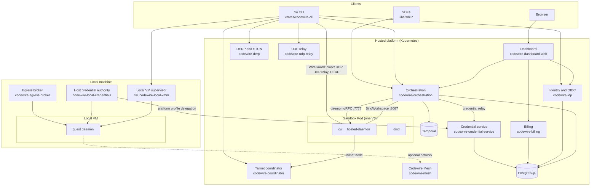

# Codewire specification

This is the one current specification of what Codewire is and how it behaves,
as shipped on `main`. It is written for an engineer or self-hoster who is new
to the system. It describes behaviour the code enforces; plans and proposals
are not here. Where a detail has its own document, this page states the
contract and links there.

How this page relates to the others: [README.md](README.md) is the front door;
[docs/ARCHITECTURE.md](docs/ARCHITECTURE.md) describes how the hosted platform
is put together on Kubernetes; [docs/GLOSSARY.md](docs/GLOSSARY.md) defines the
vocabulary this page uses; [docs/README.md](docs/README.md) is the map of every
other document.

Contents:

1. [What Codewire is](#1-what-codewire-is)
2. [Product model](#2-product-model)
3. [Components](#3-components)
4. [Hosted sandboxes](#4-hosted-sandboxes)
5. [Local VMs and trusted hosts](#5-local-vms-and-trusted-hosts)
6. [Contracts](#6-contracts)
7. [Access paths](#7-access-paths)
8. [Security model](#8-security-model)
9. [Configuration for self-hosting](#9-configuration-for-self-hosting)
10. [Delivery and verification](#10-delivery-and-verification)

## 1. What Codewire is

Codewire gives a developer or an AI coding agent an isolated development
machine: a Linux environment with persistent storage, durable terminal and
agent sessions, Docker, and access over SSH, a browser terminal, file transfer
and preview URLs. Each environment runs in its own hardware-virtualized VM with
its own kernel, because agents run untrusted code and a shared kernel would make
one exploit reach every environment on a node. The hypervisor boundary is the
security boundary.

One CLI, `cw`, drives every environment wherever it runs. One daemon, the same
`cw` binary in a private mode, runs inside every environment. The platform
services, the dashboard, the CLI, the local VM runtime, the documentation site
and the SDKs are all in this repository, under AGPL-3.0-only.

## 2. Product model

The vocabulary below is canonical; [docs/GLOSSARY.md](docs/GLOSSARY.md) has
the definitions and the words to avoid.

### Organizations and members

An **organization** is the account boundary for billing, membership,
organization secrets and hosted environment ownership. A user belongs to
organizations with a role; a hosted environment belongs to exactly one
organization and counts toward its plan. A `cw_` **API key** is bound to
exactly one organization and never inherits its owner's account-wide
authority ([docs/dev/AUTH-POLICY.md](docs/dev/AUTH-POLICY.md)).

### Environments

An **environment** is the product object: an isolated development machine with
a runtime image, workspace storage (`/workspace` and `/home/codewire`, which
survive a stop), CPU, memory and disk, sessions, ports and selected secret and
credential sources. Environment states are `pending`, `pending_build`,
`building`, `build_failed`, `pulling_snapshot`, `creating`, `starting`,
`running`, `stopping`, `stopped`, `archiving`, `archived`, `restoring`,
`resizing`, `destroying`, `destroyed`, `error` and `unknown`. A start of an
environment in `error` recovers it in both placements (#4953): a local VM's
runner first stops the failed VM it may still hold, as `cw stop` would, then
boots; a hosted Sandbox retries its create, which replaces a failed Pod. The
dashboard calls a hosted environment a **Sandbox**; it is the same object.

A `codewire.yaml` in the project describes an environment once (image,
repositories, setup, ports, kept folders, secrets and credential profile) and
either placement reads it (`crates/codewire-project` parses it). A local create
also merges the `codewire.local.yaml` beside it, for personal and local VM
settings; a cloud create never reads that file. Repeated `--file` merges the
named files in order: mappings merge by key, a later value or list replaces the
earlier one, and `null` removes a key.

A create form enters the same environment field by field: the dashboard's
Create Sandbox form and the iOS app's Create sheet. Their fields, limits and
refusal words are one set, in `codewire_project::create_input`, and
`codewire_project_proto::create_request` turns an accepted form into the
`CreateEnvironment` request, its project included; neither form keeps rules of
its own. `cw create` reads flags and `codewire.yaml` instead, with its own
lifetime syntax (`--ttl 1h30m`); every create meets the same project
validation and the server's checks.

### Placements

A **placement** is where an environment runs. The same `cw` commands work in
all three.

| Placement | Create | Runs on | Isolation | Daemon |
| --- | --- | --- | --- | --- |
| Hosted sandbox | `cw create --name app --image workspace` | the platform, on Kubernetes | one VM per environment (Kata Containers) | `cw __hosted-daemon` in the workspace container |
| Local VM | `cw create --local --name app --path .` | an x86_64 Linux machine (Cloud Hypervisor on KVM) or an Apple Silicon Mac (Virtualization.framework) | one VM per environment | the same guest daemon from the pinned runtime |
| Trusted host | `cw create --local --type host --name app --path .` | the user's machine, as their own user | none: process ownership only | a host daemon owned by the user |

A local VM needs no account. A trusted host session has no containment: an
agent there can read and change anything the user can. A
[host](#hosts) is a computer enrolled to run VMs for an organization;
`cw create --on host:NAME` places an environment on one, as a preview.

### Sessions and managed agents

A **session** is a process inside an environment: a shell, a command or a
managed agent conversation. The environment owns it, so it outlives the client
that launched it; session names are unique within an environment, and output is
retained across disconnects and across a stop and start
([docs/dev/CLI-ORCHESTRATION.md](docs/dev/CLI-ORCHESTRATION.md),
[docs/dev/TERMINAL-RETENTION.md](docs/dev/TERMINAL-RETENTION.md)). Stopping a
session ends it and every process it started, within a stated bound. Stopping
the environment stops its sessions; after a start, each one is restarted under
its own name with `cw restart ENV --session NAME`.

A **managed agent** (`cw run --agent codex|claude`, and `--agent noel` on a
trusted Linux host) is a conversation Codewire drives through the agent's own
protocol: `cw msg` sends a task, `cw inbox` lists messages and results,
`cw wait --message` returns one reply, `cw steer` and `cw interrupt` control a
turn where the client supports it. A conversation can launch workers under
itself with `--parent`; a worker's result is delivered once to its parent's
inbox. A managed agent runs the first `codex` or `claude` on the environment's
`PATH`, with no pinned version, in every placement. In a hosted sandbox or a
local VM it needs a credential profile with a provider for it; on a trusted
host it uses the user's own installed client and login.

### Application secrets and provider credentials

These are two product concepts with two boundaries
([docs/dev/SECRETS-AND-CREDENTIALS.md](docs/dev/SECRETS-AND-CREDENTIALS.md)).

- An **application secret** is a named value such as `DATABASE_URL`, stored in
  a user, organization or project source. Selecting a source for an environment
  (`--secrets`, `--user-secrets`, `--org-secrets`) projects its values into
  that environment's processes under their original names. Those processes and
  the environment's root can read them: Codewire does not promise secrecy from
  the workload itself.
- A **provider credential** is a named identity for Codex/OpenAI, Anthropic,
  GitHub or SSH. Its private material stays outside the environment. A
  **credential profile** selects identities, one per slot (`codex`, `openai`,
  `anthropic`, `ssh`; the user's GitHub connection is part of every profile).
  Selecting a profile authorizes a typed proxy, signer or repository executor,
  never raw material, except the direct delivery exceptions in
  [section 8](#8-security-model).
- Storing either does nothing by itself. No selected source means no
  application secrets; no profile means no provider access. Codewire never
  infers the category from a key's name or value, and never copies material
  between the local and platform stores.

Local values live in the Secret Service on Linux or the Keychain on macOS;
platform values live in the credential service's protected store. A local VM
may select local or platform sources; a hosted sandbox selects platform ones
only.

### Saved state vocabulary

- An **environment projection** is the set of child-visible values assembled
  for one process launch from the selected sources. It is ephemeral and
  restores nothing.
- A **snapshot** is saved state that can be reused or restored, always
  qualified ([GLOSSARY.md](docs/GLOSSARY.md#snapshot)). Two kinds ship:
  - a **skill snapshot**: immutable reusable skill content, seeded into a
    local VM's root disk by `crates/codewire-local-vmm`;
  - a **disk snapshot**: a stopped environment's disks, saved by `cw snapshot
    create` and forked into new environments by `cw create --snapshot`. It
    holds no memory. Hosted sandboxes have them (`--cloud`), and so do local
    VMs on Linux and on a Mac (#4654).

  Workspace and environment snapshots are reserved names and not implemented,
  and the `pulling_snapshot` state is defined in the contract but never
  entered. Workspace storage surviving a stop is not a snapshot. What each
  snapshot command does, and what it refuses, is in
  [docs/journeys/snapshots-and-forks.md](docs/journeys/snapshots-and-forks.md).
- A **VM checkpoint** is saved running-VM execution state: memory and device
  state, with the VM's disks ([GLOSSARY.md](docs/GLOSSARY.md#vm-checkpoint)).
  Local VMs on Linux and on a Mac have them: `cw checkpoint` creates, lists,
  inspects, restores and removes them, and `cw create --local --checkpoint`
  forks one into new environments with fresh identity. A checkpoint stays on
  the host that made it, and a Mac restores it only on the macOS build it was
  taken on (#4654). Hosted sandboxes have none.

## 3. Components

Everything in the product runtime is Rust. The control plane is a set of
service binaries on one shared chassis; the CLI, the in-environment daemon and
the local VM supervisor are one binary, `cw`.



### Control plane

| Component | Crate | Role |
| --- | --- | --- |
| Service chassis | `crates/codewire-server-core` | HTTP scaffold, authentication layer, request identity, error envelope, tracing, database and NATS helpers, the application migrations. Every service builds on it. |
| Identity | `crates/codewire-idp`, `crates/codewire-oidc`, `crates/codewire-email` | Accounts, passwords, TOTP, browser sessions, API keys and the OIDC/OAuth provider (discovery, PKCE, device flow, introspection, revocation; `codewire-oidc` is a standalone library); transactional email through SES. |
| Orchestration | `crates/codewire-orchestration` | The environment API, the Temporal worker and reconciler, the Kubernetes sandbox client, workspace binding, the credential relay, the terminal and SSH proxies, previews and admin. |
| Billing | `crates/codewire-billing` | Catalog, plans, Stripe and usage metering. |
| Credential service | `crates/codewire-credential-service`, `crates/codewire-credential-broker`, `crates/codewire-platform-credentials`, `crates/codewire-workload-secrets` | The isolated broker that holds platform provider material and application secrets and answers typed requests. |
| Tailnet | `crates/codewire-coordinator`, `crates/codewire-derp`, `crates/codewire-udp-relay`, `crates/codewire-tailnet` | Coordination of environment and client nodes, the DERP relay and STUN edge, the shared UDP relay, and the WireGuard transport library. |
| Codewire Mesh | `crates/codewire-mesh` | The network control plane for nodes that are not hosted sandboxes: local VMs and trusted hosts, with its own database. |
| Dashboard | `crates/codewire-dashboard-web`, `packages/codewire-design`, `apps/dashboard` | The server-rendered HTML dashboard (Askama templates, HTMX), its design system, image and browser tests. It is the backend-for-frontend: browser JavaScript holds no bearer token. It also serves `/docs`, the site built from `apps/docs/zola` (`CODEWIRE_DOCS_ROOT`), `/updates`, the posts of a configured Liminal CMS site (see [docs/CONFIGURATION.md](docs/CONFIGURATION.md#updates-page)), and the `install.sh` installer. |

PostgreSQL holds product state (two separate schema histories: the application
database and the Mesh database,
[docs/dev/DATABASE-MIGRATIONS.md](docs/dev/DATABASE-MIGRATIONS.md)). Temporal
runs the durable lifecycle workflows. NATS is used only for service-internal
fan-out where a service needs it.

### The `cw` binary

| Mode | Crate | Role |
| --- | --- | --- |
| CLI | `crates/codewire-cli`, `crates/codewire-cli-bin`, `crates/codewire-client` | Every user command, the OAuth client, the tailnet SSH client and the local VM supervisor. |
| Rust SDK | `crates/codewire` | The `codewire.v1` client: configuration, the Connect transport, bearer tokens, typed errors and every public service wrapper. `codewire-client` builds on it and re-exports it (#3511). |
| Hosted daemon | `crates/codewire-daemon`, `crates/codewire-workspace-access`, `crates/codewire-daemon-bridge` | `cw __hosted-daemon`: sessions, files, the SSH server, the tailnet peer and the credential bridge inside a hosted sandbox. |
| Guest daemon | the same crates | The daemon inside a local VM, from the runtime pack the release pins. |
| Release identity | `crates/codewire-cw-release` | The immutable version store behind the managed installation and `cw upgrade` ([docs/dev/CLI-MANAGED-INSTALL.md](docs/dev/CLI-MANAGED-INSTALL.md)). |

### Native apps

| Component | Crate | Role |
| --- | --- | --- |
| iOS app core | `crates/codewire-client-ffi` | The iOS app's Rust core behind UniFFI bindings for Swift (#3825): the shell, `codewire-client`'s hosted shell, the loop `cw shell` runs; and a create from the dashboard's create form rules (`codewire_project::create_input`), then `CreateEnvironment` and the setup wait `cw create` uses (`codewire_client::environment_setup::await_setup`), each row a step. Journey: [docs/journeys/ios-app.md](docs/journeys/ios-app.md). |

### Local VM runtime

| Component | Crate | Role |
| --- | --- | --- |
| Supervisor and runner | `crates/codewire-local-vmm` | Host-owned VM lifecycle: Cloud Hypervisor on Linux, the signed `codewire-vz-runner` helper on macOS (`crates/codewire-local-vmm/macos-vz-runner`). |
| Guest init | `crates/codewire-vmm-guest-probe` | The static guest init and daemon probe in the guest root. |
| Host credential authority | `crates/codewire-local-credentials`, `crates/codewire-credential-bridge`, `crates/codewire-protected-store` | The host-side broker, signer and repository executor for local credential profiles, and the delegation to the platform broker for platform profiles. |
| Network worker and egress | `crates/codewire-netstack`, `crates/codewire-egress-broker`, `crates/codewire-egress-policy`, `crates/codewire-egress-worker` | The confined packet worker and the egress broker that dials on the guest's behalf under a fixed policy. `codewire-egress-worker` holds both confined processes, the worker's session driver and the broker's control channel, for the local runtime and cw-egress. |
| Network session | `crates/codewire-network-session` | The authenticated session between an environment's guest and its host egress worker: the key, the hello, acknowledgement and ready handshake, and MAC-authenticated packet frames, shared by both halves (#4000). Its `hosted` module also holds a hosted sandbox's stream hello to cw-egress and the stream's key, which both ends use. |
| Confinement | `crates/codewire-confinement` | The process confinement the single-purpose host workers share: on Linux the single-thread check, capability and privilege locks, Landlock domains and seccomp deny lists; on macOS Seatbelt profiles. Also the parent's pre-exec isolation of a child it starts: inherited descriptors, the open-file limit and, on Linux, the parent-death signal and privilege lock. |
| Egress TLS front door | `crates/codewire-egress-front-door` | Terminates an environment's TLS to its bound egress hosts with a per-environment CA and hands each decrypted request to a caller's back end. Local HTTPS hostnames use its TLS serving, and a local VM boot that intercepts runs it in its own confined `cw __native-front-door` process, started by the runner before the seed is written, on Linux and macOS (#3999). |
| Egress front door bridge | `crates/codewire-egress-front-door-bridge` | A front door back end that maps a bound host and path to an existing transparent credential route and hands the request to the credential bridge unchanged. Its route hosts are the names a local VM boot with the `egress-intercept` switch on binds for interception; the front door process serves each request it is handed through the boot's credential broker (#3999). |
| Egress node | `crates/codewire-egress-node` | cw-egress, the per-node egress supervisor for hosted sandboxes (#4000): the per-Pod replacement limit, and the guest's stream hello and the stream's network key from the network session's `hosted` module; nothing runs it yet. |
| KVM device plugin | `crates/codewire-kvm-device-plugin` | cw-kvm-device-plugin, the node's device plugin for the `standard` runtime profile (#5602): it registers `codewire.sh/kvm` with the kubelet and has it add the node's `/dev/kvm`, read and write, to each container given one (`deployments/k8s/kvm-device-plugin`). Kind's overlays deploy it; Dev does not yet. |
| Disk scrub | `crates/codewire-ext4-scrub` | Clears every block of an ext4 disk its guest cannot read through the filesystem; a local snapshot's capture runs it on the copy of `state.raw`. |
| Prost redaction check | `crates/codewire-prost-debug-redact` | Build-time only: fails the build of a crate that generates protobuf types with prost (`codewire-daemon-proto`, `codewire-local-credentials`, `codewire-local-vmm`) when a message with a field marked `debug_redact` is missing from its `skip_debug` list, because prost's derived `Debug` ignores the option (#5034). |

### Images

`images/base` and `images/workspace` build the default workspace image (the
support pair), `images/cw-runtime` the `cw` runtime pack that runs inside a
local VM, and the daemon (support) image carries `cw` for hosted sandboxes.
`crates/codewire-workspace-image` holds the published workspace image pin.

The workspace image carries the coding agents at the versions in
`images/workspace/agents`, installed from one reviewed lockfile into a
read-only tree outside the home. Those versions are where an environment
starts, and the fallback. An environment runs the agents' newest release
(#4946): on first use the image's `claude` installs Claude Code's own
self-updating build in the home, the other agents' upgrades land in the home
too, and `PATH` prefers the home's copies, in a local VM and a hosted sandbox
alike. The Claude Code build an environment runs is fetched from its vendor at
first use and updates itself, and is not covered by Codewire's lockfile,
licence or advisory checks.

Target, not shipped (#3223): the workspace image carries a graphical desktop
as an inert layer: an X server that is also a VNC server (`Xvnc`), an XFCE
session, `xdotool` and `scrot`, and the launcher that starts them, from the
same dated package snapshot as the rest of the image. It also carries
Chromium, Debian's open-source build from a dated, signed snapshot, with its
sandbox always on, and Codewire's look for the desktop. Nothing in the layer
runs or listens until an environment's desktop is started
([Desktop](#desktop)).

## 4. Hosted sandboxes

[docs/ARCHITECTURE.md](docs/ARCHITECTURE.md) describes the Kubernetes shape in
detail; this section states the contract.

- **One Pod per environment**, created through the kubernetes-sigs
  `agent-sandbox` CRDs (`SandboxTemplate`, `SandboxClaim`, `Sandbox`,
  `SandboxWarmPool`) by orchestration's sandbox client. The Pod holds a
  `workspace` container running the user's image and a guest-local `dind`
  container. The node's container runtime socket is never mounted or proxied
  into a sandbox.
- **A runtime profile** selects the RuntimeClass: `commodity` is Kata
  Containers with Cloud Hypervisor and the normal profile; `confidential` is
  Kata with QEMU-SNP on eligible nodes; `runc` and `none` are diagnostic only
  and refused for managed creation unless
  `SANDBOX_ALLOW_DIAGNOSTIC_RUNTIME=true`
  ([docs/dev/CODEWIRE-GUARD-RUNTIME-PROFILES.md](docs/dev/CODEWIRE-GUARD-RUNTIME-PROFILES.md)).
- **The daemon binds before it listens.** The workspace Pod carries no
  environment identity, only a Pod-bound projected token with audience
  `codewire.internal.workspace-binding.v1`. The daemon long-polls
  `BindWorkspace` on orchestration's internal TLS listener (8087), receives
  its binding and access grant, and only then serves its gRPC service on
  7777, SSH on 2222 and the tailnet on UDP 31000
  ([docs/dev/SANDBOX-DAEMON.md](docs/dev/SANDBOX-DAEMON.md)). Every daemon
  RPC requires the bound Pod's daemon credential in the
  `x-codewire-daemon-token` header.
- **Lifecycle** is a set of desired states (`started`, `stopped`,
  `destroyed`, `archived`, `resized`) that the orchestration worker reconciles
  through Temporal. Every Start re-pins the Sandbox's daemon to the configured
  support image, except for confidential Sandboxes, whose attested Pod policy
  admits exactly the containers they were rendered with.
- **Docker** inside a sandbox is a daemon inside the same VM
  (`DOCKER_HOST=unix:///var/run/docker/docker.sock`), never the node's.
- **Previews** are HTTPS URLs that orchestration forwards to one application
  port; ports 2222, 5901 and 9222 are reserved
  ([docs/dev/SANDBOX-PREVIEWS.md](docs/dev/SANDBOX-PREVIEWS.md)).

Target, not shipped (#5602): a third managed runtime profile, `standard`,
runs the environment in a VM that Codewire's own runtime starts inside the
Pod: the supervisor, Cloud Hypervisor and guest that run a local VM
([section 5](#5-local-vms-and-trusted-hosts)). Kata is not involved.

- **The Pod** holds one container, `workspace`, running Codewire's runtime
  image at a pinned digest on the node's ordinary container runtime. It does
  not run as root, has no capabilities and no privilege escalation, and gets
  `/dev/kvm` from the node and nothing else. There is no `dind` container
  and no init container.
- **Inside the VM** run the user's image, Docker and the same daemon as on
  `commodity`. The daemon binds before it listens, holds the Sandbox's
  tokens, and serves 7777, 2222 and the tailnet.
- **The supervisor** in the container boots the VM, hands it the Pod's
  settings, keeps the VM's copies of the projected tokens fresh, forwards
  7777 and 2222 from the Pod's address to the daemon, and powers the guest
  off when the Pod is told to stop. The tailnet uses its relays; the direct
  UDP path is later work.
- **The VM has no network device.** Its traffic leaves through the
  supervisor to cw-egress on the node, which decides every destination, so
  `standard` is offered only where hosted egress (#4000) is on.
- **The workspace image** reaches the VM as a read-only disk that the node
  pulls and caches like any image and every Sandbox on the node shares. Each
  VM adds a small writable root that is rebuilt at every start. The home and
  the workspace persist on the Sandbox's volume, as on `commodity`.
- **Beside the other profiles.** `commodity` and `confidential` do not
  change. A profile is chosen for an organization, an environment keeps the
  profile it was created on, and nothing is converted. Until `standard` can
  run a user's own image, an environment that names one is created on
  `commodity`.
- **Not on `standard` at first:** a user's own image, private images, and
  snapshots and forks.

The Guard rules for this profile are in
[docs/dev/CODEWIRE-GUARD-RUNTIME-PROFILES.md](docs/dev/CODEWIRE-GUARD-RUNTIME-PROFILES.md),
and its walk is
[docs/journeys/standard-runtime.md](docs/journeys/standard-runtime.md).

## 5. Local VMs and trusted hosts

### Runtime

A release's `cw` pins its local VM runtime by digest. `cw setup --local`
downloads exactly those files from the release origin, checks each one and
installs them under `~/.cache/codewire/local-vmm-v1/`: Cloud Hypervisor and
virtiofsd (Linux) or the signed `codewire-vz-runner` helper (macOS), the
Codewire guest kernel, the guest root (guest init, BusyBox, runc), and the
sealed `cw` runtime pack that runs sessions and managed agents inside the VM.
Creating or starting a VM installs a missing or foreign runtime first; running
VMs keep the runtime they started with
([docs/dev/LINUX-LOCAL-VMS.md](docs/dev/LINUX-LOCAL-VMS.md),
[docs/dev/MACOS-CLI.md](docs/dev/MACOS-CLI.md)).

Host requirements on Linux: x86_64, KVM, vhost-vsock, Linux 6.2 or later with
Landlock, e2fsprogs, and a Secret Service for local values; `cw` refuses to
run local VMs as root. On macOS: Apple Silicon, macOS 26 or later; the runtime
ships its own e2fsprogs and git, and the helper must be signed with the
virtualization entitlement.

### Supervisor

One supervisor process per user (`cw __native-supervisor`) owns local VM
lifecycle, state and host ports. Its state is one SQLite database,
`supervisor.db`, in the state root (`~/.codewire/native-v1` by default,
`CODEWIRE_NATIVE_STATE_ROOT` overrides it). `cw` talks to it over gRPC on a
Unix socket under `/tmp/cw-<uid>/` whose directory is mode 0700 and whose
socket is 0600, and the supervisor checks every connection's peer uid
(`crates/codewire-local-vmm/src/uds.rs`).

The protocol is `LocalSupervisorService` in
`crates/codewire-local-vmm/proto/codewire/local/v1/control.proto`. A `cw`
carries a native protocol version and a minimum it accepts
(`NATIVE_SUPERVISOR_PROTOCOL_VERSION` and
`MINIMUM_SUPERVISOR_PROTOCOL_VERSION` in
`crates/codewire-local-vmm/src/supervisor_config.rs`; features such as SSH
are gated on the version a supervisor reports). After `cw upgrade`, the
previous `cw`'s supervisor keeps serving the VMs that still run; the new `cw`
uses it for everything that does not boot or reconfigure a VM, refuses those
while the old supervisor may still run a VM, and retires it and takes over by
itself once no VM runs. A supervisor outside the accepted range (older than
v0.3.388's, or a newer one after `cw upgrade rollback`) is refused with a
message that names it. `cw upgrade --vms` stops each VM through the old
supervisor, has it hand over the state root, and starts each VM again on the
new `cw`; the flag is the user's consent, because a restart ends the work
running in them.

### Workspace

`--path` (default: the current directory) with `--path-mode mount|copy|clone|empty`.
`mount`, the default, shares the directory live and read-write through
virtio-fs; `copy` copies it once as it is; `clone` contains only the committed
tree at `HEAD`; `empty` starts empty. The VM can change anything in a mounted
directory, `.git` included, so Git hooks and settings it writes there run on
the host the next time the user runs git in that folder. This is accepted
(owner, 2026-11-10, #4004); `clone` is the mode for untrusted workloads.
Pulling a VM's commits brings no hooks or git config; copying a repository's
`.git` directory out of a VM with `cw cp` does, so copy files or pull commits
instead. The share policy refuses the home
directory itself, anything containing it, top-level system directories and
credential stores. Folders matching `workspace.vm_only` (default `node_modules`,
`target`, `.venv`) are bound to the VM's disk over the live mount. A dedicated
Docker data disk (8 GiB by default) is attached for `/var/lib/docker`.

A create takes the workspace image from the supervisor's content store when it
can. If the image is named by digest, and that document and every blob it names
are already stored and verified, the create uses them without the network, and its
image step reads "Using the cached image". Any part that is missing is fetched
alone. A tag is always resolved with the registry, because a tag can move. A
create that can't reach the registry for a tag says that it asked the registry
for the tag (#4968).

### Networking and egress

The VM has no network device. Inside the guest a TUN device carries raw IP
over a vsock port to the host, where the confined network worker
(`cw __native-network-worker`, on `crates/codewire-netstack`) terminates the
guest's TCP and DNS and has no dial authority of its own. The egress broker
(`cw __native-egress-broker`, on `crates/codewire-egress-broker`) dials on the
guest's behalf under the VM's selected network policy, from
`crates/codewire-egress-policy`. The default is the built-in `open` (deny
first; DNS on 53 and TCP to ports 22, 80 and 443 of public addresses). The
other built-in, `locked`, allows nothing, except that a selected model
credential still reaches its provider, as the interception paragraph below
says (#5215).
`cw create --local --policy REF` and `cw update ENV --policy REF` select
another, built-in or named, and an edit to a selected policy applies to the
running VMs that select it (#3378, #3386). Loopback, private, link-local and
metadata ranges, the host's own interface addresses and the public address the
host is seen from are always refused under every policy, with an immediate
reset. Both processes run under Landlock and seccomp on Linux and under
Seatbelt on macOS; losing either fails the environment closed (`error`), and a
stop and start restores egress. The state keeps which process ended and how:
`cw info` names its exit status and what that status means, as the process's
own exit codes define it (#4953). An answer from the broker that misses the
worker's deadline refuses only its own lookup or connection: the worker keeps
the session until the late answer arrives and checks it, so a slow resolver or
a stalled broker never ends the broker or fails the environment (#4948). While
the broker is past that deadline the VM stays `running` with egress refused,
and `cw info` and `cw doctor` say so, with how long it has refused, until a
request is answered again; `cw info` names stopping and starting the VM, which
restarts the broker, as the next step (#4965). A malformed or unauthenticated
answer still ends the broker. Published ports listen on
`127.0.0.1` only. A
local VM joins Codewire Mesh only when a network is selected at creation; the
host owns the Mesh identity and the VM sees only admitted streams for its
declared ports.

Target, not shipped (#3999): for an agent's provider hosts the broker hands
the connection to a TLS front door, one process per VM, instead of dialling.
The front door is confined to no filesystem, no new sockets and no process
creation, and holds only the descriptors it inherits: by Landlock and
seccomp on Linux, and by a Seatbelt profile on macOS.
A front door that ends without a stop being asked for is not restarted: from
then on every intercepted connection is refused at once, the VM keeps
running, and `cw --local info` and `cw doctor` say that its agents can't
reach their providers and that `cw --local restart NAME` restores them; the
JSON carries `"interception": {"state": "lost"}` (#5216, the `lost` state of
#4912).
What an agent sends to its provider is not documented and changes
between releases, so a compatibility test runs the real Claude Code against a
stand-in provider (#4925): for the image's version when that version or a
login file Codewire writes changes, and on a schedule for the newest release,
which is the one environments run (#4946).
On an intercepted host, only a request that carries the environment's
placeholder on a path its route serves is served whatever the network
policy's default. A placeholder on a path the route does not serve is refused
before any lease, whatever the policy. Every other request to that host
follows the policy as if the host were not intercepted:
a rule that allows it lets it through untouched, and without one it is
refused and counted. That answer is for the host the forward would dial, the
route's own provider origin, never a name the request gives. The credential
broker that serves or forwards these requests never sees the policy. On a
local VM the supervisor, which holds the policy, gives the broker its answer
for each bound host when it starts. Nothing the front door or the request
carries can change it, an absent answer is a refusal, and a policy edit
restarts the broker with the new answer. On hosted, nobody gives an answer:
the broker runs in the platform, where an untouched forward would leave past
the Sandbox's own policy and cw-egress, so by its own rule it refuses every
such request, whatever the policy, until one can leave through the Sandbox's
own egress. A refused request gets the same answer whether it carried no
credential, the user's own key or another environment's placeholder, and
nothing is dialled; one with no placeholder-shaped value is refused before
any lease (#5555). Codex's routed workspace origins, one label under
`chatgpt.com`, can't be named ahead, so for them the supervisor's answer is
whether a rule covers every such name (`*.chatgpt.com`): it asks the policy
about a fresh random name under the suffix each time, so a rule for one name
never counts. An exact rule for one routed name doesn't let an untouched
forward through until the egress broker's signed decision reaches the
credential broker (#4931). A deny rule on a routed name refuses its
connection at the egress broker, before any hand-off. The wildcard arrives
with the per-host answer itself, at local authority protocol 27: an authority
from before ignores the whole answer, so the supervisor starts no
intercepting broker from one unless the policy allows every bound host and
every routed suffix. A deny rule on the host refuses everything to it. A
selected credential acts on the user's own account at its provider, which no
network policy limits. The managed GitHub credential is the exception: it is
served only where a rule allows the GitHub hosts, because its grant cannot be
limited to an environment's own repositories.

Target, not shipped (#5058): `cw --local policy log ENV` shows what a running
local VM has had refused since it started, most recently seen first. Rows fold
by destination, protocol, port and reason, so TCP and UDP to one port are two
rows, and each row says: the name, or the address where no name leads to it;
the latest address seen; the protocol and the port; the reason; the policy and
revision it was last refused under; when it was first and last seen; and how
many times. A refused lookup is a `dns` row with no port and usually no
address, printed as `-` (JSON `null`). The rows come from two sources, with
the reason codes of "Refusals an agent or a person can read" in
`docs/dev/SECRETS-AND-CREDENTIALS.md`:

- the egress broker's refusals of a lookup or a connection, with the raw
  `RefusalReason`, so the owner sees `protected_address` and
  `intercept_unavailable` where the guest sees only not allowed or
  unavailable. Its record log (`crates/codewire-egress-policy/src/record.rs`)
  also keeps passes while learn mode runs (#4015); the broker sends only
  refusals, so the owner's log never shows a pass;
- the credential broker's refusals of a request on an intercepted host, with
  the reason the agent received. A row names the route's bound host and its
  port, never the request's `Host` header, path, other headers, body or
  credential, so a crafted request can't put another name in the log. A
  request refused by the network policy carries the label of the answer the
  supervisor gave the broker for that host, which names the policy and
  revision it was decided under; a host the broker was given no answer for
  reads `unavailable`, with `-` for the policy.

The workload chooses the hosts and the volume, so each broker folds its
refusals before it reports and sends the rows that changed at most once a
second: the egress broker on its control channel to the runner, the
credential broker over the connection to the runner it already holds. A
host hammered with refused requests raises a count, never the size of the
log or the rate of frames. That connection is paired with this boot's runner
by the secret the runner minted for it, so the runner files every report
under the boot it serves and never under an environment a report names; a
report naming another environment is refused. The runner keeps the
environment's one merged log, bounded at 1,000 rows with the row seen least
recently dropped, and the log says when it dropped rows (`--output json`
gives `dropped`, the number of rows dropped since the VM started). Every
host is checked before it is stored or printed: ASCII only (an
international name in its IDNA form), at most 253 characters, and no
control or escape character.
A host that fails the check is kept as one row, `(a name cw won't show)`,
with its reason and count and never its text, so a host can never carry a
terminal sequence to the owner's screen. The supervisor reads the log through
a new read on `LocalSupervisorService` behind its own supervisor feature, so
an older supervisor says it can't show the log. The log is in memory only and
lasts one run of the VM: a stop, a restart or a restore starts it empty, and
on a VM that isn't running the command says so. Only the owner's socket
reads it; the view inside the environment (#4015) is the protected
projection, `guest_records`, and the two share no code path that could widen
what the guest sees. `cw info ENV` adds one line: how many requests were
refused since the VM started and when the last was, naming `cw --local policy log
ENV`; the rows keep counts, not a time series, so it can't count by hour.
`cw --cloud policy log` for a hosted Sandbox stays with #4000.

Target, not shipped (#5114, #5116, #5117): the dashboard's Network policies
page lists an organization's policies, each with its revision, its rules and
the number of Sandboxes that select it; hovering, focusing or tapping that
number names up to ten of them. Owners and admins create, edit, check and
delete policies there, and members read them, under the store's own rules
and refusals. A Sandbox's page shows its policy, revision and enforcement
state under Network access, and lets the Sandbox's creator choose another
policy without a restart; later it lists what was refused, with a one-step
Allow. While hosted Sandboxes do not enforce network policies, each of these
pages says so. The dashboard never shows a local policy: those live on the
user's computer. A page learns of a new revision, an enforcement change or a
refusal from the live event stream, never by polling; those events are part
of #5114, #5116 and #5117, and none exists yet.

A Mesh node is online only while it holds a live coordinator session that
Mesh has heard from in the last 45 s. Every Mesh client pings every 15 s, so a
node that goes silent shows offline within 45 s; Mesh records when it last
heard from each node. Silence never ends a session: a local VM's transport
cannot rejoin within its generation, so a node waking from a sleep keeps its
session and shows online again. The live sessions are in Mesh's memory, which is
complete only while Mesh runs one replica; more replicas would need that
record in the Mesh database. Who may revoke a node (#2697): a network owner,
any node; a member, only a node recorded as their own, such as a local VM they
attached. A hosted environment's node belongs to its environment: a member
cannot revoke it, and it leaves the network when the environment is destroyed.
The client that deletes a Mesh-attached local environment revokes its node,
once the removal is confirmed, with the credential of the attachment's own
owner store (`cw --local rm` does); the supervisor never holds that
credential. A failed revoke leaves the removal done and the exit status
unchanged: the node shows offline, and `cw` prints the exact
`cw network revoke` command that removes it.

Target, not shipped (#5115, #5118, #5119): a Sandbox's page in the
dashboard names its Mesh Network and whether it joined, in the words `cw info`
uses for each attachment state and failure. The Mesh Networks page lists an
organization's Mesh Networks and their nodes: whether each is online and when
Mesh last heard from it. It creates Mesh Networks and invite codes, revokes
nodes under the rules above, and deletes a Mesh Network that has no nodes.
The Sandbox create form chooses a Mesh Network. Online means the node holds a
live session with Mesh; the dashboard never claims that two nodes reach each
other. A page learns that a node or an attachment changed from the live event
stream, never by polling; those events are part of #5115 and #5118, and none
exists yet.

### Credentials on the host

The local credential authority (`cw __local-credential-authority`, on
`crates/codewire-local-credentials`) holds credential metadata in
`~/.codewire/credentials-v1` and the material in the OS protected store
(`crates/codewire-protected-store`: the Secret Service on Linux, the login
Keychain or owner-only files on macOS). The supervisor never links or owns that
authority. One broker (`cw __local-credential-broker`) per VM generation reads
an admitted value from the store, reaches the guest daemon's credential bridge
over vsock, and injects the selected credential into the provider requests the
guest sends to the daemon's loopback ingress. SSH signatures are made on the
host and only signatures cross; a GitHub or SSH repository is checked out on
the host by the repository executor. For a platform profile the broker runs as
a relay that reads no store and dials no provider: the host opens an
owner-authenticated delegation to the platform broker, which performs the
provider operations, and no platform provider material is copied to the host
or the VM. A local profile holds the owner's Codex sign-in and Claude
sign-in as a platform profile does; a Claude subscription token is still a
platform credential only. The `open`
egress policy still lets the guest open TCP 443 to a provider directly, so the
broker keeps the credential out of the workload but does not enforce provider
mediation.

### Trusted host

`--type host` runs sessions as the user's own account with their ordinary
`HOME` and tools, through the ordinary environment daemon started natively by
that user, with no VM and no credential bridge, over an owner-private
`daemon.sock` in its state directory (`~/.local/state/codewire/hosts/<id>/`
by default; `CW_HOST_DATA_DIR` overrides it). VM, secret and network flags are
refused. Codewire provides owned process cleanup only. Stop and remove retire
the daemon's runtime and keep the project directory. Linux and macOS are the
admitted hosts.

### Hosts

A **host** is a computer that a member enrolls to run Codewire VMs for their
organization, through the same local VM runtime and supervisor as `cw
--local`. It is not a trusted host: its environments are VMs. Hosts are a
preview (#3609): a host enrolls, connects and shows its state, and an
environment can be created, stopped, started and deleted on one. Reaching
that environment (`cw run`, `cw shell`, `cw exec`) is not built yet, and the
lifecycle on a host has not been observed working yet
([docs/journeys/hosts.md](docs/journeys/hosts.md)). The user guide is
`apps/docs/zola/content/environments/hosts.md`; the commands are in
`reference/cli/hosts.md` beside it.

- **Record.** `cw host enroll` (`HostService.EnrollHost`, `proto/codewire/v1/host.proto`)
  creates an Ed25519 key on the computer and registers its public key; the
  private key never leaves the computer. A host belongs to one organization and
  one owner, has a platform (`linux-x86_64-kvm` or `darwin-arm64-vz`), and its
  name is unique among the organization's hosts that are not revoked. A key
  belongs to one host record ever (migration `0015_hosts.sql`). The key is
  kept in the OS keyring (Secret Service, Keychain), or, on a Linux computer
  with no Secret Service, in a file only the user can read; the local
  enrollment beside it holds no secret.
- **Who may use it.** Enrolling grants nothing. The owner offers VMs with
  `cw host provide` (at least a maximum VM count; vCPU, memory and disk caps
  are optional) and lets named members or the whole organization place
  environments on it with `cw host grant`. A grant never follows from
  membership alone.
- **The session.** `cw host run` is the host agent. It opens one outbound
  HTTPS stream, `HostAgentService.AttachHost` (`proto/codewire/v1/host_agent.proto`),
  and nothing connects in to a host. The stream carries no bearer credential:
  the host opens with its ID, the control plane answers with a fresh nonce,
  and the host signs `codewire-host-attach-v1`, its ID and the nonce with its
  key, within 10 seconds of opening. The control plane pings every 15 seconds,
  asks for a new proof every 10 minutes (30 seconds to answer), and ends a
  session the host has gone quiet on. A host unheard for 45 seconds shows as
  offline. The agent connects again by itself, through `HTTPS_PROXY` when it is
  set. `OpenHostTunnel` is in the contract and refused until a later slice uses
  it.
- **Placing an environment.** `cw create --on host:NAME` sends the host
  (`CreateEnvironmentRequest.placement`) and a request ID, which makes a retry
  of that create return the first environment. The create is admitted under
  the organization's row lock: only the host's owner, a member it is granted
  to, or any member under an organization grant may place on it; the host
  must be offering VMs, online, running an agent that takes lifecycle
  operations, and have room within its owner's limits. A host environment
  starts with an empty workspace on the host's own runtime image: another
  image, repositories, application secrets, a credential profile, a Mesh
  network, a network policy, a hosted snapshot and the confidential tier are
  each refused by name. It counts toward the organization's environment
  limits and takes no credit and no platform CPU or memory.
- **Lifecycle on a host.** The environment's row names its backend
  (`environments.runtime_backend` is `host`), and the one lifecycle workflow
  runs each step on the host instead of the cluster. A step is one operation
  in `host_operations`, sent down the host's session and run by the agent
  through the local VM supervisor. The operation's ID is the supervisor's
  request ID, so an operation sent again after a lost reply is answered with
  its first result and never makes a second VM. A step waits at most 25
  minutes for the host's answer, then the environment is in error saying the
  host didn't answer. A host's own failure message is shown as one bounded
  line. Resize is refused for now.
- **Running the agent.** `cw host service install` keeps it running as a user
  service: systemd `--user` on Linux, a LaunchAgent on macOS. On Linux it
  names `loginctl enable-linger` when linger is off, which keeps the agent
  running while the user is logged out and starts it at boot.
- **Seen from anywhere.** `cw hosts` and the dashboard's Hosts page list the
  organization's hosts with their state, revoked ones included.
- **Ending.** `cw host revoke` (the owner, or an organization owner or admin)
  is final: the session is told and ended at its next message, the record
  stays, and its key can never be enrolled again. Revoking ends the
  operations the host has not finished, so nothing waits for it, and
  deleting an environment on a revoked host ends deleted without reaching
  the host. `cw host leave` removes this
  computer's host: its record unless revoked, its key, its service and the
  local enrollment.

The journey, with what has been observed on Dev, is
[docs/journeys/hosts.md](docs/journeys/hosts.md).

## 6. Contracts

| Contract | Source | Served as | Generated into |
| --- | --- | --- | --- |
| Control-plane API | `proto/codewire/v1` (public, strictest stability); `proto/codewire/console/v1` (the first-party dashboard surface); `proto/codewire/internal/v1` (workspace binding, coordination, Mesh authorization); `proto/codewire/testing/v1` (a never-routed conformance probe) | Connect-RPC by the platform services | `crates/codewire-proto` (Rust), `packages/codewire-proto-ts` and `libs/sdk-ts` (TypeScript), `libs/gen-go` and `libs/sdk-go` (Go), `libs/gen-python` and `libs/sdk-python` (Python) |
| Admin API | `proto/codewire/admin/v1` | Connect-RPC | `crates/codewire-admin-proto` |
| Daemon, bridge and broker | `libs/daemon-proto/proto/daemon/v1/daemon.proto` and the bridge and broker protos beside it; `proto/codewire/bridge/v1` | gRPC (tonic) between orchestration, the daemon, the credential relay and the brokers | `crates/codewire-daemon-proto` |
| Local VM supervisor | `crates/codewire-local-vmm/proto/codewire/local/v1/control.proto` | gRPC over the owner-only Unix socket ([section 5](#5-local-vms-and-trusted-hosts)) | `crates/codewire-local-vmm` |

Authoring rules, the error model and the codegen are in
[docs/dev/PROTO-STYLE.md](docs/dev/PROTO-STYLE.md). Buf generates the Go,
Python and TypeScript code for every package under `proto/codewire`, not only
the public one; the SDKs in `libs/sdk-*` are hand-written on top of them. The
two Connect contract crates compile their descriptor sets from `proto/` in
their build scripts, with a Rust compiler that `Cargo.lock` pins, so they need
no `protoc` or `buf` and nothing generated for them is checked in (#4950).
`crates/codewire-daemon-proto` compiles its protos at build time with
`protoc`, which is why a source build needs it. `make proto-drift-check`
regenerates the Go, Python and TypeScript trees and fails when they differ
from what is committed; CI runs the same check, and also holds the Rust
descriptor sets to the pinned `buf`'s. Public and generated contracts ship
with their generated clients, wrappers and tests in one change.

`daemon.v1` (`DaemonService`, `HostControlService`, `PlatformManagedService`)
is the compatibility contract between a `cw` client and the daemon of any
environment; `broker.v1` (`CredentialBrokerService`) is the broker side of
the credential bridge. The daemon's protocol version and the minimum it
accepts are `DAEMON_PROTOCOL_VERSION` and `DAEMON_MINIMUM_PROTOCOL_VERSION`
in `crates/codewire-daemon-proto/src/lib.rs`, with named capabilities such as
`exec.v1` and `pty.v1`. A client sends its version and required capabilities
in `GetCapabilities`; the daemon answers `upgrade_required` when the versions
do not overlap (naming which side to upgrade), `unsupported` when a required
capability is missing, and otherwise its runtime state (`starting`,
`unhealthy`, ready). The retired WebSocket session and HTTP file APIs do not
exist. The local credential authority has its own gRPC contract in
`crates/codewire-local-credentials/proto`.

Authentication has four credential flavors: the browser session cookie, the
OAuth user bearer (PKCE with a system browser, the device grant without one),
the organization-bound `cw_` API key, and the platform-internal HMAC service
token. Kubernetes supplies the separate Pod-bound identity a daemon uses to
fetch its binding ([docs/dev/AUTH-POLICY.md](docs/dev/AUTH-POLICY.md)).

## 7. Access paths

### SSH to a hosted sandbox

The daemon's SSH server (SFTP and SCP included) listens on port 2222 inside the
Pod and is reached over the environment's tailnet node:

```text
cw / OpenSSH / VS Code
  -> WireGuard to the daemon's SSH server
       direct UDP  ->  shared UDP relay  ->  DERP (TCP)
  -> WebSocket SSH proxy through orchestration (last resort)
```

The client publishes its node to the coordinator, dials SSH as soon as the
environment peer arrives, and WireGuard rides DERP until disco proves direct
UDP or the UDP relay; the transport then moves under the open stream without
reconnecting. A client stays one peer of the daemon while its coordinator
session reconnects: the coordinator names nodes by session, and the daemon
takes a newer announcement of the same node key in place of the older, so the
client's address keeps routing to it and its open stream continues (#5120). The coordinator binds each node key to its principal and environment, refuses the key to anyone else, retires a reconnecting peer's older session, and ends a session that has been silent for 45 s ([docs/dev/DERP-STUN.md](docs/dev/DERP-STUN.md#coordinator-sessions-and-node-keys)). The daemon's Ed25519 host key is generated per binding, never
leaves the VM, and only its public line is recorded with orchestration,
write-once. `cw setup ssh` writes an OpenSSH block whose `KnownHostsCommand`
asks the platform for that key, so there is no trust-on-first-use, and turns
off agent and X11 forwarding and every SSH authentication method: admission
happens before traffic reaches the server, in orchestration's SSH proxy or the
tailnet coordinator ([docs/dev/DERP-STUN.md](docs/dev/DERP-STUN.md)).
`cw doctor tailnet ENV` reports which transport was selected.

### SSH to a local VM

A local VM has no network device and no tailnet node by default. SSH
terminates in the host supervisor: `cw --local shell --stdio ENV` is the
OpenSSH `ProxyCommand`, it opens an SSH stream to the supervisor over the
owner-only socket (`OpenEnvironmentSshStream`), and the supervisor runs the
session through the environment's guest daemon over vsock, so nothing listens
for SSH anywhere (`crates/codewire-local-vmm/src/supervisor/ssh.rs`). Host
keys live under the supervisor root. `cw setup ssh` writes both alias
families, `cw-cloud-*` and `cw-local-*`, and `cw ssh known-hosts` answers for a
local VM with the key its supervisor holds.

### Port forwarding over SSH

A local forward (`ssh -L`, or a port an editor forwards) through either alias
reaches only the environment's own loopback: the target is `localhost` or a
literal loopback address, never a name to resolve, and a port the platform
holds there is refused by name (the daemon's SSH server, the credential
bridge and, in a hosted Sandbox, the daemon itself). A hosted Sandbox's SSH
server dials the workload's loopback; a local VM's supervisor opens the guest
daemon's `ForwardTcp`, which applies the same rule again, and refuses every
forward when the VM's runtime predates it. The server refuses remote
forwards, and the managed block turns agent and X11 forwarding off.

A Unix-socket forward (`ssh -L LOCAL.sock:REMOTE.sock`, OpenSSH's
`direct-streamlocal@openssh.com`) reaches the socket at `REMOTE.sock` as a
process of the workload user would (#5608). It is served on the same
connections as TCP forwards, each of which may also open a shell, and never on
a smaller grant. The target is an absolute path of at most 107 bytes; relative
paths, abstract names (`@…`) and remote socket forwards (`ssh -R`) are
refused. The whole lookup and the connect run as the workload user, with its
uid, gid and groups, inside the workload's own filesystem, so the kernel's
permission checks are the workload user's and the server's peer credentials
name it. Any socket that user can reach is reachable, the environment's Docker
socket included: a client forwarding it drives that Docker, which is root
inside the environment. A hosted Sandbox's SSH server, which runs as the
workload user, connects itself; a local VM's supervisor opens the guest
daemon's `ForwardUnix`, which makes the connection from a workload process: a
helper started the way every workload process is, so it has the workload
user's identity, capabilities and namespaces and sees the container's own
mounts, with no terminal, a fixed working directory and none of the secrets
ordinary workload processes are given. The root daemon never changes its own
credentials. Once connected, the helper relays the forward's bytes over its
standard input and output, so they pass through a workload process, and no
descriptor crosses to the root daemon. Since the workload controls that
helper, the daemon trusts nothing it says: it accepts one status line, bounded
in bytes and in time, from a fixed set of codes, and tells the client and the
log only its own words; and it kills the helper's process group when the
status does not come within the forward's ten seconds, and once the forward
closes or the connection ends, as soon as what the client already sent has
reached the socket, and at most ten seconds later: five for the client's side
to finish, and five for the daemon to write what it received. A VM whose
runtime predates `ForwardUnix` refuses every socket forward. Each forward,
opened or refused, is logged with the reason and its target path escaped and
bounded.

The platform's own sockets in the workload are refused, by identity, not by
name: each one's device and inode are recorded as it is bound, and a target
that resolves to one of them, through a symlink or a hard link included, is
refused, naming it; so is any target that resolves under the platform's own
directories (`/codewire`, and `/run/codewire` and its `/run/codewire-*`
siblings), whatever its identity, except exactly `/run/codewire-docker`: that
is where a local VM keeps the environment's Docker socket, which forwards may
reach, so the client machine can then drive that Docker, which is root inside
the environment; nothing of the platform's is ever put there. Its sockets are
still checked by identity first. The path is opened, checked and connected
through the same open file, so it cannot change in between. This refusal is
not a boundary against someone with a shell, who reaches the same sockets from
inside. It keeps a forward from being the supported way to carry the
environment's brokered credentials to another machine, and keeps tools that
forward sockets on their own from doing it by accident (#3068). On a local VM
the helper makes this check, and since the workload controls the helper it is
advice there, which is all it is meant to be.

### Terminal

`cw shell ENV` opens a PTY session through the daemon; `cw attach` reattaches
a durable session (`Ctrl-B`, then `d` detaches). The dashboard terminal is a
browser presentation of the same durable sessions, reached through
orchestration's terminal proxy with a short-lived ticket derived from the
browser session ([docs/dev/BROWSER-TERMINALS.md](docs/dev/BROWSER-TERMINALS.md)).

After a dropped connection, `cw` reattaches to the same session and resumes
its output where it stopped (#5090). The path line (`via direct UDP`) is
printed at the first attachment and again only when the path changes. When
`cw attach` (or `cw shell --durable`) reattaches while the session's program
holds the alternate screen, as a full-screen editor or agent does, it sets the
PTY one row shorter and then back to the terminal's size, so the program
redraws over anything printed during the drop; a first attachment never does.
Keys typed during the drop are held until the session answers; mouse and
focus reports the terminal sends meanwhile are dropped, since they describe a
pointer and focus that have since moved, so they neither count as lost keys
nor push typed keys out of what is held. Keys sent before the drop was
noticed are resent, and the notice counts them without the reports among
them.

### Ports and previews

A hosted sandbox publishes a port as an HTTPS preview URL
(`https://{label}-{sandbox-id-prefix}-{organization-slug}.{preview domain}`)
with access `creator`, `org_members` or `public`; a private preview requires
the viewer's Codewire sign-in, and the proxy strips the credential it
authenticated with before the request reaches the application. A local VM
publishes a guest port on the host's `127.0.0.1` only (`cw ports ENV --publish
PORT --host-port PORT`), and serves each labelled port at
`https://{label}-{env}.cw.localhost` through a router in the per-user
supervisor, with a certificate from the user's own CA, which is
name-constrained to `cw.localhost`. Neither is network isolation for the
environment.

### File transfer

`scp`, `sftp` and `rsync` over the SSH path; `cw cp` through the daemon's
file RPCs, which are confined to `/workspace` and `/home/codewire`.

### Desktop

Target, not shipped (#3223). The contract is
[docs/dev/SANDBOX-DESKTOP.md](docs/dev/SANDBOX-DESKTOP.md) and the acceptance
journey is [docs/journeys/desktop.md](docs/journeys/desktop.md).

An environment has at most one graphical desktop, started on request and
shared by everyone who may open a terminal there. The daemon starts it
(`StartDesktop`, capability `desktop.vnc.v1`) as the durable session
`codewire-desktop`: display `:1`, with its VNC listener on the workload's
`127.0.0.1:5901` and nowhere else. Guest port 5901 is reserved: it can never
be published, previewed or served to a Mesh Network. Nor can 9222, the port
the image's Chromium uses when a launch turns its debugging on. The desktop outlives
every viewer and ends with a stop of the desktop or of the environment.
While it runs, every command,
shell and session started in the environment gets `DISPLAY=:1`, so an agent
started there draws on the desktop and can drive and read it. An environment
whose image predates the desktop layer reports it unavailable.

Nothing new listens outside the environment. There are two ways in, and both
already admit a user:

```text
cw desktop [ENV]
  -> ssh -N -L 127.0.0.1:PORT:127.0.0.1:5901 through the managed alias
  -> the system's VNC viewer on vnc://127.0.0.1:PORT

dashboard, a hosted Sandbox's page
  -> WebSocket codewire.desktop-stream.v1, admitted as the terminal's is
  -> orchestration -> the daemon's ForwardTcp to 127.0.0.1:5901
```

`cw desktop` works the same with `--local` and `--cloud`; `--status` and `--stop`
report and end the desktop. `codewire.v1.EnvironmentDesktopService` starts,
reads and stops a hosted Sandbox's desktop for a caller with operator access;
the supervisor's control protocol does the same for a local VM's owner. The
dashboard viewer is for hosted Sandboxes only. A desktop is a shared screen
inside the workload: anything running there can watch it and read what is
typed into it, as with a terminal.

## 8. Security model

This section states what the code enforces. Each boundary names where it is
enforced; the invariants are the ones `AGENTS.md` and
[docs/dev/SECRETS-AND-CREDENTIALS.md](docs/dev/SECRETS-AND-CREDENTIALS.md)
pin.

### Boundaries

| Boundary | Enforced by | What it means |
| --- | --- | --- |
| VM per environment | Kata RuntimeClass (hosted); Cloud Hypervisor or Virtualization.framework (local) | A workload's kernel is its own. Docker runs inside the same VM. The node's or host's container runtime never reaches an environment. |
| Daemon admission | NetworkPolicy and the daemon credential (hosted); the owner-only socket (local) | Only orchestration reaches 7777 and 2222 in a hosted Pod; only the world reaches UDP 31000. Every daemon RPC carries the bound Pod's credential. |
| Identity-free Pod | The template renderer and the `identity-free-workspace` policy guard | A workspace Pod carries no daemon token, environment ID or secret, only a Pod-bound binding token (600 s) that grants its own binding and nothing else; `automountServiceAccountToken` is false. |
| Credential non-disclosure | The credential service's broker (hosted), the host authority (local) | Provider material stays outside the environment behind a transparent HTTP proxy that injects and redacts the credential, an SSH signer that returns only signatures, and a repository executor. The relay legs carry typed requests and ciphertext. |
| Application secrets | The launch projection | Selected values reach the workload's processes for one launch, under their original names; they are not written to durable configuration, Temporal history, session metadata or VM seeds. |
| Host tool confinement | Landlock and seccomp (Linux), Seatbelt (macOS) | The network worker, egress broker, local credential broker, Mesh transport and enrollment issuer run with no files, no processes and only the sockets they hold; the egress broker may only dial under the egress policy. On macOS the VM itself runs in Apple's own sandboxed Virtualization service; the signed helper has the hardened runtime and the virtualization entitlement, not a Seatbelt profile. |
| Accounts | The IdP | TOTP two-factor cannot be turned off once enabled; five failed passwords or codes lock the account for 15 minutes; browser sessions last 8 hours; disabling an account deletes its sessions and tokens and retires its API keys; an email sign-up unverified after 7 days is deleted unless it holds something; an admin deletes another account only with a fresh second factor (#4541). |

### What a workload inside a sandbox can and cannot do

Can: run as the workspace user with VM root reachable through privileged
Docker-in-Docker; read every application secret projected to it; read the
Pod's binding token and the daemon credential (both scoped to this Pod only);
read a directly delivered Codex or Claude login (below); reach the Internet
through the sandbox's egress; reach its own provider routes.

Cannot: reach the Kubernetes API (the API server rejects the binding token's
audience); reach another environment's daemon or binding; read a provider
credential that the broker holds; obtain a refresh token, API key, GitHub or
SSH private material or organization-owned credential; reach the node's
container runtime.

`cw` inside a cloud sandbox knows its server and holds no sign-in (#5100).
The bind response carries the deployment's public origin (`FRONTEND_URL`,
only when it is an absolute `https` origin), and the daemon gives each
session it as `CODEWIRE_SANDBOX_SERVER_URL`; it names no identity and
authenticates nothing. `cw` uses it only after `--server`,
`CODEWIRE_SERVER_URL` and the saved config, never writes it to the saved
config itself, and ignores any value that is not an `https` origin. A
command that needs a sign-in says this is a sandbox on that server, that
`cw network connect` works here, and that `cw login` here would store a key
that anything in the sandbox could use. Not yet observed working
(`sandbox-cw-knows-its-server`); a local VM gets the same later (#5103).

Target, not shipped (#5741): **a user's own tailnet.** The workspace image
ships `tailscale` and `tailscaled`, pinned and not started. A user may join
their own Tailscale-compatible tailnet (tailscale.com or a self-hosted Headscale) in
userspace mode (`--tun=userspace-networking`), as the workspace user. That
mode adds no network device, no route and no resolver. Their tools reach the
tailnet only through the local HTTP or SOCKS proxy that `tailscaled` serves
on loopback. Codewire's own tailnet and Mesh nodes are separate and
unaffected.
- **What the sandbox sends.** TCP to the tailnet's control server and DERP
  relays. UDP to STUN and to the endpoints its peers advertise, some of them
  private addresses. All of it is ordinary egress under the environment's
  policy:
  - Under the hosted default (TCP and DNS only), only the TCP to public
    addresses passes. Every non-DNS UDP send, and every send to a protected
    address, is refused and logged, so traffic inside the tunnel rides DERP
    over 443.
  - The control server must be at a public address, or the join is refused as
    protected.
  - The protected-address rule is unchanged because it is enforced on these
    sends like any other, not because `tailscaled` never tries.
  - A private address reached inside the tunnel, through the user's own
    subnet routers, is on the user's network, as with any VPN client.
- **The auth key** is an application secret ("Application secrets" in
  `docs/dev/SECRETS-AND-CREDENTIALS.md`). It must be one-use, ephemeral,
  tagged and short-lived; a reusable or untagged key is outside this feature.
- **The trust boundary is the sandbox tag's ACL.** Once the node exists,
  every process in the sandbox can use what the tag reaches, through the
  loopback proxy. So the tag gets only what an agent in the sandbox may reach.
- **What a join must not do:**
  - no Tailscale SSH (`--ssh`);
  - no `--advertise-exit-node` and no `--advertise-routes`;
  - no `tailscale serve` or `funnel`;
  - no preview of the proxy ports.

  Each of these would open the sandbox to the tailnet or the internet past
  Codewire's controls.
- **Codewire's part.** It neither brokers the key nor starts `tailscaled`.

Not yet observed working (`docs/journeys/own-tailnet.md`).

Hosted network policy today
(`crates/codewire-orchestration/src/sandbox/template/network.rs`):
orchestration renders one `NetworkPolicy` per environment. Ingress admits the
orchestration Pods to the daemon's 7777 and 2222 and to every TCP port, so
the preview proxy can reach a registered application port, and admits
non-private addresses to UDP 31000 when the tailnet listener is enabled.
Egress admits the public Internet (the private, loopback, link-local and
carrier-grade NAT ranges are excluded), cluster DNS, the ingress controller on
80 and 443, STUN, the UDP relay and the confidential key broker where
configured. There is no user-facing per-environment egress rule on the hosted
platform. A local VM's egress is bounded by its selected network policy,
`open` by default, as above.
Credential non-disclosure is not egress mediation: a sandbox can still open
TCP 443 to a provider directly.

Target, not shipped (#4000 P6): the egress self-check. At every start a
hosted guest probes that a direct dial and a direct DNS query, both sent
around its tunnel, fail, and reports the result. That result can only fail a
sandbox closed. A guest's "passed" is necessary, not sufficient: it never
admits a stream and never by itself makes the status `ENFORCED`, because the
guest is the party being confined. Admission needs orchestration's own
lockdown check, which reads nothing from the guest: for a Pod its live
binding records as bound, the Pod must carry that environment's label, and
the `NetworkPolicy` the cluster holds for that environment must equal the one
orchestration renders for it. `ENFORCED` needs the broker's acknowledgement
of the policy digest. The lockdown check proves that the live policy is
exactly the rendered one, so nobody removed, replaced or widened it. It does
not prove that the rendered policy confines egress to the broker: that is the
broker-mode policy of #4000 P5, and checking its rules is a done-when of P5
before the hosted-egress flag is turned on.
The lockdown check runs at admission for a guest that is already bound. A
member admitted while unbound, as a warm-pool member is, has nothing to check
then; its lockdown is checked before its first bound assignment is sent. A
claim records the binding before it applies the environment's policy, so
while the check refuses, the assignment is withheld and the member stays
unbound, on `locked`. A refusal that lasts the bind grace, 30 seconds
(`LOCKDOWN_BIND_GRACE`), ends the member's assignment stream, and the sandbox
fails closed. Each sandbox failed closed
this way is counted by reason, logged, and recorded as the environment's
enforcement status, `FAILED_CLOSED` with `lockdown_not_applied` (below;
#5068). Two limits remain. A policy changed later
under an already bound sandbox is not checked again, and neither is anything
checked on a timer; both are tracked follow-ups, and the static floor stays
the boundary that does not depend on this check. And after a release changes
what orchestration renders, a running sandbox's next admission is refused
until its policy has been applied again, so a rollout applies the policies
again before the new orchestration compares them. A deployment that does not
let orchestration manage the workspace `NetworkPolicy` has no rendering to
compare, and every bound guest is refused there. Kubernetes adds together
every NetworkPolicy that selects a Pod, so the check reads every one in the
Sandbox's namespace (#4964). Each that selects the Pod must be the
environment's policy, the policy the sandbox controller makes from the Pod's
template exactly as orchestration renders that template, or a policy with no
rule in either direction, which allows nothing. Any other, such as a
template's made before hosted egress was turned on, refuses the guest as
`policy_differs`, and the operator log names it. The check reads Kubernetes
NetworkPolicies only: a Cilium policy can allow traffic too and is not seen,
and only infra's reviewed GitOps creates those (infra#1822).

Target, not shipped (#4000): an environment made while hosted egress was off
keeps its direct Sandbox, because a start, a repair or a Pod replacement
builds the next Pod from the Sandbox's own pod template. So with hosted
egress on, orchestration refuses to start, repair or replace a Sandbox on a
VM runtime whose pod template lacks broker mode (`codewire.sh/egress:
broker`), before it changes anything, and the start fails with a reason
that says the environment was made before hosted egress and must be
recreated. A stop still works, so such an environment can be stopped and
removed. Admission is the backstop: with the switch on it denies an
orchestration update that would start or change such a Sandbox, or add
broker mode to one, since only create renders it. With the switch on,
every template orchestration writes is broker-mode except one: a
snapshot's clearing template, which runs one container on the restored
disk, is never a workspace, and has a network policy with no ingress and
no egress. The binding
service refuses a bind from a Pod on a VM runtime without broker mode, so a
Pod the controller rebuilt on its own never serves. A restore makes a new
environment through create, so it is broker-mode. Production will instead
migrate such a Sandbox to create's broker-mode render at its next start;
that is designed, not built.

Target, not shipped (#4000): with hosted egress on, a Sandbox Pod's own
egress is only to named peers inside the cluster, each by selector and port,
with no address range and no DNS: the egress process on its node, the
binding, the UDP relay, the confidential key broker where configured, the
platform's public gateway and the DERP relay. Everything else the Sandbox
sends leaves through the egress broker under its network policy. The daemon
reaches the control plane, the tailnet coordinator and Mesh through that
gateway, on the listener the public reaches, and the relay directly, at
addresses from its configuration. None of them is a destination the broker
allows, and a name whose addresses other sites share is never one. A workload
in the Sandbox can use every path the daemon has. So a Sandbox on `locked`
reaches the platform's own services, which are whatever the public gateway
serves and the relay, and nothing else; it is never described as unable to
send anything out. The journeys are `policy-hosted` and `hosted-enforcement`
in `docs/journeys/network-and-egress.md`, not yet observed.

Target, not shipped (#4000, item 5): a new cw-egress version starts on each
node beside the one it replaces. Sandboxes created or started from then on,
and every new egress stream, use the new version. The old version accepts no
more streams, and ends a Sandbox's stream once that Sandbox holds no open
connection through it; the Sandbox reconnects to the new version, and nothing
is reset. The daemon's connections to the platform's own services do not pass
through cw-egress (above), so they neither count as open nor are touched by a
move. Thirty minutes after it was told to stop, the old version ends the
streams that are left, which resets those Sandboxes' open connections once. A
Sandbox between versions has no egress through cw-egress; its path to the
platform's own services is unaffected. A version that never becomes ready
replaces nothing. The journey is
`hosted-enforcement` in `docs/journeys/network-and-egress.md`, not yet
observed.

Target, not shipped (#4001): with hosted interception on and recorded on a
Sandbox's binding, cw-egress runs one TLS front door for that Sandbox, a
child of its supervisor confined as the local one is (no filesystem, no new
sockets, no process creation, only the descriptors it inherits). The Sandbox's
broker hands each connection to a bound agent host on 443 to it instead of
dialling. The front door makes its own P-256 key; only the public key leaves
it, to the credential service's signer through orchestration, which returns
leaves of the Pod's interception CA for the binding's own hosts, each for at
most an hour and renewed at half-life. No CA key and no credential is ever on
the node. The guest's trust frame carries that CA's certificate, the same for
the Pod's life; with interception on, a stream whose CA cannot be had is
refused rather than started with an empty frame, and the guest redials. The
front door's requests go to the credential service over the
`EgressService.FrontDoorSession` cw-egress opens for that Pod alone, reopened
when it ends. Without a signed leaf, or without a session, intercepted hosts
fail closed and other egress carries on. A binding is never dialled as
ordinary egress when no front door can serve it (#5159). If every binding is
an exact name but the set can't be served (a port other than 443, a name not
in canonical form, or an environment or generation the front door can't be
keyed by), the Pod gets no front door, its broker refuses each binding's
dials on that binding's own port as `intercept_unavailable`, and other egress
carries on. A suffix, a host that is not an exact name, a port that is not
one, or more bindings than a set holds start no egress for the Pod at all, so
the Sandbox has no egress through cw-egress. A change to the intercepted set
ends the Pod's egress pair, and the next one starts with the new set. The
journey is `agent-hosted` in
`docs/journeys/network-and-egress.md`, not yet observed.

Hosted enforcement status (#4000;
`crates/codewire-orchestration/src/api/network_policies.rs`,
`crates/codewire-orchestration/src/egress/reports.rs`): an environment's
network policy status (`EnvironmentNetworkPolicy.enforcement`) says what
cw-egress reports the environment's current Pod enforces. cw-egress writes
it, through orchestration's internal egress service, with its node-bound
service-account token and only for Pods on its own node. Orchestration writes
one thing itself: its lockdown check's refusal of a Pod (#5068). The Pod's
environment comes from orchestration's own workspace binding, never from the
report; a bind moves the status to the new Pod and an unbind removes the
Pod's report. The status reads:

- `ENFORCED`, with the revision, digest and time, when the reported document
  is the selected policy's (the digest decides, not the revision number);
- `ENFORCING`, with the reported revision, while an older document is still
  in force;
- `FAILED_CLOSED` when the Pod's self-check or its policy failed, or when
  orchestration's lockdown check refused the Pod, which leaves the Pod no
  egress. `failure_code` names why, from a closed set: `self_check_failed`
  and `policy_digest_mismatch` from cw-egress, and `lockdown_not_applied`
  from orchestration. The public code does not say which lockdown refusal it
  was: each describes the platform's own `NetworkPolicy`, which the
  environment's owner cannot change. The exact refusal is kept for operators, in orchestration's
  stored refusal, its log line and its counter by reason.
  Orchestration records a lockdown refusal only when the refusal ends the
  Sandbox's stream: at once for a bound guest at admission, and after the 30
  second bind grace for a claimed warm member. A failed write is logged and
  changes nothing else: the Sandbox fails closed either way. The refusal
  stays the Pod's status over any report and at any age, so the end of the
  refused stream does not turn it into `NOT_ENFORCED`, and cw-egress can
  neither set nor clear it. It clears when the Pod's lockdown check next
  passes, when the Pod is bound to another environment, and when the Pod is
  released. A Pod that died bound keeps it until its environment is placed
  on a new Pod, unbound or deleted, as every bound Pod's row does;
- `NOT_ENFORCED` when there is no report, the Pod's stream is down, or the
  latest report is older than 15 minutes. cw-egress refreshes every live
  Pod's report every 5 minutes, so a stale report means its cw-egress is gone,
  and a cached `ENFORCED` is never shown.

`cw info` shows a hosted environment's status, and with `FAILED_CLOSED` its
reason in words, with the code under `--output json`.

The records cw-egress reports of what a Pod reached are folded per
environment and kept to the most recent 1,000. Hosted egress is off by default
(`CODEWIRE_HOSTED_EGRESS_ENABLED`) and cw-egress does not run yet, so every
hosted environment reads `NOT_ENFORCED` today, and its egress is bounded only
by the `NetworkPolicy` above. The journey is `hosted-enforcement` in
`docs/journeys/network-and-egress.md`, not yet observed.

### Direct delivery exceptions

Provider material enters an environment only where the proxy cannot work, with
owner approval, listed in
[docs/dev/SECRETS-AND-CREDENTIALS.md](docs/dev/SECRETS-AND-CREDENTIALS.md)
"Direct delivery exceptions" and cited at the delivering code. The complete
list is:

- the environment creator's own personal Codex (ChatGPT) access token and ID
  token, written as Codex's `auth.json`;
- the environment creator's own personal Claude sign-in access token, written
  as Claude Code's `~/.claude/.credentials.json` (`claudeAiOauth`), with
  exactly the six scopes of Claude Code's own login (`user:inference`,
  `user:profile`, `user:sessions:claude_code`, `user:mcp_servers`,
  `user:file_upload`, `user:plugins`) and never a scope beyond them.

Each is delivered only to a hosted sandbox or the creator's own local VM, only
while the creator's own profile selects that credential and the grant carries
the dedicated `codex-login` or `claude-login` permission, with a non-empty
placeholder refresh token. A delivered token is a bearer token for the
creator's account, usable from anywhere until it expires (about 8 hours for
Claude); every process in the environment and anyone with terminal access can
read it, and a stopped local VM keeps it on its state disk until its next
boot's check removes it or it expires. Delivery stops at the next check (within
2 minutes when denied, about 14 minutes after the environment loses credential
authority). Refresh tokens, API keys, Claude setup tokens, GitHub and SSH
material and organization-owned credentials are never delivered.

### Authority reuse limits

The credential service's broker evaluates a hosted sandbox's authority once per
bridge epoch and may reuse that decision (its runtime session and derived
grants, never material) for at most 60 seconds; only epoch admission creates
it, and a lease evaluates it again inline. Every lease of a granted slot rereads
its credential's record by id and owner and evaluates again when that record
is missing, inactive or of another revocation generation. Decrypted provider
material may be reused only within one bridge epoch, for at most two minutes,
for exactly the record that lease admitted. So:

| Change | Applies |
| --- | --- |
| Rotate, replace, Reconnect, revoke, delete, OAuth refresh | the next request |
| Membership, role, organization, environment, binding, personal-credential confirmation, Pod lineage | within 60 seconds |
| Switch to another profile | through the restart it triggers |
| SSH key change | the next signature |

Codex and Claude login delivery, owner-local delegation leases, SSH signing,
OAuth refresh admission and keep-alive, and environment projection keep full
per-call authority checks. The local placement broker keeps no cache. There is
no process-wide or persistent material or decision cache; the
`epoch-material-cache-owner` policy check guards that.

### Repository access

The Codewire GitHub App requests Contents (read and write), Pull requests
(read and write) and Metadata (read). An environment that uses a GitHub
connection can read, push to and open pull requests in every repository the
installation covers that the signed-in GitHub user can also reach; the token
never enters the environment. Codewire never
persists, injects or falls back to a raw forge token.

## 9. Configuration for self-hosting

A Codewire deployment names its own registries and hosts; the product ships no
default that points at one operator's infrastructure, and a service missing a
required value refuses to start and names the variable.

- [docs/CONFIGURATION.md](docs/CONFIGURATION.md): the runtime image
  repositories and registries a deployment configures
  (`CODEWIRE_WORKSPACE_IMAGE_REPOSITORY`, `CODEWIRE_APPROVED_IMAGE_REGISTRIES`,
  `SANDBOX_DAEMON_IMAGE`) and where the manifests set them.
- [docs/dev/CI-CONFIGURATION.md](docs/dev/CI-CONFIGURATION.md): the Forgejo
  settings and repository Actions variables a site that runs Codewire's CI
  sets once (`CODEWIRE_SOURCE_URL`, `CODEWIRE_IMAGE_REGISTRY`, the OpenBao
  address, the release and cache endpoints).
- `deployments/k8s`: the Kubernetes manifests and kustomize overlays, with
  the `codewire-config` ConfigMap that carries most service settings; each
  overlay sets its own values. The Dev and Production desired state lives in
  the separate deploy repository, not here.
- [docs/dev/DERP-STUN.md](docs/dev/DERP-STUN.md): the DERP, STUN and UDP
  relay configuration (`DERP_HOST`, `STUN_HOST`, `STUN_PORT`,
  `CODEWIRE_UDP_RELAY_ADVERTISE_ADDRS`, `CODEWIRE_UDP_RELAY_ALLOCATOR_URL`).
- [docs/dev/LOCAL-DEV.md](docs/dev/LOCAL-DEV.md): the local Kind cluster
  that runs the whole platform on one machine.

CLI and local VM configuration is documented for users on the site
(`apps/docs/zola/content/cli/configuration.md`); every value is a documented
`CODEWIRE_` variable or a `codewire.yaml` key.

## 10. Delivery and verification

- **Build once.** A push to `main` builds every runtime image (services,
  daemon, DERP, Mesh, dashboard) by digest, and the support pair (base and
  workspace image) when their inputs changed. arm64 images are built natively
  on the arm64 builder, never under emulation.
- **Verify, sign, then promote.** Deploy Dev signs an image set with Cosign
  only after `main` CI's verdict for that exact commit, binding the image
  family, the source commit and the verdict into the signature; every image
  carries SLSA provenance that names the canonical public source URL. The Dev
  cluster runs those digests. Production never builds a runtime image: a
  release tag reuses the signed Dev images of its exact commit, verified
  against the checked-in public key (`scripts/ci/trust`), and the deploy
  repository promotes them.
- **The CLI release.** `cw` is built for Linux (x86_64 and arm64) and macOS,
  the macOS binary and the VZ helper are Developer ID signed and notarized,
  and the release's `SHA256SUMS`, manifest and channel pointer are signed with
  the release OpenPGP key. `cw upgrade` verifies a release with its compiled
  key, without GnuPG, and refuses a downgrade or different bytes under the same
  version. A release's `cw` pins its local VM runtime by digest.
- **Rollouts drain.** A release replaces the orchestration Pod without
  cutting what it serves (#4426). The old Pod keeps serving for 10 s while the
  gateway drops it. Then it releases leadership and Temporal work, and lets
  open transfers finish. Streams whose clients re-attach end at once, and
  anything still open 270 s after SIGTERM ends with an error the client can
  retry, before the 300 s grace runs out. The walk is `sandbox-rollout` in
  [docs/journeys/cloud-sandbox.md](docs/journeys/cloud-sandbox.md).
- **Verification.** Pull-request CI runs the quick checks and the
  verification families the change selects; `main` runs the full verification
  after merge. The local loop is the same scripts
  (`scripts/dev/preflight.sh`), and a product change is done only when it has
  been observed working in the product
  ([CONTRIBUTING.md](CONTRIBUTING.md), [docs/TESTING.md](docs/TESTING.md)).
