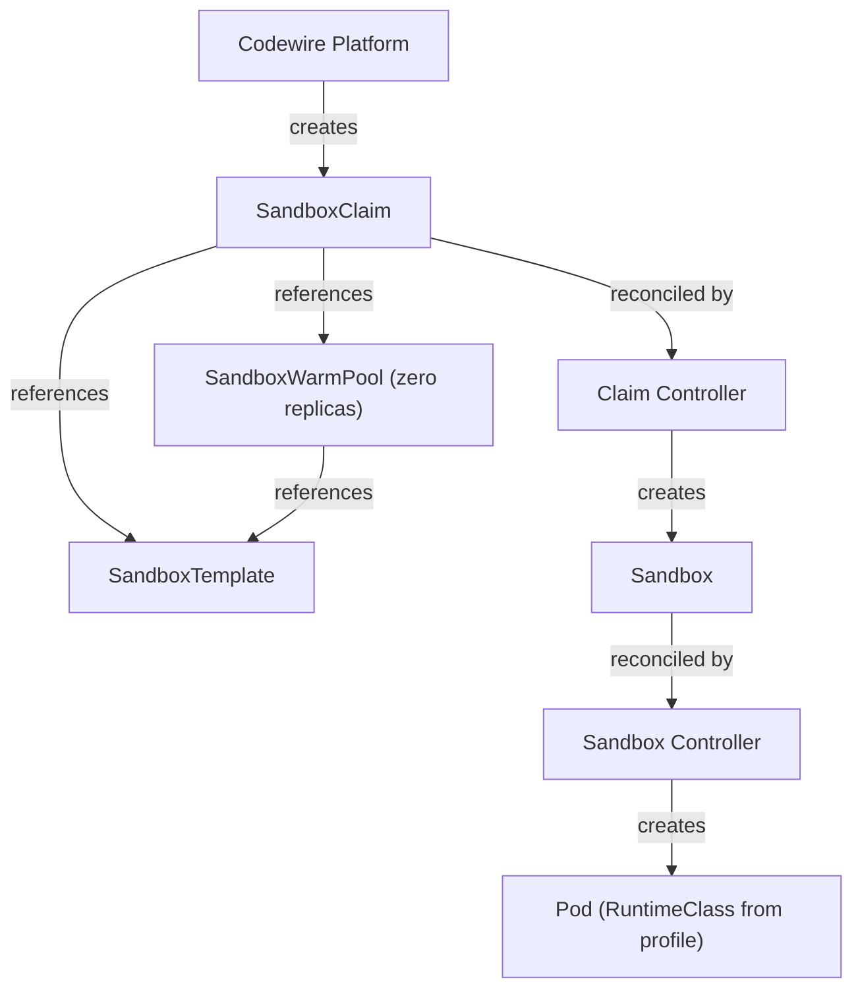
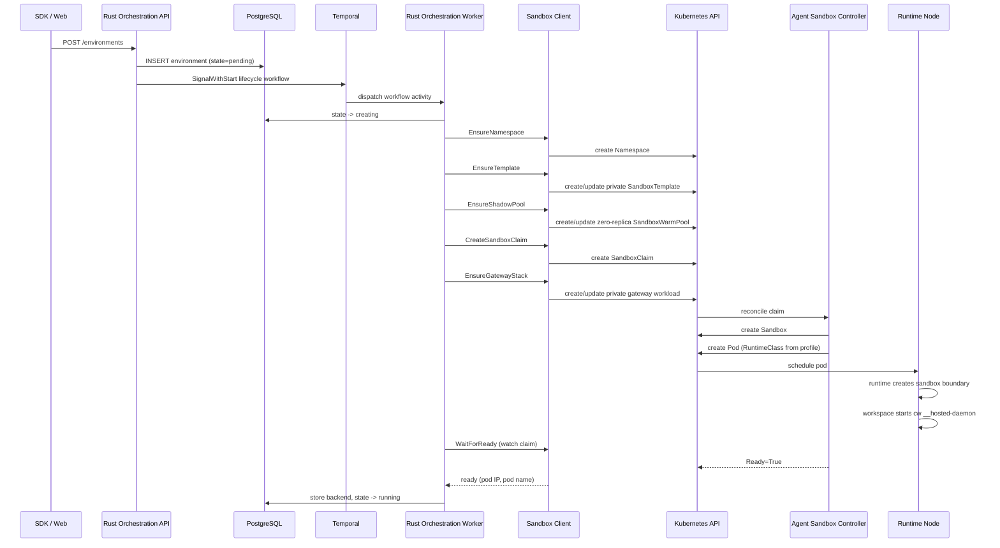
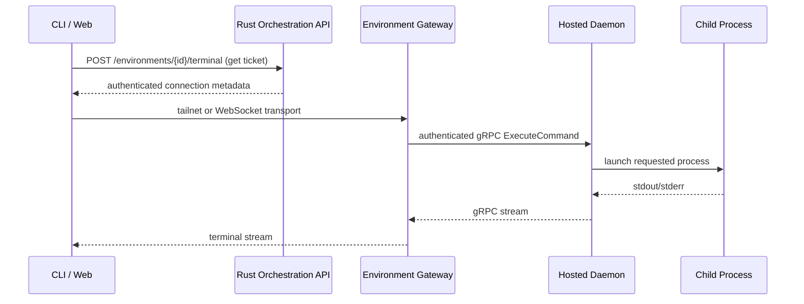

# Codewire Architecture

Status: current, stable overview

This document is the canonical architecture reference for the Codewire platform, covering
the full stack from control plane through Kubernetes abstraction to hypervisor runtime.

For implementation details, use the dev docs in `docs/dev/`. For future roadmap work, use
the design plans in `docs/plans/`.

If a plan doc and this document disagree, treat the plan as **proposed work** and this file
as the **current stable summary**.

---

## 0. Implementation language for new services

The control-plane product runtime is Rust-owned. The completed Go-to-Rust
cutover untangled the monolith into focused services behind stable contracts
and established the `codewire-server-core` shared crate. Remaining Go is
accepted SDK, generated-client, contract-harness, or explicit compatibility
oracle code; it is not a product server.

**Policy from Phase 1 onward:**

- A **new service** — a new binary owning a new bounded context — is written in
  Rust on top of `codewire-server-core` (see `crates/README.md`).
- New product/runtime work belongs in Rust services and the Rust `cw` CLI. The
  old Go `cmd/codewire` monolith source has been deleted; remaining Go code is
  non-product test/support or explicitly tracked cleanup.
- Runtime behavior is verified against the wire contract with
  `tests/contract/` and the affected `Database`, `Service integration`, or
  `Rust transport` product family. The all-up
  `scripts/ci/verify/rust-stack-rehearsal.sh` remains available for explicit
  diagnosis, not as an automatic gate for every change.

The desktop app (`crates/codewire-desktop`) is Rust. The web dashboard is a
Rust server-rendered application with HTMX progressive enhancement and embeds
the Zola documentation site; the retained mobile client is native Swift/iOS.

---

## 1. Problem Statement

Cloud development environments give developers and AI agents full Linux machines in the
cloud. The agent gets a shell, installs packages, runs code, clones repos. It operates the
same way a developer would on their laptop, except the machine lives on someone else's
infrastructure.

The key constraint is that agents run **untrusted code**. An AI coding agent executes
whatever it generates. If it hallucinates `rm -rf /`, if it pulls a malicious dependency,
or if it tries to escape its sandbox, the isolation layer is the only thing standing between
that code and the rest of the system.

Most platforms solve this with containers. Containers are fast, cheap, and well understood.
But containers share the host kernel. Every container on a node makes syscalls into the same
kernel, and the kernel is the isolation boundary. When that boundary fails, the consequences
are total:

- **CVE-2024-21626** -- file descriptor leak in runc allowed container escape
- **CVE-2022-0185** -- heap overflow in the kernel filesystem layer broke out of a user
  namespace

In both cases, a process inside a container gained root on the host, with access to every
other container on that node. For a platform running thousands of untrusted agent workloads,
one kernel exploit compromises every environment on the node.

### Why hypervisor isolation

Codewire runs each development environment in its own hardware-virtualized VM with its
own kernel. A vulnerability inside the guest kernel has nowhere to go -- there is no
shared kernel. The hypervisor sits between guests, and the hypervisor boundary is the
security boundary. The default `commodity` runtime uses Kata Containers with Cloud
Hypervisor (see §4). The `confidential` profile uses Kata with QEMU-SNP on
eligible hosts.

This is the same isolation model used by:

- **AWS Firecracker** (powers Lambda and Fargate) -- microVM-per-function
- **Kata Containers** -- VM-per-pod in Kubernetes
- **Google gVisor** -- user-space kernel (different approach, same goal)

The trade-off: real isolation at the cost of higher complexity in networking, storage, and
orchestration. The rest of this document explains how the three system layers compose to
manage that complexity.

---

## 2. System Overview

```text
                          Codewire Platform
                    (control plane, API, auth, billing)
                                 |
                    API Keys / Sessions / SDKs
                                 |
              +------------------+------------------+
              |                                     |
       PostgreSQL                              Temporal
    (product data,                         (durable workflows,
     auth, billing)                         lifecycle retries)
              |
              v
       NATS JetStream
    (optional realtime
     fanout/presence)
              |                                     |
              +------------------+------------------+
                                 |
                          Sandbox Client
                     (k8s dynamic client)
                                 |
     +-----------+---------------+-----------------+
     |           |               |                 |
  Sandbox    Sandbox         Sandbox           Sandbox
  Claim      Template       Shadow Pool        (core)
     |           |          (zero replicas)         |
     +-----------+---------------+-----------------+
                                 |
                    Agent Sandbox Controller
              (kubernetes-sigs CRD reconciliation)
                                 |
                           Pod + Service
                                 |
                    RuntimeProfile: "commodity" | "confidential"
                                  |
                    RuntimeClass from profile
                                 |
     +-----------+---------------+-----------------+
     |           |               |
  runc        Kata + CH       CoCo/TEE
  diag only   commodity       confidential
              backend         path
     |           |               |
     +-----------+-------+-------+
                         |
                  Isolated workload
          (container or VM depending on profile)
                         |
             workspace + cw __hosted-daemon
                  + guest-local dockerd
```

**Layer 1 -- Codewire Platform:** Control plane handling auth, billing,
environment lifecycle, realtime node/network control, and SDK access. Rust
services are backed by PostgreSQL for durable product state and Temporal for
durable workflows. NATS is an implementation option for realtime fanout,
presence, and cross-replica state in services such as Mesh and coordinator.

**Layer 2 -- Agent Sandbox:** Kubernetes CRDs (kubernetes-sigs/agent-sandbox) providing
declarative management of isolated, stateful, singleton workloads. The controller
reconciles SandboxClaims into Sandboxes into Pods.

**Layer 3 -- Runtime Profile + Guard Controls:** Codewire selects a
product-level runtime profile and renders the matching Kubernetes RuntimeClass
plus capability defaults. Guard controls are the defense-in-depth checks around
that selection. Managed sandboxes use `commodity` as the normal Kata + Cloud
Hypervisor profile. `runc` and `none` are diagnostic/bootstrap paths only and
are refused by managed creation unless an explicit diagnostic override is set.
The `confidential` profile keeps the same product contract but schedules only
onto infra-proven SNP nodes. The first dev proof uses Kata + QEMU-SNP; Trustee
attestation and secret release remain separate proof gates.

---

## 3. Codewire Platform

### What it is

Codewire is a control plane for agent-oriented cloud development environments. It manages
the full lifecycle from user signup through environment provisioning, execution, and
teardown.

### Canonical concepts

| Concept | Description |
|---------|-------------|
| **Organization** | Billing, member, and secret boundary |
| **Environment** | The canonical product object: an isolated sandbox for agents and developers |
| **Environment Template** | Type-specific template for creating environments |
| **API Key** | `cw_` prefixed key for programmatic SDK/CLI access (SHA-256 hashed, prefix-indexed) |
| **Session** | A process or agent running inside an environment |

### Server architecture

```text
Web / Native / SDK / cw Clients
         |
         v
  +------+--------------------------+
  | Rust services                   |
  | idp / orchestration / billing   |
  | coordinator / mesh / derp       |
  +------+--------------------------+
         |
    +----+----+----+----+----+----+
    |    |    |    |    |    |    |
  auth  API  OIDC billing temporal sandbox
         |              |    |    client
         v              v    v       |
    HTTP routes    plans workflows    v
    environment    usage  jobs    k8s CRDs
    CRUD           checkout
         |              |
         v              v
    +----+----+    +----+----+
    |PostgreSQL|    |Temporal |
    |          |    |         |
    +----------+    +---------+
```

**Key areas** — the live control plane and its correctness fixtures are
Rust-owned. The former Go application and its general service drivers have
been deleted; retained Go is consumer or Tailscale interoperability only:

- `codewire-server-core` -- shared HTTP scaffold, auth, request identity, error envelope, tracing, DB/NATS helpers
- `codewire-idp` + `codewire-oidc` -- OIDC provider and federated auth flows
- `codewire-billing` -- plans, checkout, usage, billing operations
- `codewire-orchestration` -- async lifecycle, reconciliation, and the Kubernetes sandbox client/informers
- `codewire-server-core/migrations/` -- the sole application SQLx history, embedded and applied by `codewire-server-core`

### Data stores

**PostgreSQL** -- auth, product data, organizations, billing state, environment lifecycle,
usage accounting.

**Temporal** -- durable environment lifecycle workflows. Environment
create/stop/start/destroy operations are SignalWithStart intents handled by
the Rust orchestration worker.

**NATS JetStream** -- optional realtime bus for high-churn service-internal
fanout, presence, and cross-replica state. It is not the durable lifecycle
owner after the Temporal cutover. Mesh and coordinator may use NATS behind
their service boundaries when process-local state or database polling would be
the wrong fit.

### Protected values and saved state

Storage is not delivery. Selecting a protected value only makes it eligible
for a later binding:

```text
stored value
  +-- brokered binding --> allowed operation; child never receives the value
  `-- exposed binding  --> value enters one explicitly admitted child
```

The brokered path is the target default. It is a typed proxy, signer, or
executor, not a generic secret-read API. New credential bindings are
broker-only and never silently become exposed values.

The secret-bearing broker stays outside the sandbox:

```text
local:    child -> local relay -> guest edge -> host broker -> provider
platform: child -> local relay -> gateway Pod -> internal broker -> provider
```

The relay and edge hold no provider credential. The platform workspace daemon
cannot be that edge because it shares the workload's container and process
boundary. `av-credential-proxy` and `av-proxy-helper` are reusable libraries
inside the placement-owned processes, not new control planes. Proxying is only
cooperative credential non-disclosure while direct provider egress remains
open; enforced mediation also requires denying bypass.

The target command surface is:

```text
cw secrets run -- COMMAND           # brokered
cw secrets run --expose -- COMMAND  # brokered plus permitted raw values
```

An **environment projection** is the child-visible value set built for one
explicit launch. It is never a shared file or a second version history. A
stored value without a matching binding is unavailable. An environment policy
may apply the same launch choice automatically, so a configured plain `codex`
can work without another login or wrapper.

This command must not ship until both paths are real. The brokered form needs
the reusable AV edge; the exposed form needs a trusted executor that launches
the exact child. Both must reject stale runtime operations.

Current status is narrower: local Codex brokerage and protected-value
storage/metadata exist. General `cw secrets run`, raw per-child projection, and
the platform broker boundary do not yet ship. The platform's old raw secret and
credential bootstrap paths are removed; brokered or exposed bindings fail
closed until their current runtime path exists.

Saved-state names describe what can actually be restored:

- A **skill snapshot** is immutable, reusable skill content and is implemented.
- **Workspace storage** is the live mutable filesystem. Persistence across a
  stop is not a snapshot.
- A **workspace snapshot** will be restorable workspace filesystem state.
- An **environment snapshot** will combine a workspace snapshot with the
  Codewire settings needed to create an independent environment.
- A **VM checkpoint** will contain backend-specific running-VM memory and device
  state for a future hot environment snapshot.

Workspace snapshots, environment snapshots, and VM checkpoints are reserved
capability names; they are not implemented today. In short: projections launch
processes, snapshots restore saved state, and checkpoints resume execution.

> **Rust port status:** lifecycle execution, environment reconciliation,
> sandbox liveness, environment-specific sandbox-template creation, and the
> sandbox billing-session loop are Rust-owned by default in
> `crates/codewire-orchestration`. Billing
> metering, overage, and trial-expiry crons are Rust-owned by default in
> `crates/codewire-billing`. The rendered local-kind, dev, and prod runtime no
> longer includes the Go fallback server, and the old Go monolith source has
> been deleted.

### Environment lifecycle

The environment state machine has 18 states:

```text
                                     +---> building ---> build_failed
                                     |
  pending ---> pending_build --------+
     |
     +-------> pulling_snapshot
     |              |
     +-------> creating -----> starting -----> running
                                                  |
                                          +-------+-------+
                                          |       |       |
                                       stopping resizing archiving
                                          |       |       |
                                       stopped  running archived
                                          |               |
                                       starting       restoring
                                          |               |
                                       running         running

  (any state) ---> destroying ---> destroyed

  (any state) ---> error ---> (retry to pending/starting)

  unknown (fallback)
```

**Desired states** drive transitions: `started`, `stopped`, `destroyed`, `archived`,
`resized`. The reconciler in `crates/codewire-orchestration/src/worker/lifecycle.rs`
(porting the Go `worker/handler_environment.go` oracle) detects mismatches between
current state and desired state, then enqueues the appropriate transition.

**Create-flow state machine** (`crates/codewire-orchestration/src/worker/create.rs`, the
`CreateAction` enum):

1. `EnsureNamespace` -- create the k8s namespace (and the SandboxTemplate scaffolding)
2. `CreateClaim` -- create the SandboxClaim
3. `WaitForReady` -- watch the claim until its Ready condition is True
4. `StoreBackend` -- store pod IP/name in `sandbox_environment_backend`
5. `MarkRunning` -- transition the environment to `running`
6. `PublishSetup` -- publish the setup job

The reconciler advances one action per pass via `next_create_action`, reaching `Done` once
setup completes.

### Auth model

- **Session tokens** work as Bearer tokens (raw token, not OIDC encrypted). Sliding expiry
  via `UPDATE...WHERE expires_at > NOW()`.
- **API keys** use `cw_<64 hex>` format, SHA-256 hashed in DB, prefix-indexed for lookup.
- **OIDC** provider for federated auth flows.
- **2FA** available for user accounts.

---

## 4. Agent Sandbox (Kubernetes Abstraction)

### What it is

[agent-sandbox](https://github.com/kubernetes-sigs/agent-sandbox) is a kubernetes-sigs
project providing CRDs for managing isolated, stateful, singleton workloads. It follows the
standard Kubernetes controller pattern: users create custom resources, the controller
reconciles underlying runtime resources.

### CRDs

| CRD | Group | Purpose |
|-----|-------|---------|
| `Sandbox` | `agents.x-k8s.io/v1beta1` | Core: single stateful pod with stable identity and persistent storage |
| `SandboxTemplate` | `extensions.agents.x-k8s.io/v1beta1` | Private environment-scoped template used to create one sandbox |
| `SandboxClaim` | `extensions.agents.x-k8s.io/v1beta1` | User/platform request to create a sandbox from a template |
| `SandboxWarmPool` | `extensions.agents.x-k8s.io/v1beta1` | Zero-replica shadow object required for the current claim-controller reference contract |

### Controller reconciliation flow



### Codewire integration

The sandbox client (`crates/codewire-orchestration/src/sandbox/`) bridges the
Codewire platform to the agent-sandbox CRDs using `kube-rs`.

**DB tables:**

| Table | Purpose |
|-------|---------|
| `sandbox_template_config` | Links environment-template configuration to Kubernetes image and runtime inputs |
| `sandbox_environment_backend` | Per-environment: namespace, claim name, pod name, pod IP, agent port, setup state |

**Claim creation:** The sandbox client generates a private `SandboxTemplate` and
zero-replica shadow `SandboxWarmPool` for each environment, then creates a claim
named `sandbox-{envID}` with environment and org labels. The private template
contains the environment-specific daemon token before the Sandbox starts.
Creation is idempotent and reuses matching existing objects rather than failing.

**Readiness watching:** `WaitForReady` watches the SandboxClaim until the `Ready` condition
becomes `True` (5 min timeout). A concurrent pod health checker detects terminal failures
(ImagePullBackOff, CrashLoopBackOff) for fast failure.

**Informer:** A continuous informer watches Sandbox and Pod resources, syncing pod IP/name
to the DB and detecting unexpected pod failures or sandbox expiry.

**Runtime profile scheduling:**

- `SANDBOX_RUNTIME_PROFILE=commodity` renders `RuntimeClass: commodity`.
- `SANDBOX_RUNTIME_PROFILE=confidential` renders `RuntimeClass: confidential`
  for the future hardware TEE-backed runtime lane.
- `SANDBOX_RUNTIME_PROFILE=runc` or `none` is diagnostic only for managed
  creation and requires `SANDBOX_ALLOW_DIAGNOSTIC_RUNTIME=true`; an empty
  profile is rejected.
- `commodity` relies on the RuntimeClass scheduling stanza to select Kata
  runtime candidate nodes.
- Shared performance warm pools are disabled because a prestarted daemon
  cannot safely receive the claim's unique token. Shared warm starts may return
  only with a designed claim-time authenticated bootstrap and attestation
  contract. Go fallback worker loops are no longer rendered in local-kind,
  dev, or prod runtime paths.

---

## 5. Sandbox Claim Indirection

The agent-sandbox claim API currently requires a `SandboxWarmPool` reference.
Codewire creates an environment-scoped shadow object with zero replicas, pointing
to the same private `SandboxTemplate` as the claim. It exists only to satisfy
that controller contract; it does not prestart a pod or share a daemon between
environments.

This clean cutover is intentional. Every hosted daemon starts with one validated,
environment-specific authentication token. Shared warm starts are unsupported
until a separate design can authenticate and attest claim-time bootstrap before
the daemon accepts traffic.

---

## 6. Docker in Workspaces

### Profile-dependent architecture

Docker support is a runtime-profile capability, not a RuntimeClass by itself.
Users should get dev-machine Docker semantics inside the sandbox, but the
Kubernetes node's Docker/containerd socket must never be mounted or proxied into
Codewire sandboxes.

```text
workspace process
  -> DOCKER_HOST=unix:///var/run/docker/docker.sock
  -> guest-local dockerd inside the sandbox VM/runtime boundary
```

For `commodity`, dockerd must run inside the Kata VM. Privileged nested
Docker containers are scoped to that VM, not to the Kubernetes node. The
rendered workspace pod includes a `dind` container with a pod-local socket
volume. The workspace receives
`DOCKER_HOST=unix:///var/run/docker/docker.sock`, which points at the guest-local
dind socket, not a Kubernetes node socket.

The guest Docker data root must be backed by a real Linux filesystem. The
commodity renderer currently uses an ext4 image in the workspace volume,
mounted at `/var/lib/docker`, and starts dockerd with `vfs`. Docker layer unpack
and nested container workloads require ext4/xattr semantics. The durable target is a
separate raw block PVC presented to the Kata guest, formatted and mounted at
`/var/lib/docker`; see
`docs/plans/2026-07-03-guest-docker-block-backed-data-root-plan.md`.
The bootstrap verifies the target is mounted as ext4 specifically, because
`docker:dind` can make `/var/lib/docker` an existing virtiofs mount under Kata.

For local kind, tests may use `SANDBOX_DOCKER_MODE=local-dind-direct`, which
injects the existing `docker:dind` sidecar.

The sandbox gateway is a separate per-environment workload. It reaches the
workspace daemon through the environment-local daemon Service and does not
currently mount Docker sockets in the split commodity path.

See `docs/dev/SANDBOX-GATEWAY-DAEMON.md` for the gateway, daemon, Docker
hardening, and validation contract.

### Security boundary

The VM/runtime boundary is the security boundary. The gateway does not receive
a Docker socket. If any path ever forwards to host Docker, that is a node-escape
regression.

---

## 7. Data Flow Examples

### Environment creation



### Terminal access


