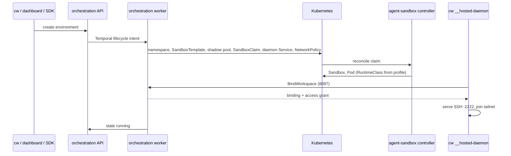

# Codewire Architecture

Status: current overview. For component detail use the linked docs; for
proposals use the maintainers' private design repository.

## 1. What Codewire is

Codewire gives developers and AI coding agents an isolated development
machine: a Linux environment with persistent storage, durable terminal and
agent sessions, Docker, and access over SSH, a browser terminal, file
transfer and preview URLs.

An environment runs in one of three placements, all driven by the same `cw`
CLI and the same in-environment daemon:

| Placement | Where it runs | Isolation |
| --- | --- | --- |
| Hosted sandbox | the Codewire platform on Kubernetes | one VM per environment (Kata Containers) |
| Local VM | the user's Linux or Apple Silicon machine | Cloud Hypervisor on KVM; Virtualization.framework on macOS |
| Trusted host | the user's machine, as their user | process ownership only, no containment |

### Why a VM per environment

Agents run untrusted code: whatever they generate, whatever dependency they
pull. Containers share the host kernel, so one kernel exploit reaches every
environment on the node. Codewire runs each environment in its own
hardware-virtualized VM with its own kernel; the hypervisor boundary is the
security boundary. The cost is more work in networking, storage and
orchestration, which the rest of this document describes.

## 2. Platform overview

```text
  cw CLI / dashboard / SDKs
            |
   Rust services (one chassis: codewire-server-core)
   idp | orchestration | billing | credential-service | coordinator | mesh
            |                          |
       PostgreSQL                  Temporal (lifecycle workflows)
            |
   sandbox client (kube-rs) -> SandboxTemplate / SandboxClaim / Sandbox
            |
   agent-sandbox controller (kubernetes-sigs) -> Pod
            |
   RuntimeClass from the runtime profile
     commodity: Kata + Cloud Hypervisor     confidential: Kata + QEMU-SNP
            |
   Pod: workspace container (cw __hosted-daemon) + dind container
```

Services, all in `crates/` (see `crates/README.md` for the full map):

- `codewire-server-core`: HTTP scaffold, auth, request identity, error
  envelope, tracing, database and NATS helpers, the application migrations.
- `codewire-idp` (+ `codewire-oidc`): accounts, sessions, two-factor, API
  keys, OIDC provider.
- `codewire-orchestration`: environment API, Temporal worker and reconciler,
  Kubernetes sandbox client, workspace binding, credential relay, terminal and
  SSH proxy, previews, admin.
- `codewire-billing`: catalog, plans, Stripe, usage metering.
- `codewire-credential-service` (+ `codewire-credential-broker`): the
  isolated broker that holds provider material and answers typed requests.
- `codewire-coordinator`, `codewire-derp`, `codewire-udp-relay`: tailnet
  coordination and relays.
- `codewire-mesh`: Codewire Mesh, the hosted or self-hosted network control
  plane for nodes and clients.
- `codewire-dashboard-web`: the server-rendered dashboard (HTMX), which also
  serves the documentation site.

Data stores: PostgreSQL for product state; Temporal for durable lifecycle
workflows (create, start, stop, destroy are signalled intents handled by the
orchestration worker); NATS only for service-internal realtime fan-out where a
service needs it (the coordinator across replicas).

Canonical concepts: organization (billing, members, secrets), environment
(the product object), preset (creation defaults), session (a process or agent
inside an environment), API key (`cw_` prefix, hashed at rest). See
[GLOSSARY.md](GLOSSARY.md).

## 3. Hosted environments on Kubernetes

### agent-sandbox CRDs

Codewire uses the kubernetes-sigs `agent-sandbox` controller:

| CRD | Purpose |
| --- | --- |
| `SandboxTemplate` | private, environment-scoped Pod template |
| `SandboxClaim` | the platform's request for one sandbox from a template |
| `Sandbox` | the stateful singleton Pod with stable identity and storage |
| `SandboxWarmPool` | prestarted members of one workspace shape |

The sandbox client (`crates/codewire-orchestration/src/sandbox/`) renders a
private `SandboxTemplate` and a zero-replica shadow `SandboxWarmPool` per
environment (the claim API requires a pool reference), then creates a claim
named `sandbox-<environment id>`. Creation is idempotent.

### Warm pools

Optionally, orchestration also keeps identity-free warm pools: one shared
template and pool per exact workspace shape (CPU, memory, disk), configured by
`SANDBOX_WARM_POOL_SHAPES`. A claim of exactly that shape adopts a prestarted
member; the member gains its environment identity only when bound, and no
environment secret reaches the pool template. Unset means no pools and every
start is cold. Confidential environments are never pooled.

### Runtime profiles

A product-level runtime profile selects the RuntimeClass and capability
defaults (`SANDBOX_RUNTIME_PROFILE`):

- `commodity`: Kata Containers with Cloud Hypervisor (`kata-clh`); the normal
  profile.
- `confidential`: Kata with QEMU-SNP on SNP-capable nodes; attestation and
  secret release are separate gates.
- `runc` / `none`: diagnostics only; managed creation refuses them unless
  `SANDBOX_ALLOW_DIAGNOSTIC_RUNTIME=true`.

See [dev/CODEWIRE-GUARD-RUNTIME-PROFILES.md](dev/CODEWIRE-GUARD-RUNTIME-PROFILES.md).

### The workspace Pod

The Pod holds two containers. `workspace` runs the user's image with
`/home/codewire` and `/workspace` on the environment's persistent volume and
starts `cw __hosted-daemon`, which comes read-only from the pinned support
image. `dind` runs a guest-local Docker daemon inside the same VM; the
workspace sees `DOCKER_HOST=unix:///var/run/docker/docker.sock`. The node's
container runtime socket is never mounted or proxied into a sandbox; any path
that forwards to host Docker is a node-escape regression.

### The daemon

The daemon is the in-environment control plane
([dev/SANDBOX-DAEMON.md](dev/SANDBOX-DAEMON.md)):

- gRPC service for exec, PTY, durable sessions and files, used by
  orchestration, the dashboard terminal and `cw`;
- an SSH server with SFTP and SCP on port 2222, with a per-binding Ed25519
  host key whose public line orchestration records;
- the environment's tailnet peer (WireGuard), started from the access grant
  orchestration issues at binding;
- the credential bridge: a loopback relay that orchestration pulls and
  forwards to the broker.

Startup: the Pod starts, the daemon calls `BindWorkspace` on orchestration's
internal listener (8087) with its workspace token, receives its binding and
access grant, then serves SSH and joins the tailnet. Orchestration waits for
the claim to be Ready, records the Pod in `sandbox_environment_backend`, and
marks the environment running. There is no per-environment gateway or sidecar
workload.

### Environment lifecycle

Environment states: `pending`, `pending_build`, `building`, `build_failed`,
`pulling_snapshot`, `creating`, `starting`, `running`, `stopping`, `stopped`,
`archiving`, `archived`, `restoring`, `resizing`, `destroying`, `destroyed`,
`error`, `unknown`. Desired states (`started`, `stopped`, `destroyed`,
`archived`, `resized`) drive the reconciler in
`crates/codewire-orchestration/src/worker/lifecycle.rs`. The create flow
(`worker/create.rs`, `CreateAction`) advances one action per pass:
`EnsureNamespace`, `CreateClaim`, `WaitForReady`, `ResumeWorkspace`,
`StoreBackend`, `MarkRunning`, `PublishSetup`, `Done`.



## 4. Reaching an environment

```text
cw / VS Code / OpenSSH
  -> WireGuard to the daemon's SSH server
       direct UDP  ->  UDP relay  ->  DERP (TCP fallback)
  -> WebSocket SSH proxy through orchestration (final fallback)
dashboard terminal -> orchestration -> daemon gRPC
```

The CLI builds a WireGuard tunnel to the environment's daemon and tries
direct UDP, then the shared UDP relay, then DERP; the WebSocket proxy through
orchestration is the last resort and the browser path. `cw setup ssh` writes
an OpenSSH block whose `KnownHostsCommand` asks the platform for the recorded
host key, so there is no trust-on-first-use. Previews are HTTPS URLs that
orchestration forwards to an application port inside the sandbox. See
[dev/DERP-STUN.md](dev/DERP-STUN.md) and
[dev/SANDBOX-PREVIEWS.md](dev/SANDBOX-PREVIEWS.md).

## 5. Secrets and credentials

Application secrets and provider credentials are separate concepts
([dev/SECRETS-AND-CREDENTIALS.md](dev/SECRETS-AND-CREDENTIALS.md)).

- **Application secrets** (for example `DATABASE_URL`) are named values a
  user selects for an environment; they reach the workload's processes as an
  environment projection under their original names. They are visible to
  those processes.
- **Provider credentials** (OpenAI/Codex, Anthropic, GitHub, SSH identities)
  stay outside the sandbox. A credential profile selects identities; the
  sandbox receives endpoints, placeholders and a bounded capability, and the
  broker performs the typed operation (HTTP proxy, signer, repository
  executor).

```text
local VM:  child -> local relay -> guest edge -> host broker -> provider
hosted:    child -> local relay -> daemon bridge -> orchestration relay -> credential service -> provider
```

The relay legs hold no provider material. The only direct deliveries are the
creator's own Codex and Claude Code sign-in tokens, written as those tools'
own login files so their account features work; refresh tokens, API keys and
organization credentials are never delivered.

Saved-state vocabulary: a **skill snapshot** is immutable reusable skill
content (implemented). **Workspace storage** is the live filesystem;
surviving a stop is not a snapshot. Workspace snapshots, environment
snapshots and **VM checkpoints** (saved running-VM state) are reserved names
and not implemented. An **environment projection** launches a process;
snapshots restore saved state; checkpoints resume execution.

## 6. Local placements

`cw create --local` runs the environment on the user's machine
([dev/LINUX-LOCAL-VMS.md](dev/LINUX-LOCAL-VMS.md),
[dev/MACOS-CLI.md](dev/MACOS-CLI.md)):

- **Linux**: Cloud Hypervisor on KVM with the Codewire guest kernel and guest
  root that the release pins; `cw setup --local` installs them by digest. A
  native supervisor owns VM lifecycle, state (an owner-only SQLite database)
  and host ports; the guest runs the same workspace image and daemon as the
  platform.
- **macOS (Apple Silicon)**: the same artifacts under Virtualization.framework
  through a signed helper; the packet worker and egress broker run as host
  processes under Seatbelt.
- **Trusted host** (`--type host`): sessions run as the user's own account
  with their tools; Codewire owns process cleanup only.

The project folder is mounted live by default (`--path-mode mount`);
`snapshot`, `clone`, `copy` and `empty` are the alternatives. Dependency and
build folders listed in `workspace.vm_only` live on the VM disk. Local
environments join Codewire Mesh only when a network is selected; the host
owns Mesh identity, and the VM sees only admitted streams for its declared
ports.

## 7. Clients and contracts

The control-plane contract is protobuf under `proto/`, served as Connect-RPC
and generated into `packages/codewire-proto-ts`, `libs/gen-go`,
`libs/gen-python` and the SDKs in `libs/sdk-*`
([dev/PROTO-STYLE.md](dev/PROTO-STYLE.md)). The daemon, bridge and broker
protocol is gRPC under `libs/daemon-proto` and `crates/codewire-daemon-proto`.
Authentication flavors are in [dev/AUTH-POLICY.md](dev/AUTH-POLICY.md).
