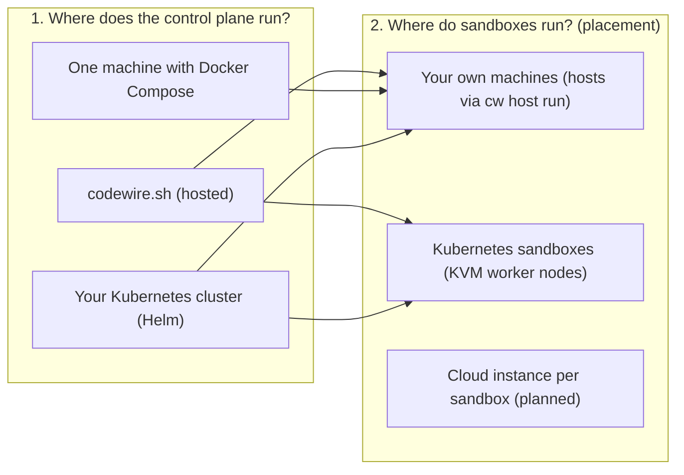
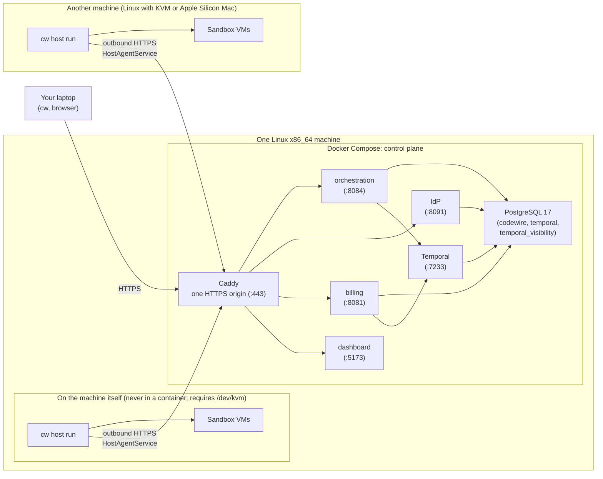

# Self-hosting Codewire with Docker Compose

Run the full Codewire control plane on one Linux machine with Docker Compose —
no Kubernetes cluster, no external secret manager, no Stripe account, and no
dependency on `codewire.sh`.

## How Codewire hosting fits together

Every Codewire deployment answers two independent questions: **where the
control plane runs** and **where sandboxes run (placement)**. Any answer to
the first works with any answer to the second.



| Control plane runs on | Sandboxes on your own machines (`hosts`) | Kubernetes sandboxes |
|---|---|---|
| **`codewire.sh`** | Bring your own machine | Hosted Codewire |
| **One machine, Docker Compose** | **Self-hosted with no Kubernetes (this guide)** | Not planned |
| **Your Kubernetes, Helm** | Self-hosted Kubernetes + attached hosts | Self-hosted Kubernetes |

## Architecture: control plane on one machine with attached hosts

The Compose project runs the control-plane services behind one Caddy HTTPS
edge. Sandboxes run outside containers on enrolled hosts (`cw host run`),
including the same Linux machine when it has `/dev/kvm`. Every host opens one
outbound HTTPS stream to the control plane — nothing calls in to a host.



## Requirements

- Linux x86_64 host with Docker Engine and Docker Compose v2 (`docker compose`).
- A hostname that every browser, `cw` client, and enrolled host can resolve and
  trust:
  1. **Tailnet name (recommended):** a Tailscale MagicDNS name and certificate
     from `tailscale cert`.
  2. **Public domain (ACME):** a DNS record pointing at the box so Caddy
     obtains an automatic Let's Encrypt certificate on port 443.
  3. **LAN or local name (internal CA):** Caddy issues an internal CA root and
     `./init` exports `secrets/root-ca.pem` for `cw login --ca-file`.
- Optional: `/dev/kvm` on this machine (or on separate Linux/Mac hosts) to run
  sandbox VMs via `cw host run`. The host agent never runs inside a container.

## Quick start

```sh
cd deployments/compose
./init
```

`./init` refuses to overwrite an existing `.env` or `secrets/` directory. It
asks three questions and bootstraps the server:

1. **Tenant-secret key provider:** defaults to `local-keyring`, generating a
   256-bit key at `secrets/tenant-keks/v1` (mode `0600`) and a separate OIDC
   signing key at `secrets/idp-signing-keks/v1`.
2. **TLS mode:** tailnet certificate (default), public ACME domain, or LAN /
   local internal CA (`tls internal`).
3. **First administrator account:** creates the server's first admin via
   `codewire-idp create-admin --email <address>` with the password passed on
   stdin. Sign-up is configured as `IDP_SIGNUP=invite-only`.

### Non-interactive / scripted install

Set environment variables before running `./init`:

```sh
CODEWIRE_HOST=codewire.tailnet.ts.net \
CODEWIRE_TLS_MODE=tailnet \
CODEWIRE_TLS_CERT_FILE=/path/to/codewire.tailnet.ts.net.crt \
CODEWIRE_TLS_KEY_FILE=/path/to/codewire.tailnet.ts.net.key \
CODEWIRE_ADMIN_EMAIL=admin@example.com \
CODEWIRE_ADMIN_PASSWORD_FILE=/run/secrets/admin-password \
./init
```

For a LAN or local test install on a custom port (for example `8443`):

```sh
CODEWIRE_HOST=localhost \
CODEWIRE_HTTPS_PORT=8443 \
CODEWIRE_BIND_ADDRESS=127.0.0.1 \
CODEWIRE_TLS_MODE=internal \
CODEWIRE_ADMIN_EMAIL=admin@example.com \
CODEWIRE_ADMIN_PASSWORD_FILE=/path/to/password-file \
./init
```

### Building from a local checkout

By default `compose.yaml` pulls the published `ghcr.io/codewiresh/services` and
`ghcr.io/codewiresh/dashboard` images. To build both from this repository
instead, pass the override file:

```sh
CODEWIRE_COMPOSE_FILES=compose.local-build.yaml ./init
```

Or after `./init`:

```sh
docker compose -f compose.yaml -f compose.local-build.yaml up -d --build
```

## Sign in, invite teammates, and enroll a host

1. Open your server URL (printed by `./init`) and sign in as the admin created
   during setup.
2. Create your first organization at `/organizations/new`.
3. Invite teammates from the organization's **Members** page. Without mail
   configured, copy the generated one-time invitation link (valid for 24 hours)
   and send it directly; anyone without an invitation waits as disabled until
   you approve them under **Admin → Manage account access**.
4. Authenticate the `cw` CLI:

   ```sh
   # Tailnet or ACME domain:
   cw login --server https://codewire.example.com

   # LAN / local internal CA (exclusive CA pin for this origin):
   cw login --server https://localhost:8443 --ca-file deployments/compose/secrets/root-ca.pem
   ```

5. Enroll a machine with KVM (or an Apple Silicon Mac) and start the host agent:

   ```sh
   cw host enroll --name my-box
   cw host provide --max-vms 4
   cw host run
   ```

6. Create and control an environment on the enrolled host:

   ```sh
   cw create --on host:my-box --name demo
   cw run demo -- uname -a
   cw stop demo
   cw start demo
   cw rm demo
   ```

## Operations

### Backup and restore

> **Warning:** Losing `deployments/compose/secrets/tenant-keks/` permanently
> loses every stored tenant secret in PostgreSQL, and losing
> `secrets/idp-signing-keks/` invalidates persisted OIDC signing keys. Always
> back up `deployments/compose/secrets/` together with your PostgreSQL dump.

```sh
cd deployments/compose
docker compose exec -T postgres pg_dump -U codewire codewire > codewire-backup.sql
tar --mode='go-rwx' -czf codewire-secrets-backup.tar.gz .env secrets/
```

### Upgrades

Database migrations move forward only and run automatically at service startup.
Update the pinned image references in `compose.yaml` (or `.env`), then:

```sh
cd deployments/compose
docker compose pull
docker compose up -d
```

### Stopping and removing

```sh
cd deployments/compose
docker compose down          # stop containers, keep Postgres and Caddy volumes
docker compose down -v       # stop containers and delete volumes (destructive)
```

## Scope and later stages

This Compose package runs the control plane (`caddy`, `postgres`, `temporal`,
`idp`, `orchestration`, `billing`, `dashboard`) with host-placed environments
(`--on host:<name>`) and zero dependency on `codewire.sh`.

Planned follow-up stages add:

- Self-hosted `credential-service` without Kubernetes (for GitHub App
  connections, private repositories, and managed agent credentials).
- Self-hosted `coordinator`, DERP, and UDP relay (for direct tailnet `cw shell`
  and SSH paths).
- External OpenBao / Vault authentication without Kubernetes.
- Release-published `compose.yaml` manifests with digest-pinned service images.
