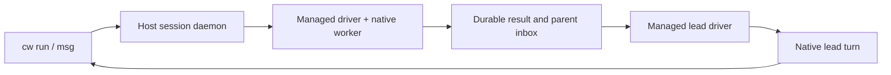

# CLI sessions and agent orchestration

The CLI uses an environment as the execution placement and a durable session
as the process identity. Session names are unique within an environment;
commands resolve an exact ID before a name. `cw list` (alias `cw ls`)
inventories every accessible environment and its sessions, shows stopped
environments as not running, and reports running environments it cannot
reach as errors; `cw list ENV` lists one environment.

## Placements

| Placement | Create | Terminal sessions | Managed agents |
| --- | --- | --- | --- |
| Trusted Linux host | `--local --type host` | Owner daemon and private Unix socket | Codex and Claude |
| Native Linux sandbox | `--local --type sandbox` | Native supervisor and guest daemon | Codex/Claude implementation; VM qualification pending |
| Platform sandbox | `--platform --type sandbox` | Authenticated platform API | Qualification pending |
| macOS host or sandbox | Separate hardware qualification | See Program #2064 | Qualification pending |

```sh
cw env create --local --type host --name host-team --path .
cw env create --local --type sandbox --name vm-team --path .
cw env create --platform --type sandbox --name cloud-team --repo REPOSITORY_URL
```

A trusted host runs as the local user with their ordinary HOME and installed
tools. Its daemon uses a dedicated state directory, outside the workspace by
default; `CW_HOST_DATA_DIR` selects another registry location. It provides
owned process cleanup, not filesystem or network containment. Stop and remove
retire its owned runtime; they preserve the workspace. Linux is the admitted host
implementation. Other hosts fail before creation effects.

Native sandboxes retain their protected credential and workspace contracts.
Creating a host does not copy authentication files into a sandbox.

Managed Linux VM sessions require a selected local credential profile with a
typed Codex or Anthropic provider. Provider material stays in the host broker;
the guest receives its generated proxy configuration. VM sessions use the same
`run --agent`, `msg`, `steer`, `interrupt`, `inbox` and `wait --message` commands.
Their parent must be a running managed session in the same VM. A worker writes
one deterministic notification into that parent's private inbox; the parent
adopts it when idle or after restart. Guest agents do not have authority to
launch sessions through the host CLI.

Managed native shutdown is durable: if the local `cw stop` caller is cancelled,
the driver can still finish cleanup. Run `cw stop` again to join that operation.
`cw restart` waits for confirmed child cleanup and driver exit, then compares the
selected launch generation at the daemon. If another caller has replaced that
launch, the request fails before stopping the replacement. JSON session output
includes `launch_generation`; zero means the daemon does not support this fence.
Missing or stale custody records prevent managed restart. An interrupted active
turn stays unknown and is never replayed automatically.

## Ordinary commands

Use the same session commands with `host-team`, `vm-team`, or `cloud-team`:

```sh
cw run host-team --name tests --detach --no-tty -- make test
cw list host-team
cw list
cw wait host-team tests --timeout 10m
cw logs host-team tests
cw stop host-team tests
cw restart host-team tests
```

`wait` succeeds only after observed zero exit, confirmed cleanup and drained
output EOF. Timeouts,
nonzero exits, interrupted processes and unknown cleanup return failure.
Output retains its absolute cursor across reconnects and restarts. A history
gap is reported rather than silently treated as complete output.

For an interactive shell:

```sh
cw run host-team --name shell --tty --detach -- sh
cw send host-team shell 'pwd'
cw send host-team shell 'partial text' --no-newline
cw send host-team shell --key enter
cw send host-team shell --key ctrl-c
cw attach host-team shell
```

`send` acknowledges a bounded write to stdin. It does not prove that a shell
command finished. Use a separate `run` and `wait` when command completion is
needed. Input is never automatically resent after an ambiguous write.

Inline `run --env NAME=VALUE` overrides stay with the live daemon owner. They
are absent from saved session metadata. After daemon recovery, restart refuses
sessions requiring those unavailable values; launch a new session with fresh
overrides. Environment-owned application projections continue to use their
existing source and delivery contracts.

## Orchestrator and workers on a host

```sh
cw run host-team --name lead --agent codex --model gpt-6.1-sol \
  --effort max --detach --prompt 'Coordinate the assigned work.'
cw run host-team --name runtime --parent lead --agent claude \
  --model claude-opus-5-5 --effort xhigh --detach \
  --prompt 'Implement the assigned runtime slice and report the result.'
cw run host-team --name review --parent lead --agent codex \
  --model gpt-6.1-sol --effort max --detach \
  --prompt 'Review the runtime change without editing it.'

cw msg host-team runtime 'Cover the failed-start recovery case too.'
cw inbox host-team lead
cw wait --message MESSAGE_ID --timeout 10m
cw steer host-team review 'Focus on ownership and cleanup.' --turn-id TURN_ID
cw interrupt host-team runtime
cw stop host-team runtime
cw restart host-team runtime
```

Agent launches with `--prompt` and message commands return durable message
IDs. `msg` sends a semantic task, follow-up or reply to the native agent protocol.
A raw terminal write is refused for managed sessions. Parents are bound to canonical session
and driver identities in the same host environment; an unmanaged process
cannot receive semantic worker results. `cw wait --message ID` returns the final
reply; the message ID alone names its session. `cw logs ENV SESSION` shows each
turn's prompt, the commands, edits and tools the agent uses, and its reply.
`cw stop` stops the session and every descendant still running, since a parent
owns its workers; `cw restart` affects only the named session.



An idle parent starts a turn when a worker completes. A busy parent queues the
notification. A stopped parent adopts it after restart. Deterministic message
identities prevent duplicate admission. Recovery repairs a missing result
notification without replaying a completed or ambiguous provider task.

| Provider | Receiver | Mid-turn steering | Interrupt | Resume |
| --- | --- | --- | --- | --- |
| Codex | App Server stdio | `turn/steer`, expected turn required | Native turn control | Saved thread ID |
| Claude | CLI stream JSON | Explicitly unsupported | Advertised after native control probe | Saved session UUID |
| Kimi | ACP adapter planned | Qualification pending | Qualification pending | Qualification pending |

Managed Codex uses `danger-full-access` and `approvalPolicy: never` on the
explicitly trusted host. Claude retains the installed CLI's settings and
permission rules. Neither adapter copies login material. Claude supports
`low`, `medium`, `high`, `xhigh`, and `max`; omitting effort preserves its
configured default.

No additional MCP server is needed to receive these messages. A native protocol
driver owns delivery and completion. A foreground controller can forward
terminal events to its coordinating session; this does not establish an
unattended wake interface for the Codex application.

## Mesh members

`cw mesh up/status/down` manages a local Mesh service, and
`cw network create/join/nodes/use` manages network membership. Native sandbox
peers have the existing WireGuard direct/relay transport and declared ingress.

Use `--member` to control sessions on an enrolled trusted Linux member after
pinning its exact key and granting the required execution capabilities. Managed
workers and their parent belong to the member's same pinned environment:

```sh
cw --member build-linux run --name lead --agent codex --detach \
  --output json --prompt 'Coordinate the assigned work.'
# Save the returned .session.session_id as LEAD_ID.
cw --member build-linux run --name implement --parent "$LEAD_ID" \
  --agent codex --detach --prompt 'Implement the assigned slice.'
cw --member build-linux run --name review --parent "$LEAD_ID" \
  --agent claude --detach --prompt 'Review the assigned slice.'

cw --member build-linux list
cw --member build-linux msg "$WORKER_ID" 'Include the recovery case.' --output json
cw --member build-linux inbox "$LEAD_ID" --output json
cw --member build-linux wait --message "$MESSAGE_ID" --timeout 10m
cw --member build-linux steer "$WORKER_ID" 'Focus on cleanup.' --turn-id "$TURN_ID"
cw --member build-linux stop "$WORKER_ID"
```

Use the Codex implement worker's canonical ID from `list` as `WORKER_ID`, the
ID returned by `msg` as `MESSAGE_ID`, and its active turn ID from `inbox` as
`TURN_ID`.

Member controls use canonical `session-UUID` IDs. An explicit environment must
match the pinned UUID. Reconnect through `logs`, `inbox` and `wait`; observe a
lost control reply with `cw member observe build-linux REQUEST_UUID --output json`.
Retain `--request-id` and the observed `--expected-launch-generation` when
recovering a control operation. Parent notifications stay within that member's
environment; a host coordinator reads the member's inbox explicitly.

Ordinary member commands use `run --no-tty -- COMMAND`, followed by `wait` and
`logs`. Member PTY attachment is unsupported. Run the host updater on the
member owner; `--member` does not provide remote environment or updater controls.
Provider steering and interruption follow the capabilities in the table above.

## Install local execution

Install the production host CLI before creating environments or sessions that
you intend to retain:

```sh
make cli-install-user
```

Trusted hosts use that installed executable and the user's ordinary agent
tools. Native Linux VMs also need durable base artifacts, their matching lock
file, and the static managed guest runtime. Keep those inputs outside a
disposable worktree. The base defaults are
`$HOME/.cache/codewire/local-vmm-v1/artifacts` and the adjacent
`artifacts.lock.json`; `CODEWIRE_NATIVE_ARTIFACT_ROOT` and
`CODEWIRE_NATIVE_ARTIFACT_LOCK` select absolute alternatives that share one
parent directory.

Build the static runtime, then its minimal OCI image, in fresh owned directories:

```sh
scripts/dev/build-native-managed-agent.py \
  --rust-tools /absolute/path/to/rust/toolchain/bin \
  --protoc /absolute/path/to/protoc \
  --output /absolute/fresh/owned/cw-build
python3 scripts/dev/cw-runtime-image.py build \
  --artifact /absolute/fresh/owned/cw-build/managed-agent-cw.json \
  --output /absolute/fresh/owned/cw-image
```

The image contains only static Linux/amd64 `cw` and public build provenance.
It is an OCI image with one uncompressed layer; this local producer neither
executes the image nor publishes it. Its external `image.json` receipt pins
the index, manifest and payload. Produce the separate native runtime bundle:

```sh
python3 scripts/dev/cw-runtime-image.py pack \
  --image /absolute/fresh/owned/cw-image/cw.oci.tar \
  --index-sha256 <index_sha256 from image.json> \
  --output /absolute/fresh/owned/cw-runtime
```

Install its sealed `cw-runtime.lock.json` and `runtime.pack` beside the base
artifact lock, in the same owner-private directory. Build the initramfs with
`scripts/ci/verify/build-local-vmm-initramfs.sh --verify-root` and the required
BusyBox/runc inputs; `cw` is no longer embedded there. Include the initramfs's
exact digest and size in the matching base artifact lock. Compatible startup
admits and caches an independent read-only runtime catalog disk once, then
persists its selected generation. Keep these durable inputs outside a worktree.

Every VM boot exposes that image payload at
`/run/codewire-runtime/cw/<cw_sha256>/cw`, on a read-only root-owned system
mount outside HOME. Managed launches do not upload or install a helper. The
host selects the expected payload from the VM UUID's retained runtime catalog;
each invocation verifies and seals the selected bytes before execution. The
workspace still needs the checked-in `/usr/bin/python3` launcher prerequisite.
Conversation journals remain private to the workload user under HOME.

### Updating cw in a running native Linux VM

The bootstrap image/disk stays fixed. A compatible Linux protocol9 guest runs
a root-owned publisher outside HOME and exposes sealed versions through the
same read-only runtime mount. Publishing copies a verified image-derived pack
once; it does not execute incoming bytes as guest root. An atomic selector
changes the default for new invocations. Existing conversations keep their
original digest paths, and the VM and its existing processes keep running.
The workload view contains `selection.json`, the trusted `cw` launcher and
retained `<payload_sha256>/{cw,provenance.json}` members. Its selector carries
the complete catalog, default, previous version, revision and operation
receipts. The original bootstrap `catalog.json` remains on `/codewire-cw`;
changing the live default never changes that disk or bootstrap binding.
The trusted launcher also has a read-only bind at `/usr/local/bin/cw`, so a
login shell that resets PATH resolves the same selected default. Existing
managed helpers continue to execute their original member paths.

Use an explicit environment and the revision returned by `info`:

```sh
cw env --local runtime info vm-a --output json
cw env --local runtime update vm-a \
  --source /absolute/owned/cw-runtime/cw-runtime.lock.json \
  --image-sha256 <admitted image index SHA256> \
  --target-sha256 <admitted executable SHA256> \
  --expected-revision 1 --request-id <stable request UUID>
cw env --local runtime rollback vm-a --expected-revision 2
```

These commands do not restart the VM or invoke workspace/image lifecycle
recipes. Stale revisions and conflicting provenance refuse selection. The
publisher retains up to 16 versions and 128 selection receipts; it refuses
further changes at capacity and never prunes bytes behind a live helper.

Keep the printed request UUID after a lost or cancelled local reply. Query or
cancel that same operation, rather than submitting a new update:

```sh
cw env --local runtime observe vm-a --request-id <original request UUID>
cw env --local runtime cancel vm-a --request-id <original request UUID>
```

A cancellation before commit leaves the default unchanged. A cancellation
after commit reports the durable committed effect. A pending unknown effect
retains its intent and fences lifecycle changes on that live VM birth until
observed or durably cancelled. A later boot verifies the retained selector against host
receipts before startup succeeds; an interrupted operation is not assumed to
have had no effect. Older guests without the trusted publisher refuse live
updates and need an explicit later compatible boot. Platform and Mac runtime
updates are outside this Linux route.

Runtime commands resolve saved identity and observe the exact retained runner
and VMM. A pending lifecycle intent or changed process, socket, boot, or protocol
causes refusal with the original processes and journal preserved. These
commands never dispatch lifecycle recovery, create a runner, or retire a VM.

A changed global image or artifact lock does not change an existing VM's
retained runtime on restart. Missing retained bytes refuse recovery without
replaying a task. Keep the durable base inputs outside disposable worktrees.
Boot assets from the earlier seed8 format cannot start a seed9 runner. Reads
preserve an exact incompatible runner; explicit stop/delete remain available.
A restart must refuse unsupported boot assets before stopping the VM. Runtime
selection does not silently replace those boot assets.
Stop task-owned daemons and retire task-only environments before deleting their
executable paths. Retained host managed sessions still need the original `cw`
path after daemon shutdown; preserve that executable and their state.

## Verification

```sh
scripts/dev/test-cli-host.py --cw target/debug/cw
scripts/dev/test-cli-host.py --cw target/debug/cw --native-agents
```

The first journey uses independent synthetic native peers and owned runtime
fixtures. It covers input, names, process ownership, parent wake, native
controls, durable outbox recovery, startup failure, and launch projection
recovery. The second uses ordinary installed Codex/Claude login and observes
conversation resume, Claude xhigh and a resumed lead invoking `cw` itself.
Neither replaces the matching native Linux hardware or retained Kind sandbox
journey. Program #2255 holds current commands, outcomes and landing evidence.

The managed VM journey runs the actual pinned guest agents through the
synthetic protected broker. Supply the image-derived initramfs described above,
then add `--managed-agent-sessions --managed-agent-cw-image-receipt
/absolute/cw-image/image.json` to the existing
`smoke-native-local-environment.sh --managed-credential-broker` command. Its
verified workspace OCI receipt and existing broker assertions remain required.
Before the first conversation, the journey observes root ownership, read-only
mount flags, image identity and payload digest. It then checks native
acknowledgement, two turns, resume, guest tool execution, held-turn controls,
parent continuation, history and cleanup. Custody cases exercise detached and
TERM-resistant tools, a cancelled stop caller, driver death, safe generation
admission, missing/stale receipt refusal and an unrelated sentinel. Provider
responses are synthetic; live provider enrollment remains under #1902.

Stalled provider initialization has a separate bounded isolated check:

```sh
scripts/dev/test-native-managed-startup.py --cw /absolute/candidate/cw
```

This runs the actual guest driver and control helper with synthetic stalled
peers on Linux. Its shutdown, startup-signal and custody assertions are focused
development proof; the VM journey remains required.
