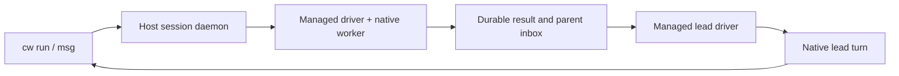

# CLI sessions and agent orchestration

The CLI uses an environment as the execution placement and a durable session
as the process identity. Session names are unique within an environment;
commands resolve an exact ID before a name. `cw list --all` inventories
accessible environments and reports unavailable targets as errors.

## Placements

| Placement | Create | Terminal sessions | Managed agents |
| --- | --- | --- | --- |
| Trusted Linux host | `--local --type host` | Owner daemon and private Unix socket | Codex and Claude |
| Native Linux sandbox | `--local --type sandbox` | Native supervisor and guest daemon | Codex/Claude implementation; VM qualification pending |
| Platform sandbox | `--platform --type sandbox` | Authenticated platform API | Qualification pending |
| macOS host or sandbox | Separate hardware qualification | See Program #2064 | Qualification pending |

```sh
cw env create --local --type host --name host-team --path .
cw env create --local --type sandbox --name vm-team --path .
cw env create --platform --type sandbox --name cloud-team --repo REPOSITORY_URL
```

A trusted host runs as the local user with their ordinary HOME and installed
tools. Its daemon uses a dedicated state directory, outside the workspace by
default; `CW_HOST_DATA_DIR` selects another registry location. It provides
owned process cleanup, not filesystem or network containment. Stop and remove
retire its owned runtime; they preserve the workspace. Linux is the admitted host
implementation. Other hosts fail before creation effects.

Native sandboxes retain their protected credential and workspace contracts.
Creating a host does not copy authentication files into a sandbox.

Managed Linux VM sessions require a selected local credential profile with a
typed Codex or Anthropic provider. Provider material stays in the host broker;
the guest receives its generated proxy configuration. VM sessions use the same
`run --agent`, `msg`, `steer`, `interrupt`, `inbox` and `wait --message` commands.
Their parent must be a running managed session in the same VM. A worker writes
one deterministic notification into that parent's private inbox; the parent
adopts it when idle or after restart. Guest agents do not have authority to
launch sessions through the host CLI.

Managed native shutdown is durable: if the local `cw stop` caller is cancelled,
the driver can still finish cleanup. Run `cw stop` again to join that operation.
`cw restart` waits for confirmed child cleanup and driver exit, then compares the
selected launch generation at the daemon. If another caller has replaced that
launch, the request fails before stopping the replacement. JSON session output
includes `launch_generation`; zero means the daemon does not support this fence.
Missing or stale custody records prevent managed restart. An interrupted active
turn stays unknown and is never replayed automatically.

## Ordinary commands

Use the same session commands with `host-team`, `vm-team`, or `cloud-team`:

```sh
cw run host-team --name tests --detach --no-tty -- make test
cw list host-team
cw list --all
cw wait host-team tests --timeout 10m
cw logs host-team tests
cw stop host-team tests
cw restart host-team tests
```

`wait` succeeds only after observed zero exit, confirmed cleanup and drained
output EOF. Timeouts,
nonzero exits, interrupted processes and unknown cleanup return failure.
Output retains its absolute cursor across reconnects and restarts. A history
gap is reported rather than silently treated as complete output.

For an interactive shell:

```sh
cw run host-team --name shell --tty --detach -- sh
cw send host-team shell 'pwd'
cw send host-team shell 'partial text' --no-newline
cw send host-team shell --key enter
cw send host-team shell --key ctrl-c
cw attach host-team shell
```

`send` acknowledges a bounded write to stdin. It does not prove that a shell
command finished. Use a separate `run` and `wait` when command completion is
needed. Input is never automatically resent after an ambiguous write.

Inline `run --env NAME=VALUE` overrides stay with the live daemon owner. They
are absent from saved session metadata. After daemon recovery, restart refuses
sessions requiring those unavailable values; launch a new session with fresh
overrides. Environment-owned application projections continue to use their
existing source and delivery contracts.

## Orchestrator and workers on a host

```sh
cw run host-team --name lead --agent codex --model gpt-6.1-sol \
  --effort max --detach --prompt 'Coordinate the assigned work.'
cw run host-team --name runtime --parent lead --agent claude \
  --model claude-opus-5-5 --effort xhigh --detach \
  --prompt 'Implement the assigned runtime slice and report the result.'
cw run host-team --name review --parent lead --agent codex \
  --model gpt-6.1-sol --effort max --detach \
  --prompt 'Review the runtime change without editing it.'

cw msg host-team runtime 'Cover the failed-start recovery case too.'
cw inbox host-team lead
cw wait --message MESSAGE_ID --timeout 10m
cw steer host-team review 'Focus on ownership and cleanup.' --turn-id TURN_ID
cw interrupt host-team runtime
cw stop host-team runtime
cw restart host-team runtime
```

Agent launches with `--prompt` and message commands return durable message
IDs. `msg` sends a semantic task, follow-up or reply to the native agent protocol.
A raw terminal write is refused for managed sessions. Parents are bound to canonical session
and driver identities in the same host environment; an unmanaged process
cannot receive semantic worker results.



An idle parent starts a turn when a worker completes. A busy parent queues the
notification. A stopped parent adopts it after restart. Deterministic message
identities prevent duplicate admission. Recovery repairs a missing result
notification without replaying a completed or ambiguous provider task.

| Provider | Receiver | Mid-turn steering | Interrupt | Resume |
| --- | --- | --- | --- | --- |
| Codex | App Server stdio | `turn/steer`, expected turn required | Native turn control | Saved thread ID |
| Claude | CLI stream JSON | Explicitly unsupported | Advertised after native control probe | Saved session UUID |
| Kimi | ACP adapter planned | Qualification pending | Qualification pending | Qualification pending |

Managed Codex uses `danger-full-access` and `approvalPolicy: never` on the
explicitly trusted host. Claude retains the installed CLI's settings and
permission rules. Neither adapter copies login material. Claude supports
`low`, `medium`, `high`, `xhigh`, and `max`; omitting effort preserves its
configured default.

No additional MCP server is needed to receive these messages. A native protocol
driver owns delivery and completion. A foreground controller can forward
terminal events to its coordinating session; this does not establish an
unattended wake interface for the Codex application.

## Mesh members

Today `cw mesh up/status/down` manages a local Mesh service, and
`cw network create/join/nodes/use` manages network membership. Native sandbox
peers have the existing WireGuard direct/relay transport and declared ingress.
These commands do not expose a host session daemon for remote execution.

The next member-control design is in
[CLI delivery backlog](plans/2026-09-29-cli-delivery-backlog.md).
Proposed member selectors and remote grants there are future UX.

## Verification

```sh
scripts/dev/test-cli-host.py --cw target/debug/cw
scripts/dev/test-cli-host.py --cw target/debug/cw --native-agents
```

The first journey uses independent synthetic native peers and owned runtime
fixtures. It covers input, names, process ownership, parent wake, native
controls, durable outbox recovery, startup failure, and launch projection
recovery. The second uses ordinary installed Codex/Claude login and observes
conversation resume, Claude xhigh and a resumed lead invoking `cw` itself.
Neither replaces the matching native Linux hardware or retained Kind sandbox
journey. Program #2255 holds current commands, outcomes and landing evidence.

The managed VM journey runs the actual pinned guest agents through the
synthetic protected broker. Prepare the guest control binary with the actual
checked-in Rust toolchain:

```sh
scripts/dev/build-native-managed-agent.py \
  --rust-tools /absolute/path/to/rust/toolchain/bin \
  --protoc /absolute/path/to/protoc \
  --output /absolute/fresh/owned/guest-cw-artifacts
```

Select its private `managed-agent-cw.json` descriptor with
`CODEWIRE_NATIVE_MANAGED_AGENT_ARTIFACT`. The host verifies the binary digest,
static x86_64 format and control protocol before launching it in the VM.
The installed runtime is private and addressed by its digest; message records
bind permanent environment, driver and session IDs.

Add `--managed-agent-sessions --managed-agent-cw-artifact /absolute/descriptor`
to the existing `smoke-native-local-environment.sh --managed-credential-broker`
command. Its verified workspace OCI receipt and all existing broker assertions
remain required. The additional journey checks native acknowledgement, two
turns, resume, guest tool execution, held-turn controls, parent continuation,
history and cleanup. Custody cases exercise detached and TERM-resistant tools,
a cancelled stop caller, driver death, safe generation admission, missing/stale
receipt refusal and an unrelated sentinel. It proves the transport with synthetic provider responses;
live provider enrollment has separate acceptance under #1902.

Stalled provider initialization has a separate bounded isolated check:

```sh
scripts/dev/test-native-managed-startup.py --cw /absolute/candidate/cw
```

This runs the actual guest driver and control helper with synthetic stalled
peers on Linux. Its shutdown, startup-signal and custody assertions are focused
development proof; the VM journey remains required.
