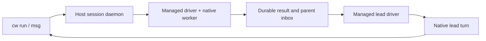

# CLI sessions and agent orchestration

The CLI uses an environment as the execution placement and a durable session
as the process identity. Session names are unique within an environment;
commands resolve an exact ID before a name. `cw ls` (alias `cw list`)
inventories every accessible environment with its location, state and session
count, keeps stopped environments, and marks a running environment whose
sessions it cannot read as unavailable without failing; it exits non-zero
only when a location (cloud, local runtime) cannot be listed, after printing
every environment it could. `cw ls ENV` lists one environment's
sessions with their normal or managed mode, and fails when they cannot be
read.

## Placements

| Placement | Create | Terminal sessions | Managed agents |
| --- | --- | --- | --- |
| Trusted Linux host | `--local --type host` | Owner daemon and private Unix socket | Codex, Claude and noel |
| Native Linux sandbox | `--local --type sandbox` | Native supervisor and guest daemon | Codex/Claude implementation; VM qualification pending |
| Platform sandbox | `--cloud --type sandbox` | Authenticated platform API | Qualification pending |
| macOS trusted host | `--local --type host` | Owner daemon and private Unix socket | Codex and Claude |
| macOS local sandbox | `--local --type sandbox` on Apple Silicon | Shared supervisor, VZ helper and arm64 guest daemon | Same host route as a native Linux sandbox; needs a local credential profile, see [MACOS-CLI.md](MACOS-CLI.md) |

```sh
cw create --local --type host --name host-team --path .
cw create --local --type sandbox --name vm-team --path .
cw create --cloud --type sandbox --name cloud-team --repo REPOSITORY_URL
```

A trusted host runs as the local user with their ordinary HOME and installed
tools. Its daemon uses a dedicated state directory, outside the workspace by
default; `CW_HOST_DATA_DIR` selects another registry location. It provides
owned process cleanup, not filesystem or network containment. Stop and remove
retire its owned runtime; they preserve the workspace. Linux and macOS are the
admitted host implementations. Other hosts fail before creation effects.

Native sandboxes retain their protected credential and workspace contracts.
Creating a host does not copy authentication files into a sandbox.

Managed Linux VM sessions require a selected credential profile, local or
platform, with a provider for the agent, chosen by the rule a hosted Sandbox
uses: Codex takes the Codex slot, and the OpenAI API-key slot only without one;
Claude takes the Anthropic slot. A platform profile qualifies by the slots the
VM pinned when its sources were selected. Provider material stays outside the
VM (the host broker, or the platform broker for a platform profile); the guest
receives its generated proxy configuration. The VM's Codex home is configured
for the slot the rule picks, with the same provider configuration a hosted
managed Codex agent gets, so a profile with only the OpenAI API-key slot runs
Codex through that route. VM sessions use the same
`run --agent`, `msg`, `steer`, `interrupt`, `inbox` and `wait --message` commands.
Their parent must be a running managed session in the same VM. A worker writes
one deterministic notification into that parent's private inbox; the parent
adopts it when idle or after restart. Guest agents do not have authority to
launch sessions through the host CLI.

Managed native shutdown is durable: if the local `cw stop --session` caller is
cancelled, the driver can still finish cleanup. Run the same `cw stop` again to
join that operation. `cw restart --session` waits for confirmed child cleanup
and driver exit, then compares the
selected launch generation at the daemon. If another caller has replaced that
launch, the request fails before stopping the replacement. JSON session output
includes `launch_generation`; zero means the daemon does not support this fence.
Missing or stale custody records prevent managed restart. An interrupted active
turn stays unknown and is never replayed automatically.

## Ordinary commands

Use the same session commands with `host-team`, `vm-team`, or `cloud-team`:

```sh
cw run host-team --name tests --detach --no-tty -- make test
cw ls host-team
cw ls
cw wait host-team tests --timeout 10m
cw logs host-team --session tests
cw stop host-team --session tests
cw restart host-team --session tests
```

`wait` succeeds only after observed zero exit, confirmed cleanup and drained
output EOF. Timeouts,
nonzero exits, interrupted processes and unknown cleanup return failure.
Output retains its absolute cursor across reconnects and restarts. A history
gap is reported rather than silently treated as complete output.

For an interactive shell:

```sh
cw run host-team --name shell --tty --detach -- sh
cw send host-team shell 'pwd'
cw send host-team shell 'partial text' --no-newline
cw send host-team shell --key enter
cw send host-team shell --key ctrl-c
cw attach host-team shell
```

`send` acknowledges a bounded write to stdin. It does not prove that a shell
command finished. Use a separate `run` and `wait` when command completion is
needed. Input is never automatically resent after an ambiguous write.

Inline `run --env NAME=VALUE` overrides stay with the live daemon owner. They
are absent from saved session metadata. After daemon recovery, restart refuses
sessions requiring those unavailable values; launch a new session with fresh
overrides. Environment-owned application projections continue to use their
existing source and delivery contracts.

## Orchestrator and workers on a host

```sh
cw run host-team --name lead --agent codex --model gpt-6.1-sol \
  --effort max --detach --prompt 'Coordinate the assigned work.'
cw run host-team --name runtime --parent lead --agent claude \
  --model claude-opus-5-5 --effort xhigh --detach \
  --prompt 'Implement the assigned runtime slice and report the result.'
cw run host-team --name review --parent lead --agent codex \
  --model gpt-6.1-sol --effort max --detach \
  --prompt 'Review the runtime change without editing it.'

cw msg host-team runtime 'Cover the failed-start recovery case too.'
cw inbox host-team lead
cw wait --message MESSAGE_ID --timeout 10m
cw steer host-team review 'Focus on ownership and cleanup.' --turn-id TURN_ID
cw interrupt host-team runtime
cw stop host-team --session runtime
cw restart host-team --session runtime
```

Agent launches with `--prompt` and message commands return durable message
IDs. `msg` sends a semantic task, follow-up or reply to the native agent protocol.
A raw terminal write is refused for managed sessions. Parents are bound to canonical session
and driver identities in the same host environment; an unmanaged process
cannot receive semantic worker results. `cw wait --message ID` returns the final
reply; the message ID alone names its session. `cw logs ENV --session SESSION` shows each
turn's prompt, the commands, edits and tools the agent uses, and its reply.
`cw stop ENV --session NAME` asks at a terminal whether to stop the session's
running children too; adding `--all` stops every running descendant without
asking. Without a terminal, children keep running and `cw stop` names them.
`cw restart ENV --session NAME` affects only the named session. Without
`--session`, `stop` and `restart` act on the whole environment.

A host conversation's native agent gets its own identity: `CW_ENVIRONMENT`
and `CW_SESSION_ID` hold its host environment and session IDs, so a lead
launches a worker under itself with
`cw run "$CW_ENVIRONMENT" --parent "$CW_SESSION_ID" --agent ...`. Only a
conversation the host user launched gets them. A member conversation on a
host loses any copy it would inherit, and no host session inherits one from
whatever started the host daemon. VMs and platform sandboxes are given none,
and their agents' environment is otherwise left as their session has it.



An idle parent starts a turn when a worker completes. A busy parent queues the
notification. A stopped parent adopts it after restart. Deterministic message
identities prevent duplicate admission. Recovery repairs a missing result
notification without replaying a completed or ambiguous provider task.

| Provider | Receiver | Mid-turn steering | Interrupt | Resume |
| --- | --- | --- | --- | --- |
| Codex | App Server stdio | `turn/steer`, expected turn required | Native turn control | Saved thread ID |
| Claude | CLI stream JSON | Explicitly unsupported | Advertised after native control probe | Saved session UUID |
| Kimi | ACP adapter planned | Qualification pending | Qualification pending | Qualification pending |
| noel | `noel --mode rpc` stdio, upstream pi's RPC | `steer` with `expectedRunId`, run ID required | `abort` with `expectedRunId` | Saved session ID, reopened with `--session-id`; a run a crash interrupted, or its environment's takedown paused, continues with `resume_run` |

Managed Codex uses `danger-full-access` and `approvalPolicy: never` on the
explicitly trusted host. In every placement it starts with its working
directory trusted as a Codex project: a `-c projects=…` launch override sets
Codex's `[projects."<dir>"] trust_level = "trusted"` entry, so the project's
own `.codex` configuration, hooks and exec policies load without a trust
warning, and no `config.toml` is written. Neither adapter copies login
material. Claude supports `low`, `medium`, `high`, `xhigh`, and `max`; omitting
effort preserves its configured default.

Managed Claude keeps the installed CLI's settings, MCP configuration and
permission rules on every placement; Codewire adds no option that hides them
and never passes a bypass or skip-permissions option. What differs is the
permission mode:

| Placement | Permission mode | Why |
| --- | --- | --- |
| Trusted host | None passed: the user's own default mode decides | The user's rules on their own machine |
| Local VM, platform sandbox | `--permission-mode auto` | A headless turn can use tools such as Bash with no person to answer a prompt |

Verified against Claude Code 2.1.288: `auto` is one of
`--permission-mode`'s choices and needs no separate opt-in. The argument
outranks `permissions.defaultMode` in the user's settings. A
`permissions.disableAutoMode` setting (the user's or an administrator's) still
turns auto mode off, and Claude Code then starts in its default mode, where a
tool that needs approval is refused: nobody answers a headless turn, and the
driver declines every control request. The provider can also refuse auto mode
for an account or a model. Auto mode relies on safety verdicts the provider
returns with its responses, so in a Sandbox it depends on the credential route
passing responses through unchanged.

noel, the Rust port of pi, runs only on a trusted Linux host; macOS hosts,
VMs, Mesh members and platform sandboxes refuse it. Codewire looks up `noel`
on PATH, never an installed `pi`. It keeps the user's ordinary noel settings
(`~/.noel`), login and project trust; its tools run without approval prompts,
and the driver declines any extension dialog. noel's notifications, such as
an account failover switch, appear in `cw logs` and get no answer.
`--model PROVIDER/ID` is required.
`--effort` `low` to `max` becomes `--thinking`, `ultra` is refused, and
without `--effort` noel keeps its own level. Startup requires noel to report
the saved session, the requested model and level, and its `run-id` and
`expected-run-id` RPC extensions; a pi build that answers JSON-RPC fails at
once. Each prompt starts one run, whose `agent_settled` ends the message; the
driver clears noel's queue first, so a steer an interrupt left there never
joins the next message. A noel that also reports `request-id` and
`resume-run` (pi `ef09c03f` or later) resumes a run a crash interrupted or
its environment's takedown paused, as described below; `cw inbox --output
json` shows it as the driver's `capabilities.resume`.

**A noel conversation that has its own identity is told how to delegate.**
Its `bash` tool can already launch workers under itself, as above; a skill
gives its model the commands. At every launch the driver writes the skill
`codewire-delegation` to `skills/codewire-delegation/SKILL.md` in the
conversation's own directory under the environment's runtime root
(`agents/DRIVER_ID`), and passes that directory to noel as `--skill`. The
directories and the file are the owner's alone (0700 and 0600); the file is
replaced through a rename, and a symlink in its place is never followed. noel
lists the skill's name, description and file in its system prompt, and its
model reads the file when a task calls for delegation.

- **What it says.** When to delegate; the launch command for a Codex, Claude
  or noel worker under this conversation; a worker name derived from the
  task, so launching the same task again fails with `session name is already
  retained` instead of starting a second worker; that results arrive as
  messages, without polling; and `cw wait --message`, `cw inbox`, `cw msg`,
  `cw steer`, `cw interrupt`, and `cw stop --session` with and without
  `--all`.
- **Which `cw`.** Every command names the `cw` that runs the driver by its
  absolute path, so the lead needs no `cw` on its PATH. The skill is written
  again at every launch: after a `cw` update, the conversation's next start
  names the `cw` that starts it. The driver resolves that path once, when it
  starts, so a `cw` file that is replaced while the conversation runs does
  not change what a noel started again after a crash is told.
- **Who gets none.** A member's conversation on a host and every other
  placement: no file is written and no `--skill` is passed. Codex and Claude
  are launched exactly as before.
- **An older noel.** Listing a `--skill` directory needs a noel built from
  noeljackson/noel `main` at `08566af5` or later. An older noel accepts the
  option and ignores the directory: the conversation starts and works as
  before, its model is told nothing, and nothing reports it.

**Stopping or restarting a conversation cancels its active noel run.** This
covers `cw stop --session`, its `--all`, the confirmed parent cascade,
`cw restart --session`,
and StopSession or RestartSession from any client. The run is interrupted
first, bounded at 10 s, and the message ends interrupted.

**Taking the whole environment down pauses it, and starting the environment
again resumes it.** This covers `cw stop ENV`, `cw restart ENV` and
`cw rm ENV`, a shutdown of the environment's host daemon, and a host's
orderly reboot. The
conversation keeps going; the environment is only its executor. The active
message goes to `paused`, which is not a final state, and its parent hears
once that it paused. noel's journal keeps the run interrupted, not aborted.

- **What you see.** `cw inbox`, the message status line and `cw wait` show
  `paused: environment stopped`. JSON output has `"state": "paused"` and
  `"pause": {"reason": "environment_stopped", "paused_at": "..."}`. The
  reason is closed: nothing else pauses a message. The `pause` object stays
  on the record after the message resumes, and `cw inbox` then adds
  "(resumed after its environment stopped)".
- **Resume.** When the environment's host daemon starts again, it restarts
  each noel conversation that holds a paused message, and no other
  conversation. That is `cw start`, the second half of `cw restart ENV`,
  and the first command after a reboot in an environment that was never
  stopped. No session restart is needed; `cw restart ENV --session SESSION` does the same
  by hand. The conversation's startup handshake decides the run by the table
  below, within its 120 s. A resume after a pause is not a crash and does
  not count toward the three crash resumes. The parent hears once of the
  final state, after the pause.
- **Waiting.** `cw wait --message` goes on through a pause. It prints
  `message ID paused: environment stopped; waiting for its conversation to
  start again` to stderr once per pause and returns only the final record.
  A timeout during a pause is still a failure, and says the message is
  paused. The wait ends at once, with the outcome unknown, when the message
  can no longer end: its environment was removed, or its conversation's
  session record is gone.
- **Codex and Claude** cannot resume a run. Their message ends unknown when
  the environment stops, as before, and their conversations are not
  restarted.

**Script contract.** A managed message's `state` may now be `paused` for noel
conversations; it is non-terminal. A script that reads `state` from `cw inbox
--output json` should treat `paused` like `running`: not finished. `cw wait
--message --output json` still exits 0 only with a final record (`completed`),
and still fails for `error`, `interrupted`, `unknown` and a timeout, so a
consumer that knows only the final states keeps working. Codex and Claude
records never carry `paused` or the `pause` fields.

**Why:** an environment-level takedown is indistinguishable from a reboot in
the daemon, and the owner-approved plan keeps a run that host shutdown stops
resumable in noel's journal. `cw restart ENV` exists to come back. So the
semantic depends on the scope of the stop, not on the client or route, which
keeps everything consistent.

Before signalling a running managed conversation for a stop or restart, the
host daemon records the stop's intent (see below) and then asks the
conversation's record helper whether its agent takes an interrupt first. For
noel with an active run, the helper records the fenced
interrupt `cw interrupt` sends, the daemon delivers it, and the helper waits
for the message to end and the parent's notification to be written. noel
aborts the run and records it aborted, and the driver starts nothing queued
before the signal; queued messages stay accepted for the next start. A
refusal or timeout is logged in the daemon log and the stop goes on, leaving
the outcome unknown. Codex and Claude stops are unchanged: each costs one
helper run, which answers at once. The host CLI allows a stop or restart 20 s.

**How a pause is recorded.** Before the host daemon signals any session for a
shutdown, it asks the same record helper, for each running managed
conversation, to pause the active run (`pause_before_shutdown`), bounded at
2 s. The helper pauses only a run whose driver reported `capabilities.resume`,
and never one an explicit stop is recorded for. It writes the message `paused`
and queues the parent's notice in the parent's inbox; the parent shares the
environment and adopts the notice when it runs again. So the pause is on disk
before the first signal. The daemon signals SIGTERM and, 250 ms later,
SIGKILL: a driver that is killed before it acts leaves the same records as one
that handles its signal, and the next start resumes both to the same outcome.

**What a stop means is on disk before its signal.** The host daemon writes
the evidence itself, before anything of a stop can signal a session, so it
does not depend on the record helper:

- **A takedown:** the environment's takedown marker, `shutdown.json` in the
  environment's runtime root. `cw stop ENV`, `cw restart ENV` and
  `cw rm ENV` write it to ask the daemon to stop. For any other shutdown the daemon writes it before
  it cancels a launch or stops a session. The daemon removes it when it
  starts. The message the helper paused is a takedown's second evidence.
- **An explicit stop or restart:** a stop intent, `stop-intent.json` in the
  session's directory under the environment's runtime root. The daemon
  writes it for a host owner's managed conversation before the stop cancels
  a launch, runs the helper or signals. `cw stop --session` records it whether
  or not the conversation is running. `cw restart --session` records it only
  when it stops a
  running conversation: restarting a stopped one is how a run resumes. A
  stop whose intent cannot be written signals nothing and fails. From the
  intent on, the stop finishes even if its caller goes away. The
  conversation's next start acts on the intent and removes it.

A driver that is signalled reads the disk:

- **An explicit stop is recorded**, by the stop intent or by the stop's
  interrupt for the message: the run ends as an explicit stop, at once. It
  is never paused.
- **A takedown is recorded**, by the marker or by the message already
  paused: the run is paused, at once.
- **Neither:** the signal is not the daemon's. It is a host shutting down,
  which signals every process at once, or a stray signal. The driver waits
  up to 3 s for the marker its daemon writes when it is signalled too, and
  pauses when it comes. With no marker the message ends unknown, as before,
  and the parent hears once.

**An explicit stop never pauses a message, and nothing resumes it later.**

- The evidence is the daemon's stop intent and, when the helper worked, the
  stop's interrupt for the message. The helper writes that interrupt before
  the daemon signals, also when the run has not reported its ID yet and
  while noel is starting again after a crash. With either, neither the
  helper nor the driver pauses the message.
- A helper that fails changes nothing. The daemon's stop intent is already
  on disk, so the driver ends the message unknown when its signal arrives.
  A driver that is killed before it acts leaves the message running, and
  the conversation's next start finds the intent and ends the message
  unknown ("its conversation was stopped while this was in flight"). When
  the helper did record the stop's interrupt, that start aborts the run
  instead and the message ends interrupted. Neither resumes it, and the
  parent hears once.
- `cw stop --session` of a conversation that is not running ends a message its
  environment's takedown paused (`stop_paused`): unknown, "its conversation
  was stopped before it resumed". So a paused run is cancelled by stopping
  its conversation, whether or not it has resumed yet. If that helper fails,
  the stop intent ends the message at the conversation's next start, and a
  daemon that starts does not restart the conversation for it. A message a
  crash left running ends unknown at that start too: its owner stopped the
  conversation since.
- An explicit stop during the startup handshake of a paused message ends it
  unknown. A takedown during the handshake leaves it paused.

What remains, each on the safe side, where a run is not resumed against an
explicit stop:

- A takedown whose helper failed and whose driver was killed before it
  acted, or whose marker could not be written, leaves the message running.
  The next start resumes it as a crash: counted, and without the pause
  notice.
- A daemon that dies without shutting down kills its sessions and records
  nothing. That is a crash, as before.
- A start that cannot remove the stop intent logs it. The conversation's
  next stop signal is then read as explicit, and its run ends unknown
  instead of pausing.
- A launch the daemon abandons, or that another restart of the same
  conversation cancels, kills a driver that has only just started, with
  nothing recorded. The driver records nothing either, and the next start
  decides the message.

**A paused message never waits for a start that cannot come.**

- `cw rm` deletes the environment's records, so the paused message goes
  with every conversation that could be its parent: a parent is always in
  the same environment.
- A conversation the daemon can never start again resolves its paused
  message unknown, once, and its parent hears once. That is a conversation
  launched with inline `--env` values, which are not kept across a daemon
  restart; one whose process cleanup is unknown; and one whose session
  record retention removes (128 records per environment), for which the
  daemon asks the helper first (`retire_before_prune`). The daemon names
  the reason with its refusal: the restart's gRPC status carries
  `codewire-never-restarts` metadata (`no-session`, `projection-lost`,
  `cleanup-unconfirmed` or `generation-exhausted`) beside its code and
  message. Nothing is decided from a refusal's text.
- A start whose noel cannot resume the run, or whose startup fails, ends
  the message unknown, as for a crash.
- A host that loses power fences its sessions (cleanup unknown) as before:
  nothing was recorded, and the message stays running.

**A crash resumes the run, once per crash and at most three times.** When the
driver or noel dies without a stop (`kill -9`, an out-of-memory kill, a
crash, a host that loses power), the message is still running. noel's journal
decides it:

- **The driver died.** `cw restart ENV --session NAME` starts a new driver. Instead of ending
  the running message unknown, it sets the message aside until noel's startup
  handshake. The handshake must finish within 120 s, or the message ends
  unknown.
- **noel died while the driver lives.** The driver starts noel again, once
  per message, and runs the same handshake. noel stopped by SIGTERM, SIGHUP
  or SIGINT is never started again: that is a stop. Nor is a noel without
  `request-id` and `resume-run`. If noel dies again, or does not start, the
  message ends unknown, as before.

After `get_state` and `clear_queue`, the handshake reads `lastRun`. The run is
the message's when its `requestId` is the message ID:

| noel's last run | The driver sends | The message |
| --- | --- | --- |
| The message's, running or interrupted, no interrupt accepted for it, and either paused by its environment's takedown or resumed after a crash fewer than 3 times | `resume_run {expectedRunId}` | Runs again under the same run ID and ends as any run does; `cw inbox` adds "(resumed by noel)" after a crash and "(resumed after its environment stopped)" after a pause |
| The message's, running or interrupted, with an accepted `cw interrupt` or an explicit stop's recorded interrupt | `abort {expectedRunId}` | Interrupted |
| The message's, completed, failed or aborted: the driver missed its settlement | `get_last_assistant_text`, for a completed run only | Completed with that reply, failed, or interrupted |
| Another message's, none, or a noel without `request-id` and `resume-run` | `abort {expectedRunId}` if that run is interrupted | Unknown, exactly as Codex and Claude today |

Each crash resume is counted in the record's `native_resumed` before
`resume_run` is sent, so a driver that dies before the resumed run settles
finds it counted. After three crash resumes the next crash ends the message
unknown. A paused message goes back to `running` in that same write,
uncounted, so a driver that dies after it finds a running message: a crash.
The session log says `message ID resumed by noel: run RUN, resume N of 3` and
what noel does next. A resumed run re-runs only cut-off `read`, `grep`, `find`
and `ls` calls; noel reports every other cut-off tool call to the model as
interrupted, so `bash`, `edit` or `write` never runs twice. A cut-off model
request is sent again, and billed again. Steers and interrupts the driver
accepted before the crash are never replayed: the queue is cleared before the
resume, a steer ends unknown, and an accepted interrupt ends the run. noel
saves no reply or reason for a failed or aborted run, so such a missed
settlement carries none. The parent hears once, of the final state. Codex and
Claude recovery is unchanged: their running message ends unknown at once, and
a dead Codex or Claude process ends its driver.

No additional MCP server is needed to receive these messages. A native protocol
driver owns delivery and completion. A foreground controller can forward
terminal events to its coordinating session; this does not establish an
unattended wake interface for the Codex application.

## Mesh members

`cw mesh up/status/down` manages a local Mesh service, and
`cw network create/join/nodes/use` manages network membership. Native sandbox
peers have the existing WireGuard direct/relay transport and declared ingress.

Use `--member` to control sessions on an enrolled trusted Linux member after
pinning its exact key and granting the required execution capabilities. Managed
workers and their parent belong to the member's same pinned environment:

```sh
cw --member build-linux run --name lead --agent codex --detach \
  --output json --prompt 'Coordinate the assigned work.'
# Save the returned .session.session_id as LEAD_ID.
cw --member build-linux run --name implement --parent "$LEAD_ID" \
  --agent codex --detach --prompt 'Implement the assigned slice.'
cw --member build-linux run --name review --parent "$LEAD_ID" \
  --agent claude --detach --prompt 'Review the assigned slice.'

cw --member build-linux ls
cw --member build-linux msg "$WORKER_ID" 'Include the recovery case.' --output json
cw --member build-linux inbox "$LEAD_ID" --output json
cw --member build-linux wait --message "$MESSAGE_ID" --timeout 10m
cw --member build-linux steer "$WORKER_ID" 'Focus on cleanup.' --turn-id "$TURN_ID"
cw --member build-linux stop --session "$WORKER_ID"
```

Use the Codex implement worker's canonical ID from `ls` as `WORKER_ID`, the
ID returned by `msg` as `MESSAGE_ID`, and its active turn ID from `inbox` as
`TURN_ID`.

Member controls use canonical `session-UUID` IDs. An explicit environment must
match the pinned UUID. Reconnect through `logs`, `inbox` and `wait`; observe a
lost control reply with `cw member observe build-linux REQUEST_UUID --output json`.
Retain `--request-id` and the observed `--expected-launch-generation` when
recovering a control operation. Parent notifications stay within that member's
environment; a host coordinator reads the member's inbox explicitly.

Ordinary member commands use `run --no-tty -- COMMAND`, followed by `wait` and
`logs`. Member PTY attachment is unsupported. Run the host updater on the
member owner; `--member` does not provide remote environment or updater controls.
Provider steering and interruption follow the capabilities in the table above.

## Install local execution

Install the production host CLI before creating environments or sessions that
you intend to retain:

```sh
make cli-install-user
```

Trusted hosts use that installed executable and the user's ordinary agent
tools. A release's `cw` installs everything a native Linux VM needs with
`cw setup --local` (see [LINUX-LOCAL-VMS.md](LINUX-LOCAL-VMS.md)); the rest of
this section is for a development build. Native Linux VMs also need durable
base artifacts, their matching lock file, and the static managed guest runtime. Keep those inputs outside a
disposable worktree. The base defaults are
`$HOME/.cache/codewire/local-vmm-v1/artifacts` and the adjacent
`artifacts.lock.json`; `CODEWIRE_NATIVE_ARTIFACT_ROOT` and
`CODEWIRE_NATIVE_ARTIFACT_LOCK` select absolute alternatives that share one
parent directory.

Build the static runtime, then its minimal OCI image, in fresh owned directories:

```sh
scripts/dev/build-native-managed-agent.py \
  --rust-tools /absolute/path/to/rust/toolchain/bin \
  --protoc /absolute/path/to/protoc \
  --output /absolute/fresh/owned/cw-build
python3 scripts/dev/cw-runtime-image.py build \
  --artifact /absolute/fresh/owned/cw-build/managed-agent-cw.json \
  --output /absolute/fresh/owned/cw-image
```

The static build compiles C dependencies with the target's musl gcc
(`x86_64-linux-musl-gcc`) when it is on PATH; otherwise it uses
`cargo-zigbuild` and `zig` from PATH, as release delivery does.

The image contains only static Linux `cw` and public build provenance. A local
VM runs its host's architecture: an x86_64 Linux host uses the default
x86_64 target, and an Apple Silicon Mac uses `--target
aarch64-unknown-linux-musl`, which produces a `linux/arm64` image (see
[MACOS-CLI.md](MACOS-CLI.md)).
It is an OCI image with one uncompressed layer; this local producer neither
executes the image nor publishes it. Its external `image.json` receipt pins
the index, manifest and payload. Produce the separate native runtime bundle:

```sh
python3 scripts/dev/cw-runtime-image.py pack \
  --image /absolute/fresh/owned/cw-image/cw.oci.tar \
  --index-sha256 <index_sha256 from image.json> \
  --output /absolute/fresh/owned/cw-runtime
```

Install its sealed `cw-runtime.lock.json` and `runtime.pack` beside the base
artifact lock, in the same owner-private directory. Build the initramfs with
`scripts/ci/verify/build-local-vmm-initramfs.sh --verify-root` and the required
BusyBox/runc inputs; `cw` is no longer embedded there. Include the initramfs's
exact digest and size in the matching base artifact lock. Compatible startup
admits and caches an independent read-only runtime catalog disk once, then
persists its selected generation. Keep these durable inputs outside a worktree.

Every VM boot exposes that image payload at
`/run/codewire-runtime/cw/<cw_sha256>/cw`, on a read-only root-owned system
mount outside HOME. Managed launches do not upload or install a helper. The
host selects the expected payload from the VM UUID's retained runtime catalog;
each invocation verifies and seals the selected bytes before execution. The
workspace still needs the checked-in `/usr/bin/python3` launcher prerequisite.
Conversation journals remain private to the workload user under HOME.

### Updating cw in a running native Linux VM

The bootstrap image/disk stays fixed. A compatible Linux protocol9 guest runs
a root-owned publisher outside HOME and exposes sealed versions through the
same read-only runtime mount. Publishing copies a verified image-derived pack
once; it does not execute incoming bytes as guest root. An atomic selector
changes the default for new invocations. Existing conversations keep their
original digest paths, and the VM and its existing processes keep running.
The workload view contains `selection.json`, the trusted `cw` launcher and
retained `<payload_sha256>/{cw,provenance.json}` members. Its selector carries
the complete catalog, default, previous version, revision and operation
receipts. The original bootstrap `catalog.json` remains on `/codewire-cw`;
changing the live default never changes that disk or bootstrap binding.
The trusted launcher also has a read-only bind at `/usr/local/bin/cw`, so a
login shell that resets PATH resolves the same selected default. Existing
managed helpers continue to execute their original member paths.

Use an explicit environment and the revision returned by `info`:

```sh
cw --local runtime info vm-a --output json
cw --local runtime update vm-a \
  --source /absolute/owned/cw-runtime/cw-runtime.lock.json \
  --image-sha256 <admitted image index SHA256> \
  --target-sha256 <admitted executable SHA256> \
  --expected-revision 1 --request-id <stable request UUID>
cw --local runtime rollback vm-a --expected-revision 2
```

These commands do not restart the VM or invoke workspace/image lifecycle
recipes. Stale revisions and conflicting provenance refuse selection. The
publisher retains up to 16 versions and 128 selection receipts; it refuses
further changes at capacity and never prunes bytes behind a live helper.

Keep the printed request UUID after a lost or cancelled local reply. Query or
cancel that same operation, rather than submitting a new update:

```sh
cw --local runtime observe vm-a --request-id <original request UUID>
cw --local runtime cancel vm-a --request-id <original request UUID>
```

A cancellation before commit leaves the default unchanged. A cancellation
after commit reports the durable committed effect. A pending unknown effect
retains its intent and fences lifecycle changes on that live VM birth until
observed or durably cancelled. A later boot verifies the retained selector against host
receipts before startup succeeds; an interrupted operation is not assumed to
have had no effect. Older guests without the trusted publisher refuse live
updates and need an explicit later compatible boot. macOS local VMs use this
same route with an aarch64 runtime; platform runtime updates are outside it.

Runtime commands resolve saved identity and observe the exact retained runner
and VMM. A pending lifecycle intent or changed process, socket, boot, or protocol
causes refusal with the original processes and journal preserved. These
commands never dispatch lifecycle recovery, create a runner, or retire a VM.

A changed global image or artifact lock does not change an existing VM's
retained runtime on restart. Missing retained bytes refuse recovery without
replaying a task. Keep the durable base inputs outside disposable worktrees.
Boot assets from the earlier seed8 format cannot start a seed9 runner. Reads
preserve an exact incompatible runner; explicit stop/delete remain available.
A restart must refuse unsupported boot assets before stopping the VM. Runtime
selection does not silently replace those boot assets.
Stop task-owned daemons and retire task-only environments before deleting their
executable paths. Retained host managed sessions still need the original `cw`
path after daemon shutdown; preserve that executable and their state.

## Verification

```sh
scripts/dev/test-cli-host.py --cw target/debug/cw
scripts/dev/test-cli-host.py --cw target/debug/cw --native-agents
scripts/dev/test-cli-host.py --cw target/debug/cw --real-noel /absolute/path/to/noel
```

The first journey uses independent synthetic native peers and owned runtime
fixtures. It covers input, names, process ownership, parent wake, native
controls, durable outbox recovery, startup failure, and launch projection
recovery. It runs on Linux and macOS; [MACOS-CLI.md](MACOS-CLI.md) describes
the macOS process-ownership check. The second uses ordinary installed
Codex/Claude login and observes conversation resume, Claude xhigh and a
resumed lead invoking `cw` itself. The synthetic noel peer sends the records
the noel binary sends for its `faux/echo` model, and the notification noel
sends on an account failover switch; it adds only a dialog, which noel never
opens, and a JSON-RPC mode for an older pi build. The real-noel
journey runs a built noel with `faux/echo`, offline, with a private HOME and
noel directory. It observes the first answer in `cw inbox`, a second turn
in the same session, a worker waking its lead once per finished message, a
slow turn's refused and acknowledged steers and interrupt, and a restart whose
next message answers normally in the same session. Both prove the stop rules
above: a direct stop, a restart, `stop --all` and the confirmed cascade
interrupt every noel run first (the synthetic noel receives `abort
{expectedRunId}` before its signal; the real noel's journal records the run
aborted), while `cw stop ENV` leaves it interrupted in noel's journal, as
`get_state.lastRun` reports, and its message paused. Both also prove the
pause: the host daemon pauses the message before it signals, the lead's inbox
holds one pause notice, a waiting `cw wait` says the message is paused and
goes on, and `cw start` resumes the run with no session restart. The wait
then returns the reply, and the restarted lead hears of the pause once and
then of the final state once. Codex and Claude end unknown and are not
restarted. The synthetic journey repeats the takedown with the driver stopped,
so the daemon kills it when the grace ends, and with the daemon and the driver
signalled together, as a host that shuts down does; the outcome is the same,
and the second is resumed by the daemon start that the next command causes. It
stops a conversation while the daemon's record helper fails, with a driver
that handles its signal and with one that is killed first: the daemon's stop
intent is on disk, the message is never paused, the next start never resumes
it, and the lead hears once. It also removes an environment under a waiting
`cw wait`, which ends at once. The real-noel journey resumes a run whose model
request the takedown cut off, which noel sends again once, and shows that a
conversation launched with inline `--env` values, which can never restart,
resolves its paused message unknown. It also stops a conversation while the
record helper fails and its driver is killed first: the run is never resumed,
and its cut-off model request is not sent again. The synthetic journey also
proves Codex and Claude keep their unknown outcome on each of those routes,
and that each agent, and no other session, receives its conversation identity.
It proves the delegation skill too: a noel conversation's skill is in its own
driver directory, owner-only, with every command naming the journey's `cw`;
noel is passed that directory; a restart replaces a stale file; and Codex and
Claude are passed no skill and hold none. The real-noel journey then has a
lead with noel's `faux/script` model delegate: noel's system prompt lists the
skill's name and file, and the lead reads the file with noel's `read` tool and
runs every command in it with noel's `bash` tool, exactly as written. It
launches a noel, a Codex and a Claude worker under itself; launching the first
again is refused and starts no second worker; and the lead is woken once per
finished worker message, with its result. It then reads a worker's state,
follows up, steers, waits for one result, interrupts, and stops a worker that
has a worker of its own, with `cw stop --session` and its `--all`.
The real-noel journey needs a noel built from noeljackson/noel `main` at
`08566af5` or later, which lists `--skill` directories; its other checks need
`ef09c03f`.

The synthetic noel also keeps noel's durable runs and queue, and answers a
repeated `requestId`, `resume_run` and `get_last_assistant_text` as noel
`ef09c03f` does. Both journeys prove crash resume with `kill -9`: noel killed
mid-turn, and the driver killed mid-turn and then restarted, each resume the
run once; the lead hears once, and `cw inbox` and `cw logs` note the resume.
When the driver is killed after it sent `resume_run`, the next start resumes
the run again, counted twice. The real-noel journey adds noel's `faux/script`
model: a model request the kill cut off is sent again (noel's
`NOEL_FAUX_SCRIPT_LOG` holds it twice), and a `bash` call killed while it
sleeps after appending a line to a file never runs again (the file keeps one
line). The synthetic journey also proves a killed Codex or Claude driver or
process still ends the message unknown, and that neither agent is started
again by its driver.
None replaces the matching native Linux hardware or retained Kind sandbox
journey.

A managed agent runs the client the workspace user's shell runs, in a local
VM and in a hosted Sandbox alike (owner decision 2026-10-16): the first
`codex` or `claude` on the PATH a session gets, followed through symbolic links
to the file it runs, found by the same code in both placements. That PATH
includes a workspace environment that sets PATH; the daemon's own is never
used. No version is pinned, and the file needs no particular owner, layout or
architecture; Claude Code may still be the image's wrapper that installs its
native build on first use. A
client the user updates, or one that updates itself, such as Claude Code's
native build in `~/.local/bin`, is the one the next conversation runs. Any
process running as the workspace user can therefore replace the client a
managed conversation runs.

A hosted Sandbox reports each client's SHA-256, size and the version its own
`--version` names, and a launch or Resume runs only while the client is still
the one it was offered; one that changed in between is refused. A
conversation keeps the client it was launched with: its driver opens that same
file again at every start and requires the same bytes, so after the client
updates, a Restart that finds the file changed or gone fails when its driver
starts, and a new conversation runs the new client. A Resume in a new Pod
moves the conversation to the client the shell runs there. Managed Claude runs
with Claude Code's own updater on, as the shell's does. A trusted host always
runs the user's installed client.

The managed VM journey runs the guest's own agents through the synthetic
protected broker. Supply the image-derived initramfs described above,
then add `--managed-agent-sessions --managed-agent-cw-image-receipt
/absolute/cw-image/image.json` to the existing
`smoke-native-local-environment.sh --managed-credential-broker` command. Its
verified workspace OCI receipt and existing broker assertions remain required.
Before the first conversation, the journey observes root ownership, read-only
mount flags, image identity and payload digest. It then checks native
acknowledgement, two turns, resume, guest tool execution, held-turn controls,
parent continuation, history and cleanup. Before the first conversation it
stages a user's update of `codex` and `claude` in `~/.npm-global/bin`, each of
which records that it ran and then runs the client the shell found before it,
shows they come first on PATH, and proves both managed agents ran them.
`--synthetic-peers` runs the peers staged on PATH the same way. Custody cases
exercise detached and TERM-resistant tools, a cancelled stop caller, driver
death, safe generation admission, missing/stale receipt refusal and an
unrelated sentinel. Provider responses are synthetic; live provider enrollment
is covered by the credentials journeys in
[SECRETS-AND-CREDENTIALS.md](SECRETS-AND-CREDENTIALS.md).

Stalled provider initialization has a separate bounded isolated check:

```sh
scripts/dev/test-native-managed-startup.py --cw /absolute/candidate/cw
```

This runs the actual guest driver and control helper with synthetic stalled
peers on Linux. Its shutdown, startup-signal and custody assertions are focused
development proof; the VM journey remains required.
